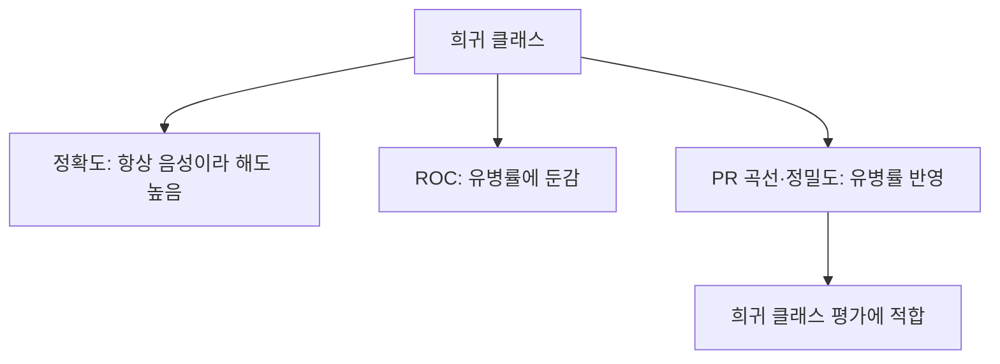
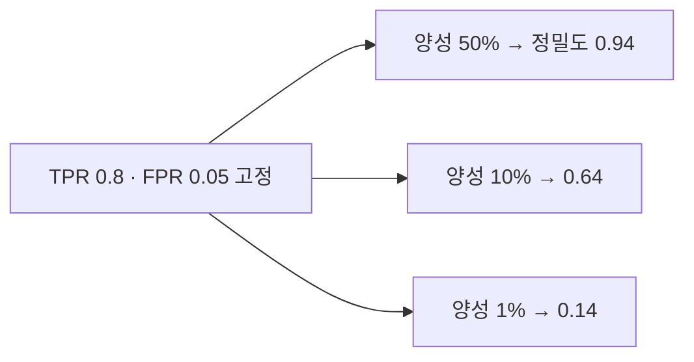

# 희귀 클래스 평가법

> 양성이 1%처럼 드문 문제에서는 정확도와 ROC 곡선이 모델을 좋아 보이게 만든다. 희귀 클래스는 정밀도·재현율(PR 곡선)과 비용 기반 지표, 그리고 충분한 양성 표본으로 평가해야 한다.

## 쉽게 말하면
1,000명 중 환자가 10명인 마을에서 의사가 "환자 없음"만 외치면 99% 맞는다. 하지만 환자를 한 명도 못 찾았으니 쓸모가 없다. 희귀한 쪽을 얼마나 찾고, 찾았다고 한 것 중 얼마나 맞는지를 따로 봐야 한다.

## 자세히
- **정밀도와 재현율(Wikipedia Precision and recall, 열람)**: 정밀도 = TP/(TP+FP)(양성이라고 한 것 중 맞은 비율), 재현율 = TP/(TP+FN)(진짜 양성 중 찾은 비율). F1은 둘의 조화평균 2PR/(P+R)이고 일반형 Fβ는 재현율에 β배 가중한다(F2는 재현율 중시, F0.5는 정밀도 중시).
- **PR 곡선이 ROC보다 나은 이유(같은 문서)**: Saito와 Rehmsmeier는 불균형 데이터에서 PR 곡선이 ROC보다 더 유익하다고 했고 ROC는 신뢰도를 "시각적으로 오해하게" 만들 수 있다. 이유는 유병률(양성 비율)이다. ROC의 TPR·FPR은 클래스 비율에 의존하지 않지만 정밀도는 의존한다. 문서의 식: 정밀도 = TPR / (TPR + (1/r)·FPR), r = P/N이다. 양성이 드물수록 같은 FPR에서 정밀도가 떨어지는데 PR 곡선은 이를 보여 주고 ROC는 보여 주지 않는다.
- **직접 계산한 예**: 분류기의 TPR 0.8, FPR 0.05(ROC 상으로 좋은 점)를 고정하고 양성 비율만 바꾸면 정밀도는 양성 50%에서 0.941, 10%에서 0.640, 1%에서 0.139, 0.1%에서 0.016이다. 양성이 1%이면 "양성"이라고 외친 건의 약 86%가 틀린다. ROC 곡선의 한 점(0.05, 0.8)은 모든 경우에서 같다.
- **[클래스 불균형과 임계값](#class-imbalance-threshold)과 연결**: 정확도의 함정은 여기서 출발한다. 평가 지표를 정하는 단계에서 비용([오탐 vs 미탐 비용](#false-positive-vs-false-negative-cost))을 반영하는 것이 가장 직접적이다.
- **표본 크기(해석)**: 희귀 클래스는 양성의 절대 개수가 중요하다. 지표가 정의되지 않거나 불안정해지는 문제([클래스 누락 시 지표 미정의](#metric-undefined-missing-class))가 있으므로 양성 수를 [Clopper-Pearson·Wilson 구간](#wilson-interval)으로 불확실성과 함께 보고한다.
- **권장 조합(해석)**: PR 곡선, 정해진 임계값에서의 정밀도·재현율, 비용 기반 점수, 양성 수와 신뢰구간. 한 개의 숫자(정확도·AUC)만 보고하지 않는다.

## 그림으로 보기

## 예시
- 사기 거래 탐지: 양성 0.1%에서 정밀도가 1.6%라면 알림 100건 중 98건이 오탐이다. 정밀도·재현율과 처리 가능한 알림 수를 같이 보고 임계값을 정한다.
- 교육 활용: 같은 TPR·FPR에서 양성 비율을 바꿔 정밀도 변화를 표로 계산하는 실습.

## 헷갈리는 것과 비교
| 개념 | 차이 |
| --- | --- |
| [층화 K겹과 희귀 클래스](#n-splits-vs-rare-class) | 상위 주제. 평가 지표 선택의 측면 |
| ROC 곡선 | TPR·FPR. 유병률에 둔감해 희귀 클래스에서 낙관적으로 보일 수 있음 |
| PR 곡선 | 정밀도·재현율. 희귀 클래스에서 더 유익 |
| 정확도 | 희귀 클래스에서 부적합 |

## 더 읽을거리
- [Wikipedia: Precision and recall](https://en.wikipedia.org/wiki/Precision_and_recall) — 정의, F-measure, PR 대 ROC
