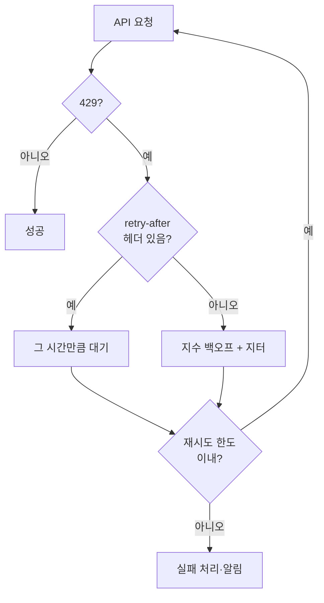
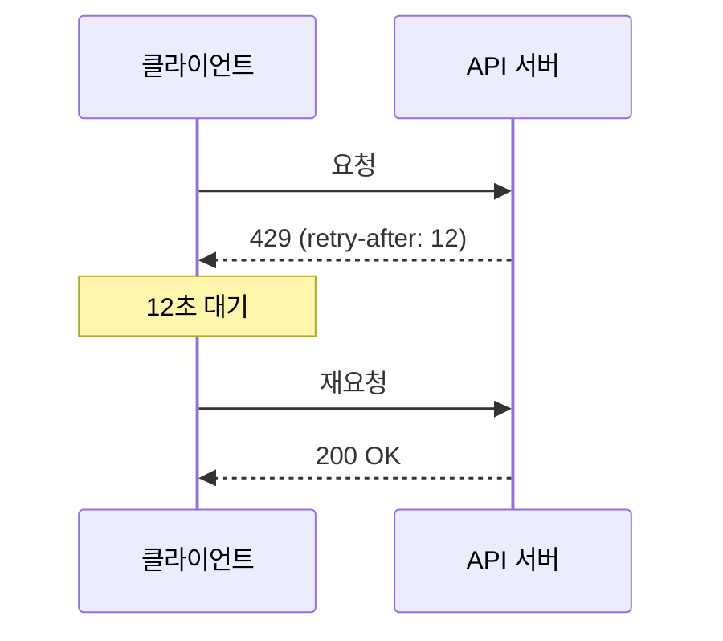

# 속도 제한과 재시도(429)

> API가 "너무 빨리, 너무 많이 보냈다"며 거절할 때(HTTP 429) 서버가 알려 준 시간만큼 기다리고, 그 뒤엔 대기 시간을 점점 늘리며 무작위성을 섞어 다시 시도하는 표준 대응법.

## 쉽게 말하면
인기 식당 전화 예약을 떠올려 보자. 통화 중이면 1초마다 연타하지 말고, 점원이 "5분 뒤에 걸어 주세요"라고 하면 그대로 따른다. 안내가 없으면 1분, 2분, 4분처럼 간격을 늘려 건다. 손님 수백 명이 똑같이 정각에 다시 걸면 또 통화 중이 되므로 각자 조금씩 다른 시간에 건다. 이 무작위 어긋남이 지터(jitter)다.

## 자세히
**한도의 종류(Claude API 문서, 2026-11 기준)**
- 분당 요청 수(RPM), 분당 입력 토큰(ITPM), 분당 출력 토큰(OTPM)을 모델 계열별로 잰다. 하나라도 넘으면 429가 나온다.
- **토큰 버킷** 방식이라 정각에 리셋되지 않고 용량이 계속 채워진다. 60 RPM은 실제로는 초당 1건처럼 짧은 간격으로 집행될 수 있다.
- **캐시 인식 ITPM**: 캐시에서 읽은 토큰(`cache_read_input_tokens`)은 ITPM에 세지 않는다. 문서 예: ITPM 200만, 캐시 적중 80%면 총 1,000만 입력 토큰/분 처리 가능. 프롬프트 캐싱이 곧 처리량 증가.
- **램프 한도**: 사용량이 갑자기 급증하면 한도 아래라도 429가 날 수 있다(`ramp_limit_exceeded`). 한 번에 몰아 보내지 말고 분당 한 단계씩 올린다. 배치 API는 해당 없음.
- **지출 한도 429**: 월 지출 상한(Start $500, Build $1,000, Scale $200,000)에 닿으면 `enforced_spend_limit_reached`와 함께 429가 나오지만 `retry-after`가 없고 다음 달 1일 00:00 UTC까지 재시도해도 소용없다.

**재시도 설계**
1. `retry-after` 헤더가 있으면 그 초만큼 기다린다(그 전 재시도는 실패할 수 있음).
2. 없으면 **지수 백오프**(대기를 1·2·4·8초…로 늘리고 상한을 둠) + **지터**(무작위 가감).
3. **재시도 횟수 제한**. AWS Builders' Library에 따르면 재시도는 "이기적"이어서 과부하 때 상황을 악화시킨다. 층마다 3회씩 5층이면 DB 부하가 243배가 된다. 한 지점에서만 재시도하고 토큰 버킷으로 총량을 제한한다.
4. **멱등성**: 부작용이 있는 호출(결제, 생성)은 멱등 키가 있어야 안전하게 재시도할 수 있다.
5. 응답 헤더 `anthropic-ratelimit-*-remaining`으로 선제 조절.

## 그림으로 보기




## 예시
```python
import random, time

def call_with_retry(fn, max_tries=5):
    for n in range(max_tries):
        resp = fn()
        if resp.status_code != 429:
            return resp
        wait = float(resp.headers.get("retry-after", 2 ** n))
        time.sleep(wait + random.uniform(0, 1))  # 지터
    raise RuntimeError("재시도 한도 초과")
```
업무 예: 밤새 수천 건 문서를 요약하는 스크립트는 처음부터 낮은 속도로 시작해 서서히 올리고, 즉시성이 필요 없으면 [배치 API](#batch-api)로 돌린다.

## 헷갈리는 것과 비교
| 개념 | 차이 |
|---|---|
| 429 속도 제한 | 일시적. 기다리면 풀림 |
| 지출 한도 429 | `retry-after` 없음. 다음 달 또는 한도 상향까지 못 씀 |
| 5xx 서버 오류 | 서버 측 문제. 같은 백오프 방식으로 재시도하되 횟수는 제한 |
| [프롬프트 캐싱](#prompt-caching) | 캐시 읽기 토큰은 ITPM에서 제외되어 처리량을 늘림 |
| [멱등성](#idempotency) | 재시도가 안전하기 위한 전제 |

## 더 읽을거리
- [Rate limits (Claude API 문서)](https://platform.claude.com/docs/en/api/rate-limits) — RPM·ITPM·OTPM, 램프 한도, 헤더
- [Timeouts, retries, and backoff with jitter (AWS Builders' Library)](https://builder.aws.com/content/3EumjoZascWd1oZiEgL8ORlv3qE/timeouts-retries-and-backoff-with-jitter) — 재시도 증폭·지터·멱등성
