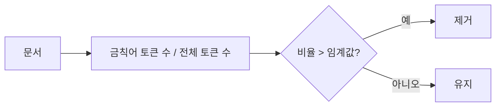
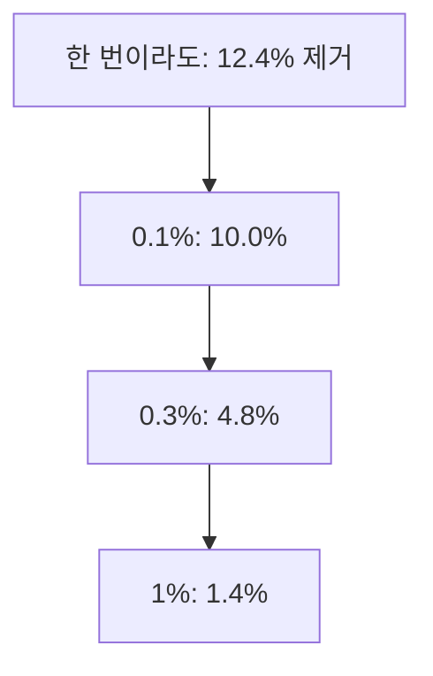

# 비율 기반 비속어 필터

> 금칙어가 **한 번이라도 나오면 문서를 버리는** 대신, **문서 안의 금칙어 비율(또는 개수)이 기준을 넘을 때만 제거하는** 방식이다. 우연히 한두 번 나온 문서를 살려 오탐을 줄인다.

## 쉽게 말하면
교실에서 학생이 한 번 속어를 썼다고 수업 전체를 중단하지 않고, 대화의 상당 부분이 속어일 때만 개입하는 것과 같다. 한 번의 우연과 계속되는 패턴을 구분한다.

## 자세히
- 동기: C4처럼 "금칙어가 하나라도 있으면 페이지 폐기"는 정당한 문서까지 지운다([금칙어 필터 정밀도와 재현율](#blocklist-precision-recall)). 비율 기준은 문서 길이를 고려해 "얼마나 많이"를 본다(제안).
- 직접 실행(`CC-MAIN-2024-10` WET 앞 2MB의 영어 문서 210개, LDNOOBW 영어 단일 단어 항목 기준, 문서 안의 토큰 중 금칙어 토큰 비율):
  | 제거 기준 | 제거되는 문서 | 비율 |
  |---|---|---|
  | 한 번이라도(기존 C4 방식) | 26 | 12.4% |
  | 비율 > 0.1% (1,000단어당 1개 초과) | 21 | 10.0% |
  | 비율 > 0.3% | 10 | 4.8% |
  | 비율 > 1.0% | 3 | 1.4% |
  | 비율 > 3.0% | 3 | 1.4% |
- 분포(걸린 26문서): 금칙어 비율의 **중앙값은 1,000단어당 약 2.0개**, 최솟값 0.22개, **최댓값 102.5개**(문서의 약 10%가 금칙어). **26개 중 10개는 금칙어가 단 한 번 나온 문서**였다. 3문서는 300단어 미만이라 짧은 글에서는 한 단어만으로 비율이 급등한다.
- 읽는 법: 임계값을 올리면 제거 문서가 급감하고(0.3%에서 4.8%) 극단적인 3개 문서(1%·3% 이상)만 남는다. **어느 임계값이 "정답"인지는 이 실험만으로 알 수 없다** — 남겨진 문서 중 실제로 부적절한 것이 몇 개인지 사람이 표본 검토해야 한다([필터 평가용 수동 라벨링](#manual-labeling-for-filter-eval)).
- 설계 주의(제안): ① 짧은 문서는 최소 단어 수 조건을 둔다 ② 단어 목록의 다의어(`xx`, `scat`, `hardcore` 등)는 비율 계산에서도 오탐을 만든다 — 목록 자체를 다듬는다 ③ 단어 경계·대소문자·활용형을 정한다 ④ 임계값은 용도(어린이용·일반 모델·연구용)에 따라 다르게 둔다.
- 한계: 한 파일의 앞부분 영어 표본이고, 단일 단어 항목만 센 간이 구현이다(다단어 항목 제외).

## 그림으로 보기



## 예시
```python
ratio = sum(t in BAD for t in tokens) / max(len(tokens), 1)
drop = ratio > 0.003 and len(tokens) >= 100
```
- 교육: 임계값을 바꾸며 제거 문서 수가 어떻게 달라지는지 그래프로 보는 실습.

## 헷갈리는 것과 비교
| 개념 | 차이 |
|---|---|
| 한 단어 규칙 | 한 번이라도 있으면 제거 |
| 비율 규칙 | 길이 대비 많을 때만 제거 |
| 분류기 | 모델이 맥락까지 판단 |
| [금칙어 필터](#bad-words-list-filter) | 이 방식들의 기반이 되는 목록 필터 |

## 더 읽을거리
- [T5 논문 (arXiv 1910.10683)](https://arxiv.org/abs/1910.10683) — "하나라도 있으면 제거" 규칙(읽음).
- 직접 실행: 영어 210문서 비율 분포와 임계값별 제거 수.
