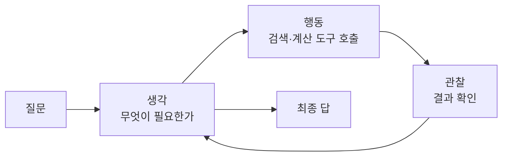
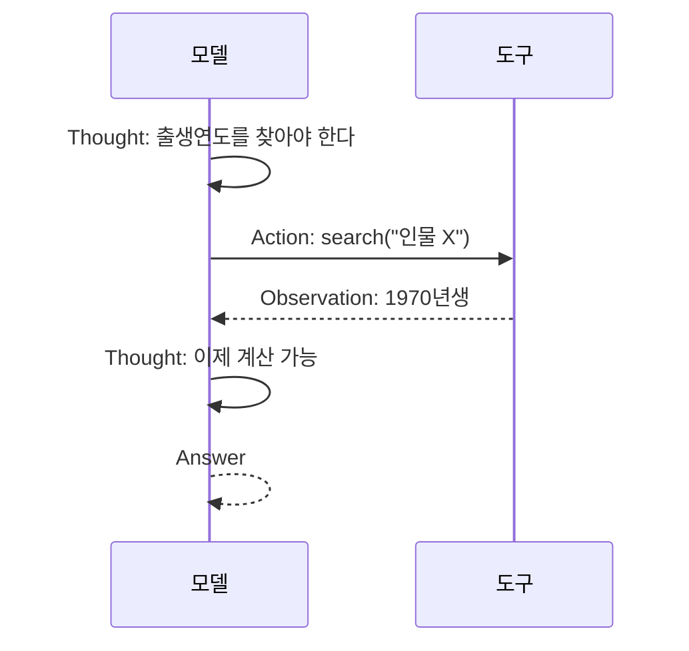

# ReAct 패턴

> ReAct(Reason + Act)는 모델이 "생각 → 행동(도구 호출) → 관찰"을 번갈아 반복하며 문제를 푸는 에이전트 설계 패턴이다. 2022년 Yao 외 논문(ICLR 2023 채택)에서 제안됐다.

## 쉽게 말하면
탐정은 추리만 하지 않고, 추리하다가 현장에 가서 단서를 확인하고, 그 결과로 다시 추리한다. "머리로만 생각"하면 지어내기 쉽고, "생각 없이 행동"하면 헤맨다. 둘을 번갈아 하는 것이 ReAct다.

## 자세히
- 논문(arXiv 2210.03629): 추론(chain-of-thought 등)과 행동 생성이 따로 연구되던 것을 **번갈아 생성**하게 했다. 추론은 계획을 세우고 갱신하고 예외를 다루며, 행동은 Wikipedia API 같은 외부 소스에서 정보를 가져온다.
- 결과(논문 초록): HotpotQA·FEVER에서 외부 API와 상호작용해 CoT의 환각·오류 전파를 줄였고, ALFWorld·WebShop에서는 한두 개의 in-context 예시만으로 모방·강화학습 방법보다 성공률이 **절대값 34%, 10%** 높았다. 추론 흔적이 남아 해석 가능성이 높다는 주장도 한다.
- 오늘날 에이전트 루프(모델 호출 → 도구 실행 → 결과를 다시 입력)는 ReAct의 직계 후손이다. 다만 현대 모델은 내부 thinking과 네이티브 도구 호출을 갖고 있어 "Thought:/Action:" 텍스트 형식을 직접 쓰는 일은 줄었다(일반 동향).
- 약점: 도구 결과가 틀리면 추론도 오염되고, 루프가 길면 비용이 늘며, 끝없이 반복할 수 있어 종료 조건이 필요하다.

## 그림으로 보기



## 예시
```
Thought: 환율을 모르니 조회해야 한다.
Action: get_rate("USD","KRW")
Observation: 1380
Thought: 100달러는 138,000원.
Answer: 약 138,000원
```

## 헷갈리는 것과 비교
| 개념 | 차이 |
|---|---|
| ReAct | 생각과 행동을 번갈아 반복 |
| [생각 사슬(CoT)](#chain-of-thought-prompting) | 생각만, 외부 확인 없음 |
| [에이전트 루프](#agent-loop) | ReAct를 일반화한 실행 구조 |
| [워크플로 vs 에이전트](#workflow-vs-agent) | 고정 경로 vs 모델이 경로 결정 |

## 더 읽을거리
- [ReAct: Synergizing Reasoning and Acting in Language Models](https://arxiv.org/abs/2210.03629) — 원논문 초록과 결과.
