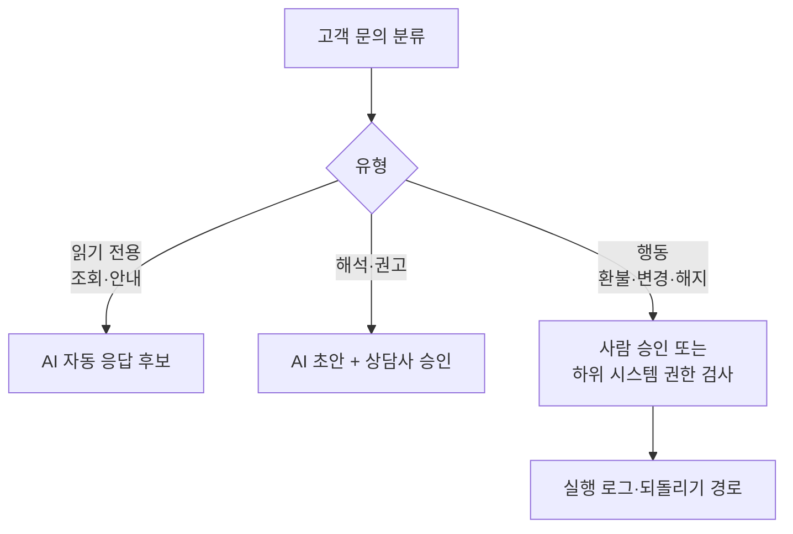

# 읽기 전용 문의 vs 행동 문의

> 고객 문의를 **정보를 알려 주기만 하는 것(읽기 전용)**과 **계정·결제·주문을 바꾸는 것(행동)**으로 나눠 AI의 자율 범위를 달리 두는 설계 원칙. 행동 문의일수록 틀렸을 때 피해가 크고 되돌리기 어렵다.

## 쉽게 말하면
은행 창구에서 "환율이 얼마예요?"는 말만 틀려도 정정하면 된다. "이 계좌의 돈을 보내 주세요"는 한 번 나가면 되돌리기 어렵다. 앞의 것은 직원이 혼자 답해도 되지만 뒤의 것은 확인 절차가 필요하다.

## 자세히
출처: OWASP GenAI "LLM06:2025 Excessive Agency"(본문 확인, 2026-11-18). 상담 문의 분류는 이 원칙을 적용한 제안이다.
- **과도한 행위 능력(Excessive Agency)**: LLM 기반 시스템이 예상 밖·모호·조작된 출력에 반응해 해로운 행동을 하는 위험. 원인은 환각·낮은 성능, 직접·간접 프롬프트 주입(악성 확장, 다중 에이전트에서 침해된 동료 에이전트 포함).
- **세 가지 근본 원인**: 과도한 **기능**(필요 이상의 도구), 과도한 **권한**, 과도한 **자율성**(사람 승인 없이 실행).
- **OWASP 예**: 메일함 비서가 읽기·보내기 둘 다 가능한 확장을 쓰다가 악성 메일의 지시로 민감 정보를 전달한다. 완화는 읽기 전용으로 기능을 줄이고, 읽기 전용 OAuth 범위를 쓰고, 보내기 전 사용자 승인을 요구하며, 보내기 인터페이스에 속도 제한을 두는 것.
- **예방 8가지(OWASP)**: 확장 최소화, 확장 기능 최소화, 개방형 확장 회피, 확장 권한 최소화, 사용자 문맥에서 실행, 사용자 승인 요구, **완전 중재**(권한 검사를 LLM이 아니라 하위 시스템에서 강제), 입력·출력 정화. 로깅·모니터링·속도 제한은 예방은 못 하지만 피해를 줄인다.
- **상담 적용(제안)**: ①읽기 전용(배송 조회, 약관 안내) → 자동 응답 후보 ②초안만(환불 규정 해석) → 상담사 승인 후 발송 ③행동(환불 실행, 주소 변경, 해지) → 사람 승인 또는 하위 시스템 권한 검사 필수. 승급은 단계별 기준으로([승급 조건](#intent-promotion-criteria)).
- **핵심**: 권한은 프롬프트의 "하지 마"가 아니라 **API 권한과 승인 절차**로 강제한다(완전 중재 원칙).
- **한계**: 읽기 전용도 틀린 안내(잘못된 약관 해석)로 피해를 낳을 수 있다. 위험 수준은 "행동 여부"만이 아니라 내용의 중요도와 함께 정한다(해석).

## 그림으로 보기

## 예시
| 문의 | 유형 | 권장 자율성 |
|---|---|---|
| 배송 현황이 어디인가요 | 읽기 전용 | 자동 응답 |
| 이 환불은 규정상 가능한가요 | 해석 | 초안 후 승인 |
| 환불 처리해 주세요 | 행동 | 사람 승인 + 권한 검사 |
교육 활용: 자사 문의 유형 20개를 이 3분류에 직접 나눠 보고 이견이 생기는 건을 토론한다.

## 헷갈리는 것과 비교
| 개념 | 차이 |
|---|---|
| 읽기 전용 | 정보 제공만, 상태 변경 없음 |
| 행동 문의 | 상태를 바꾸는 요청 |
| 프롬프트 주입 | 모델을 속이는 공격, 과도한 권한이 피해를 키움 |
| [승급 조건](#intent-promotion-criteria) | 자율 단계를 올리는 기준 |

## 더 읽을거리
- [OWASP LLM06:2025 Excessive Agency](https://genai.owasp.org/llmrisk/llm062025-excessive-agency/) — 원인 세 가지와 예방 8가지
