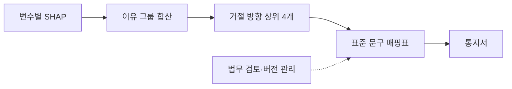

# 변수→이유 문구 매핑

> SHAP 같은 변수별 기여도 순위를 사람이 읽는 통지 이유 문구로 바꾸는 작업. 모델 변수(수십~수백 개)와 법이 요구하는 "구체적이고 정확한 이유" 사이의 번역 층이다.

## 쉽게 말하면
엔진 진단기가 내는 코드 P0420을 "촉매 변환기 효율 저하"로 번역해 주는 매뉴얼과 같다. 변수 이름 `util_ratio_12m`을 고객에게 "카드 한도 대비 사용 비율이 높음"으로 바꿔 보여 준다.

## 자세히
법적 요건은 [이유 코드](#reason-codes)(Reg B 1002.9, 2026-11-15 확인)에 있다. 아래는 그 요건을 매핑에 적용한 설계 요령이며, 대부분은 일반 실무 제안이다(단일 출처 확인 아님).
1. **변수 → 이유 그룹**: 여러 변수를 한 이유로 묶는다(연체 관련 변수 5개 → "연체 이력"). 같은 이유가 중복 나열되지 않게 그룹별 기여를 합산.
2. **순위 산정**: 거절 건의 [Shapley 기여](#shapley-values)에서 거절 쪽으로 가장 크게 민 그룹부터 정렬. 비교 기준(배경 분포)을 무엇으로 두느냐에 따라 순위가 달라지므로 기준을 문서화.
3. **개수**: 주석은 4개 초과가 도움이 되기 어렵다고 본다 → 상위 4개 이내.
4. **정확성**: 문구는 실제 점수화한 요인과 일치해야 한다. 요인이 신청자에게 무관해 보여도 주된 요인이면 포함. "내부 기준" 같은 모호한 문구 금지.
5. **방향 일관성**: 단조 제약([단조 제약](#monotonic-constraints))으로 변수 방향을 고정하면 "연체가 있어서 불리"와 모델 거동이 어긋나지 않는다.
6. **금지 요인 점검**: 보호 속성과 상관 큰 변수가 이유 상위에 반복되면 차별 영향 점검([신용 차별 영향 분석](#disparate-impact-credit))으로 연결.
7. **검증**: 샘플 건에서 변수를 바꿔 이유가 실제로 점수를 움직이는지 확인, 법무 검토 후 문구 확정, 모델 버전과 매핑표를 함께 버전 관리.

## 그림으로 보기

## 예시
| 변수 | 그룹 | 통지 문구 |
|---|---|---|
| late_30d_cnt, late_90d_cnt | 연체 | 최근 연체 이력이 있음 |
| util_ratio_12m, revolving_bal | 사용률 | 신용 한도 대비 사용 비율이 높음 |
| acct_age_months | 이력 | 신용 거래 기간이 짧음 |

## 헷갈리는 것과 비교
| 개념 | 차이 |
|---|---|
| 매핑표 | 변수→문구 번역 규칙 |
| [반사실 설명](#counterfactual-explanation) | 개선 행동 제시 |
| 설명 도구(SHAP) | 기여도 산출 |

## 더 읽을거리
- [Reg B §1002.9](https://www.consumerfinance.gov/rules-policy/regulations/1002/9/) — 이유 진술 요건(조문·주석)
- [SHAP 원논문](https://arxiv.org/abs/1705.07874) — 기여도 산출 방식
