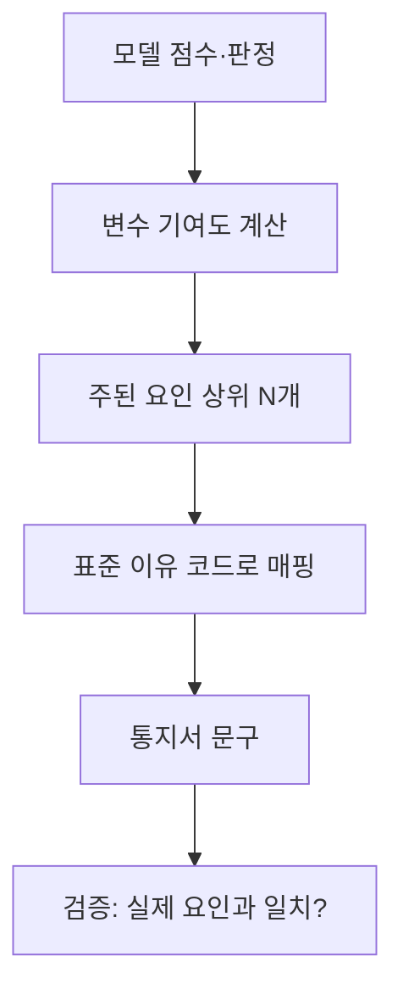

# 이유 코드

> 모델의 점수·판정을 신청자에게 줄 "거절의 주된 이유"로 바꾸는 표준 항목과 그 산출 방식. 미국 신용 분야에서 Regulation B가 요구하는 구체적 이유 진술의 실무 도구다. (법률 자문 아님)

## 쉽게 말하면
점수 580점이라는 결과를 "연체 이력"과 "높은 한도 사용률" 같은 말로 번역해 주는 사전이다. 숫자만 받은 신청자는 무엇을 고칠지 알 수 없다.

## 자세히
출처: CFPB Regulation B 1002.9 조문·주석 페이지(2026-11-15 확인).
- **요건(1002.9(b)(2))**: 이유는 구체적이어야 하고 주된 이유를 밝혀야 한다. "내부 기준·정책"이나 요인을 밝히지 않은 "점수 미달"은 불충분.
- **개수**: 고정 상한은 없지만 주석은 네 개를 넘기면 도움이 되기 어렵다고 본다(권고, 하드 상한 아님).
- **정확성**: 이유는 실제로 고려·점수화한 요인과 일치해야 하며, 신청자가 보기에 신용도와 무관해 보여도 주된 요인은 빼면 안 된다. 자동 거절 요인(예: 파산)이 결정을 좌우했다면 그 요인을 명시.
- **FCRA와의 관계**: 신용 보고서를 썼다고만 말하는 것은 충분하지 않다. 연체 같은 이유 자체를 적어야 한다.
- **예시(주석)**: 허용 "거주 기간"(왜 불리했는지 설명 불필요); 불허 "내부 기준 미충족", 데이터가 충분한데 "불완전한 신청".
- **시한**: 완비된 신청 접수 후 통상 30일 이내 통지. 이유 자체 대신 요청 권리를 고지하면 신청자는 60일 내 요청, 신용 제공자는 30일 내 이유 진술.
- **모델에서의 산출**: 선형·점수카드는 항목별 점수 차이, 복잡한 모델은 [SHAP 기반 기여도](#shapley-values)나 [반사실 설명](#counterfactual-explanation)으로 순위를 낸 뒤 표준 문구로 매핑한다([이유 문구 매핑](#reason-code-mapping)). 사후 설명이 근사라면 정확도 검증이 필요하다는 CFPB 해석(2022-03)은 2025-05 철회됨([불리한 조치 통지](#adverse-action-notice)).

## 그림으로 보기

## 예시
- 코드 R01 "최근 12개월 내 연체 이력", R07 "신용 한도 대비 사용률 높음", R12 "신용 거래 이력 짧음". 거절 건마다 기여도가 큰 순서로 최대 4개 표시.

## 헷갈리는 것과 비교
| 개념 | 차이 |
|---|---|
| 이유 코드 | 통지용 표준 사유 |
| SHAP 값 | 기여도 숫자 |
| 반사실 설명 | 무엇을 바꾸면 되나 |
| [불리한 조치 통지](#adverse-action-notice) | 통지 의무 전체 |

## 더 읽을거리
- [Reg B §1002.9 (CFPB)](https://www.consumerfinance.gov/rules-policy/regulations/1002/9/) — 이유 진술·시한 조문
