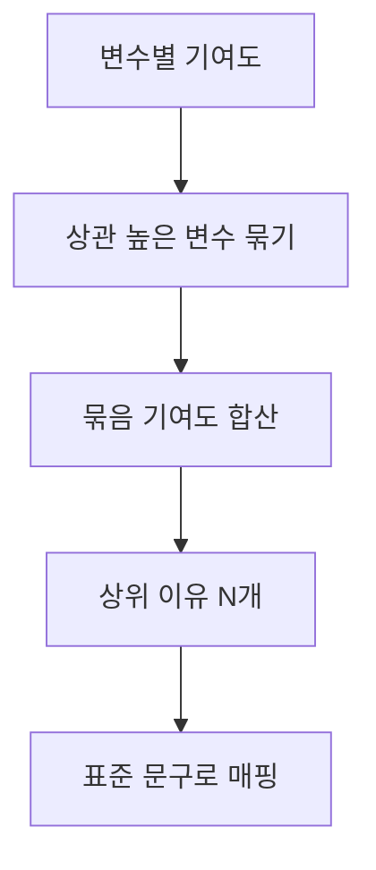
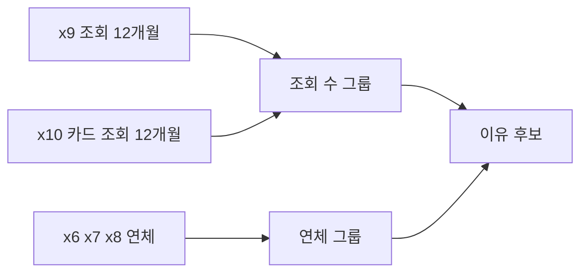

# 이유 그룹핑

> 서로 강하게 연관된 변수들(예: 최근 12개월 조회 수, 최근 24개월 조회 수)을 하나의 묶음으로 보고 기여도를 합쳐 하나의 거절 이유로 말하는 방법. 변수 하나하나로 쪼개면 영향이 흩어져 중요한 이유가 순위에서 밀리기 때문이다.

## 쉽게 말하면
"최근 3개월 연체 건수"와 "최근 6개월 연체 건수"는 사실상 같은 이야기다. 영향이 두 변수에 나뉘면 각각은 작아 보여서 상위 4개 안에 못 든다. 그런데 합치면 "연체 이력"이라는 큰 이유가 된다. 그룹핑은 같은 이야기를 한 줄로 합쳐서 말하는 방법이다.

## 자세히
출처: Wells Fargo 모델 리스크팀 논문 "Explaining Adverse Actions in Credit Decisions Using Shapley Decomposition"(Nair 외, arXiv 2204.12365, 2022-04-25, 직접 읽음. 시뮬레이션 데이터 사례이며 규제기관이 인정한 방법이라는 뜻은 아니다). 보조: Interpretable ML 책 Shapley 장(직접 읽음).
- **문제**: 변수가 상관되면 "변수를 가린다"는 계산에서 현실에 없는 조합이 생겨 모델이 데이터 범위 밖에서 신뢰하기 어려운 값을 낸다. 책은 해법으로 ① **상관된 변수를 함께 치환해 하나의 Shapley 값을 주는 그룹핑**, ② 조건부 샘플링(Shapley 대칭 공리를 깨뜨려 더 이상 원래 게임의 Shapley 값이 아님)을 소개한다.
- **논문 사례**: 신용카드 모사 데이터에 변수 10개. 변수별 중요도에서는 최근 12개월 카드 조회 수(x10)가 최하위로 나왔는데 x9(조회 수)와 높은 상관 때문일 수 있다고 본다. x6~x8(연체 계좌·금액)도 효과가 분산된다. 10개를 **5개 그룹**(잔액, 신용 나이, 사용률, 계좌 수 연체, 조회 수)으로 묶어 공동 중요도를 계산하니 연체와 조회가 묶음 단위로 드러났다.
- **수치 예**: 한 거절 신청자의 그룹 귀속(Table 4): 신용 나이 1.925(59.4%), 조회 수 1.173(36.2%), 잔액 0.126(3.9%), 사용률 0.018(0.5%), 계좌 수 0 → 이유는 "신용 나이"와 "조회 수" 둘로 깔끔해진다. 다른 비교 쌍에서는 연체 계좌·금액이 75.7%로 가장 컸다.
- **특허 계열(검색 결과, 방법 제안일 뿐)**: Shapley 값을 범주별로 합산해 합이 큰 범주를 이유로 제시하는 방식, 상관 군집화(PCA·PROC VARCLUS)에 이유 코드를 함께 고려하는 방식, 그룹 Shapley 값을 직접 계산하는 방식이 있다.
- **그룹 중요도의 수식**: 두 변수 묶음의 분산 = 각 분산의 합 + 2×공분산. 상관이 있으면 따로 볼 때 작아 보인다(arXiv 2112.11071에서 인용된 설명).
- **주의**: 어떤 변수를 묶느냐가 순위를 바꾼다. 묶음은 이유 문구표와 함께 [버전 관리](#mapping-version-control)하고, 규제기관이 그룹 이유를 받아들이는지 별도 확인이 필요하다(이번에 찾지 못함).

## 그림으로 보기

## 예시
- 변수별로는 조회 12개월 3%, 조회 24개월 2%로 순위가 낮지만 묶으면 5%로 상위권에 든다 → 이유 "최근 신용 조회가 많음".
- 연체 관련 변수 3개의 기여도를 합쳐 "연체 이력" 한 줄로 통지.

## 헷갈리는 것과 비교
| 개념 | 차이 |
|---|---|
| 이유 그룹핑 | 변수 묶음 단위로 기여도를 합쳐 이유 도출 |
| [이유 문구 매핑](#reason-code-mapping) | 이유를 표준 문구로 번역 |
| [SHAP 기준 분포](#shap-background-choice) | 변수를 가린다는 정의를 정하는 문제 |
| [이유 4개 권고](#four-reason-guideline) | 몇 개를 보여 주나 |

## 더 읽을거리
- [Explaining Adverse Actions in Credit Decisions Using Shapley Decomposition (arXiv 2204.12365)](https://arxiv.org/pdf/2204.12365) — 그룹 귀속 사례
- [Interpretable Machine Learning: Shapley Values](https://christophm.github.io/interpretable-ml-book/shapley.html) — 상관 변수와 그룹핑 해법
