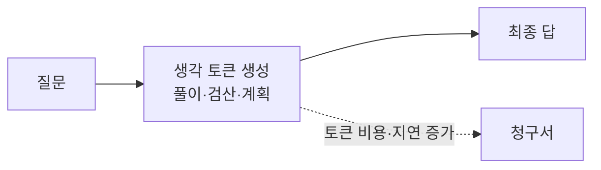
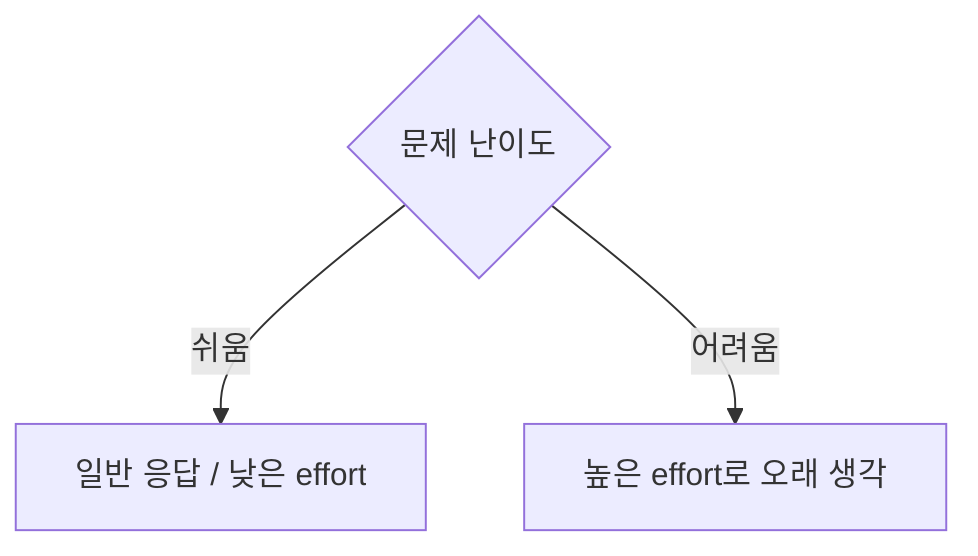

# 추론 모델 (Reasoning Models)

> 추론 모델은 최종 답을 내기 전에 **긴 "생각" 토큰을 먼저 생성**하도록 훈련·설정된 LLM이다. 답하기 전에 더 오래 계산하는 대신 어려운 문제(수학·코드·계획)의 정확도를 높인다.

## 쉽게 말하면
시험에서 바로 답만 적는 학생과, 시험지 여백에 풀이를 적은 뒤 답을 쓰는 학생의 차이다. 풀이(생각 토큰)를 쓰는 데 시간과 종이(토큰 비용)가 더 들지만, 어려운 문제에서는 맞힐 확률이 크게 오른다.

## 자세히
- 핵심 아이디어는 **테스트 시점 연산(test-time compute) 늘리기**: 모델을 더 키우는 대신, 답을 낼 때 더 많이 "생각"하게 한다. 초기 [chain-of-thought](#chain-of-thought) 프롬프트("단계별로 생각해")를 모델 훈련 단계에 내재화한 것에 가깝고, 강화학습으로 올바른 풀이 과정을 보상하는 방식이 널리 쓰인다.
- 응답은 **생각 블록 + 최종 답**으로 나뉜다. 생각 토큰은 출력 토큰으로 과금되고 컨텍스트 창을 차지한다.
- Anthropic API 사례(공식 문서 확인, 2026-11-08): 초기의 "extended thinking"(`thinking.type: "enabled"` + `budget_tokens`, 최소 1,024, `max_tokens`보다 작게)은 **레거시**가 되었고, Claude 4.7 이후 모델에서는 400 오류를 낸다. 대신 `thinking: {type: "adaptive"}`로 모델이 질문마다 생각 여부·분량을 정하고, 깊이는 `output_config: {effort: ...}`로 조절한다.
- 응답에 보이는 생각은 요약본일 수 있고, 원문은 암호화되어 반환되기도 한다(모델·설정별 상이).
- 언제 쓰나: 다단계 수학·논리, 복잡한 코드 수정, 에이전트의 계획 수립. 언제 안 쓰나: 단순 분류·번역·요약(느리고 비쌈).
- 한계: 생각 과정이 모델의 실제 계산을 충실히 반영한다는 보장은 없다(연구 논점) — 생각 로그를 "증거"로 과신하지 않는다.

## 그림으로 보기



## 예시
```python
r = client.messages.create(
    model="<모델 id>", max_tokens=16000,
    thinking={"type": "adaptive"},
    output_config={"effort": "high"},
    messages=[{"role":"user","content":"이 동시성 버그의 원인을 찾아줘 …"}])
for b in r.content:
    print(b.type)   # thinking → text 순서로 온다
```
업무에서는 "복잡한 요구사항 분석은 high, 형식 변환은 low"처럼 작업별로 effort를 나눠 비용을 아낀다.

## 헷갈리는 것과 비교
| 개념 | 차이 |
|---|---|
| 추론 모델/thinking | 모델이 답 전에 내부 생각을 길게 생성 |
| [chain-of-thought](#chain-of-thought) | 프롬프트로 단계별 풀이를 유도하는 기법 |
| [온도](#temperature-sampling) | 뽑는 무작위성 조절, 생각 깊이와 무관 |
| 모델 크기 키우기 | 훈련 때 연산을 늘림 vs 추론 때 연산을 늘림 |

## 더 읽을거리
- [Extended thinking (Anthropic 문서)](https://platform.claude.com/docs/en/build-with-claude/extended-thinking) — 예산 규칙, 레거시 전환, adaptive 마이그레이션(열어서 확인).
