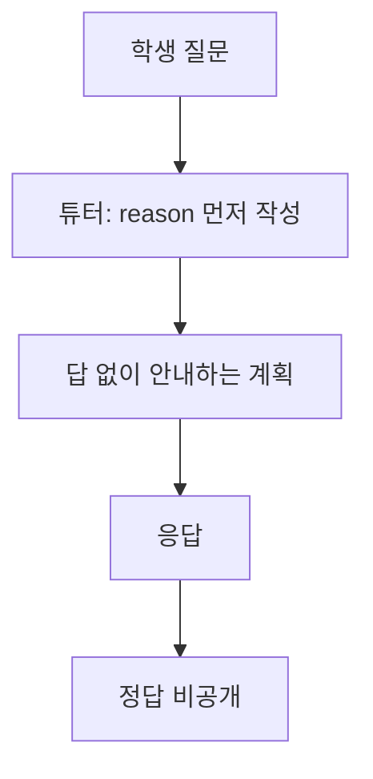
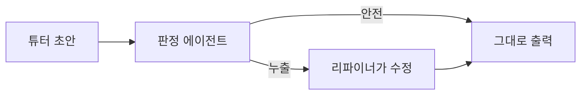

# 추론형 튜터 방어

> 튜터가 **답하기 전에 먼저 이유(계획)를 쓰게** 해서, 정답을 직접 말하지 않고 안내하도록 하는 방어 방식이다.

## 쉽게 말하면
선생님이 입을 열기 전에 메모장에 "이 학생에게 답을 알려 주지 말고 어떤 질문을 해 줄까"를 먼저 적게 하는 것이다. 적어 보는 동안 충동적으로 답을 말하는 일이 줄어든다.

## 자세히
(Zhao 외, arXiv 2604.18660 본문 앞부분을 직접 읽었다.)
- **방식(논문)**: 튜터가 응답 전에 중간 추론 단계를 JSON의 `reason` 필드로 쓴다. 거기서 정답을 공개하지 않고 학생을 안내할 계획을 세운 뒤 답한다.
- **비교 방어**: **멀티에이전트형** — 튜터의 초안을 판정 에이전트가 누출 여부 검사하고, 누출이면 *리파이너*가 고쳐 쓴 뒤 학생에게 보인다.
- **결과(논문, 튜터 누출률, 기본 → 멀티에이전트 / 추론)**:
  - Qwen-32B, 수동 프롬프트: 46% → 4% / **2%**
  - Llama-8B, 미세조정 공격자: 34% → 6% / 3%
  - Qwen-32B, 미세조정 공격자: 70% → 4% / 3%
  - Qwen2.5-72B, 미세조정 공격자: 80% → 8% / 8%
  - **Qwen-7B, 미세조정 공격자: 82% → 61% / 38%** — 작은 모델에서는 효과가 제한적이었다.
  - GPT-5(수학만, 가장 강한 공격자): 누출 4.58%.
- **해석**: 큰 모델에서는 방어가 매우 효과적이지만 작은 7B는 자체 이행 능력이 부족할 수 있다(저자의 설명을 요약한 것으로, 원인 검증은 본문 범위에서 확인하지 못했다).
- **주의**: 정답은 가리더라도 지나치게 구체적인 힌트는 누출로 세지 않아, 교육 품질은 별도로 점검해야 한다.

## 그림으로 보기

## 예시
- 시스템 프롬프트(제안): "응답을 JSON으로 `reason`과 `reply` 두 필드로 쓰고, reason에서 학생의 현재 이해와 답을 숨기며 안내할 방법을 먼저 적어라."
- 7B급 소형 모델에는 판정·수정 단계를 추가해야 안전한지 직접 측정한다(제안).

## 헷갈리는 것과 비교
| 개념 | 차이 |
|---|---|
| 추론형 튜터 | 응답 전 계획을 쓰는 방어 |
| 멀티에이전트형 | 초안을 따로 검사해 수정 |
| [정답 누출률](#answer-leakage-rate) | 방어 효과를 재는 지표 |

## 더 읽을거리
- [arXiv 2604.18660](https://arxiv.org/html/2604.18660v1) — 방어 설계와 수치(직접 읽음).
