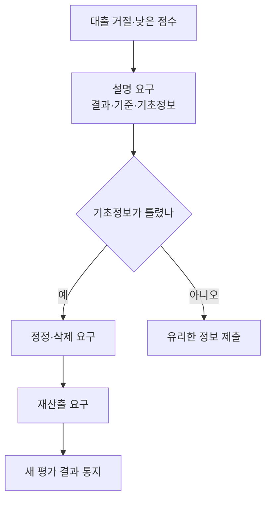

# 결과 재산출 요구

> 신용정보법 제36조의2 제2항에 근거해, 자동화평가의 기초정보가 부정확하거나 최신이 아니라고 보는 개인이 **정정·삭제** 또는 **평가 결과를 다시 산출**해 달라고 요구하는 권리. (법률 자문 아님)

## 쉽게 말하면
시험 채점 기계가 내 답안을 잘못 읽었다면 "답안 다시 읽고 점수를 다시 매겨 주세요"라고 하는 것과 같다. 재산출은 '틀린 입력을 고친 뒤 계산을 다시 돌려 달라'는 요구다.

## 자세히
출처: itwiki 제36조의2 조문 정리(2022-06 편집본 기준, 본문 확인), BC카드 설명요구서 양식(검색 요약). 최신 조문은 국가법령정보센터에서 대조해야 한다.
- **조문 구조**: 제2항은 유리한 정보 제출과 함께, 기초정보가 "정확하지 아니하거나 최신의 정보가 아니라고 판단되는 경우" 기초정보의 정정·삭제 또는 평가 결과의 재산출을 요구할 수 있다고 정한다.
- **순서**: 보통 ①설명 요구로 어떤 기초정보가 쓰였는지 확인 → ②틀린 정보 정정·삭제 → ③정정된 정보로 재산출. 정정 없이 재산출만 요구하는 방식의 해석은 자료에서 확인하지 못했다.
- **회사 측 거절**: 제3항 사유(특별 규정·의무 준수, 거래 설정·유지 곤란, 시행령 유사 사유)가 있으면 거절할 수 있다([요구 거부 사유](#refusal-grounds)). 절차·거절 통지는 대통령령에 위임되어 있다.
- **한계**: 기한 등 세부는 이 자료에서 확인하지 못했다.
- **AI 관점**: 모델은 같아도 입력 데이터가 바뀌면 점수가 달라진다. 그래서 재산출은 "모델 설명"보다 "데이터 정확성" 구제 수단에 가깝다(해석).

## 그림으로 보기

## 예시
- 이미 갚은 연체 기록이 남아 점수가 낮게 나온 경우 → 기록 정정 후 재산출 요구.
- 직무 교육 활용: 금융·HR 직무 교육에서 "AI 결과를 고치려면 입력 데이터를 먼저 고친다"는 원칙으로 쓴다.

## 헷갈리는 것과 비교
| 개념 | 차이 |
|---|---|
| 결과 재산출 요구 | 데이터를 고친 뒤 다시 계산 |
| [인적 개입 재처리](#human-reprocessing) | 개인정보 보호법상 사람이 다시 처리 |
| [신용정보법 제36조의2](#credit-info-act-36-2) | 두 권리를 담은 상위 조항 |
| [요구 거부 사유](#refusal-grounds) | 회사가 거절할 수 있는 경우 |

## 더 읽을거리
- [itwiki: 신용정보법 제36조의2](https://www.itwiki.kr/w/%EC%8B%A0%EC%9A%A9%EC%A0%95%EB%B3%B4%EC%9D%98_%EC%9D%B4%EC%9A%A9_%EB%B0%8F_%EB%B3%B4%ED%98%B8%EC%97%90_%EA%B4%80%ED%95%9C_%EB%B2%95%EB%A5%A0_%EC%A0%9C36%EC%A1%B0%EC%9D%982) — 조문 항별 정리(2022-06 기준)
- [BC카드 설명요구서](https://www.bccard.com/down/individual/membership/request_explanation.pdf) — 금융사 실제 양식(검색 요약만 확인)
