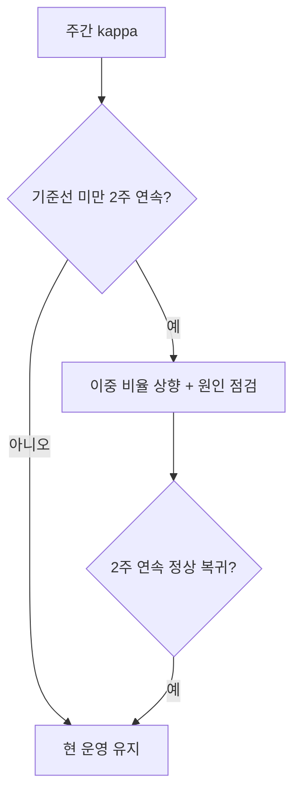
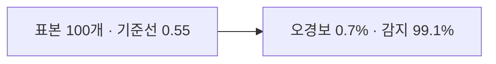

# 재보정 조건

> 재보정 조건은 일부만 이중 라벨하는 운영(하이브리드 분담) 중에 일치도가 떨어졌을 때 "다시 이중 라벨 비중을 높이고 지침을 재점검한다"를 발동시키는 미리 정한 기준이다.

## 쉽게 말하면
자동차 계기판의 경고등이 켜지는 기준을 미리 정해 두는 것과 같다. 기준 없이 "조금 이상한 것 같은데"로 대응하면 너무 늦거나 너무 자주 멈춘다.

## 자세히
- **직접 시뮬레이션(이진 균형, 주석자 2명, 정상 정확도 0.92(kappa 약 0.70), 하락 시 0.82(kappa 약 0.41), 규칙: 주간 kappa가 기준선 미만인 주가 연속 2주)**:

| 주당 이중 표본 | 기준선 | 정상 12주 중 오경보 확률 | 하락 후 4주 안에 발동 확률 |
| --- | --- | --- | --- |
| 50 | 0.55 | 0.051 | 0.941 |
| 50 | 0.60 | 0.222 | 0.986 |
| 100 | 0.55 | 0.007 | 0.991 |
| 100 | 0.60 | 0.059 | 1.000 |

  표본이 50개이고 기준선 0.60이면 정상인데도 12주 안에 22%가 오경보다. 표본 100개·기준선 0.55로 하면 오경보 0.7%, 감지 99.1%다. (단순 가정 시뮬레이션이며 클래스 쏠림이나 주석자 교체가 있으면 달라진다.) 기준선은 합격선([kappa 해석표 비교](#kappa-interpretation-scales))보다 약간 낮게 두면 오경보가 줄어든다.
- **발동 후 조치(해석)**: ① 이중 라벨 비율을 일시적으로 올린다(예: 10%→50%) ② [불일치 샘플 토론](#disagreement-discussion)으로 원인 확인 ③ 지침·교육 보강 후 [라벨러 훈련 라운드](#annotator-training-rounds) ④ 두 주 연속 기준선 위로 돌아오면 원래 비율로 복귀.
- **발동 신호 후보(해석)**: 주간 kappa 외에 클래스별 일치도([클래스별 일치도](#specific-agreement)), 판단 불가 비율([판단 불가 선택지](#cannot-decide-option)), 신규 주석자 투입·지침 변경 이벤트.
- **복귀 조건도 정한다**: 되돌릴 기준이 없으면 비싼 모드에 갇힌다.

## 그림으로 보기

## 예시
- 신규 주석자 3명이 투입된 주에 kappa가 0.52, 0.50이면 이중 비율을 50%로 올리고 토론을 연다.
- 교육 활용: 기준선과 표본 수를 바꿔 오경보·감지 표를 직접 만들어 본다.

## 헷갈리는 것과 비교
| 개념 | 차이 |
| --- | --- |
| 재보정 조건 | 이중 라벨 복귀를 발동하는 기준 |
| [주간 일치도 대시보드](#weekly-agreement-dashboard) | 그 기준을 보여 주는 화면 |
| [시범 라운드 종료 조건](#round-stopping-criteria) | 시범을 끝내는 기준 |
| [라벨링 비용 모델](#annotation-cost-model) | 복귀 시 비용 변화 |

## 더 읽을거리
- [Interrater reliability: the kappa statistic (McHugh, 2012)](https://pmc.ncbi.nlm.nih.gov/articles/PMC3900052/) — kappa 해석 기준
