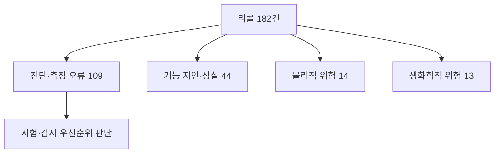

# 리콜 원인

> FDA 허가 AI 의료기기의 리콜을 제조사가 밝힌 원인별로 나눈 분류. 한 연구에서 리콜 182건 중 진단·측정 오류가 가장 많았다. 원인별 분류는 연구 방법에 따라 달라진다.

## 쉽게 말하면
자동차 리콜을 "브레이크 문제", "에어백 문제", "소프트웨어 문제"로 나누듯, 의료 AI 리콜도 왜 회수됐는지를 유형별로 센다. 가장 흔한 원인을 알면 시험·감시에서 어디를 더 볼지 정할 수 있다.

## 자세히
출처: Lee 외, "Early Recalls and Clinical Validation Gaps in Artificial Intelligence–Enabled Medical Devices", JAMA Health Forum 2025;6(8):e253172(2025-08-22, PMC 원문을 열어서 읽음).
- **표본**: FDA 허가 AI 의료기기 950개(논문 본문), 이 중 60개(6.3%)에서 리콜 182건이 있었다.
- **원인별(제조사가 밝힌 원인, Results)**:
  - 진단·측정 오류: 109건(리콜된 단위 수 935,063)
  - 기능 지연·상실: 44건(755,647단위)
  - 물리적 위험: 14건(8,192단위)
  - 생화학적 위험: 13건(76,257단위)
  - 위 네 범주 합계 180건. 나머지 2건과 방법 절에 있는 "시판 후 변경" 범주 개수는 본문에서 확인하지 못했고, 본문에 소프트웨어 범주는 따로 없었다.
- **해석 주의**: 분류는 제조사의 서술에 의존한다. 진단·측정 오류가 알고리즘 문제인지 입력 품질·하드웨어 문제인지는 분류만으로 알 수 없다. 단위 수는 해당 리콜에 영향받은 기기 수라 건수와 규모가 다르다.
- **한계(저자)**: 공개된 검증 보고서에 의존했고, 리콜로 표시되지 않은 소프트웨어 업데이트는 제외했으며, 2022년 이후 허가 기기는 추적 기간이 짧다.
- **다른 분석과의 차이**: 이 지도의 [AI 기기 리콜](#ai-device-recalls) 글은 903개 기기 43개 리콜(4.8%)이라는 다른 수치를 적는데, 이번에 읽은 PMC 판(950개·60개)과 달라 같은 논문의 다른 판본인지 확인하지 못했다. 인용할 때는 출처 판본을 밝혀야 한다.

## 그림으로 보기

## 예시
- 점검: 도입 후보 기기의 같은 product code에서 진단·측정 오류 리콜이 있었는지 FDA 리콜 DB에서 확인([기기 리콜 DB](#device-recall-database)).
- 교육 토론: "진단·측정 오류" 리콜이 가장 많다는 사실이 임상 검증 요구에 어떤 의미를 주는가.

## 헷갈리는 것과 비교
| 개념 | 차이 |
|---|---|
| 리콜 원인 | 회수의 이유 분류 |
| [AI 기기 리콜](#ai-device-recalls) | 상위 노드 |
| [임상 검증과 리콜](#clinical-validation-recalls) | 검증 보고 유무와 리콜의 연관 |
| [이상 사례 보고](#adverse-event-reporting) | 리콜 이전에 쌓이는 신고 자료 |

## 더 읽을거리
- [Early Recalls and Clinical Validation Gaps in AI-Enabled Medical Devices (JAMA Health Forum, PMC)](https://pmc.ncbi.nlm.nih.gov/articles/PMC12374217) — 원인별 리콜 건수(열어서 확인)
