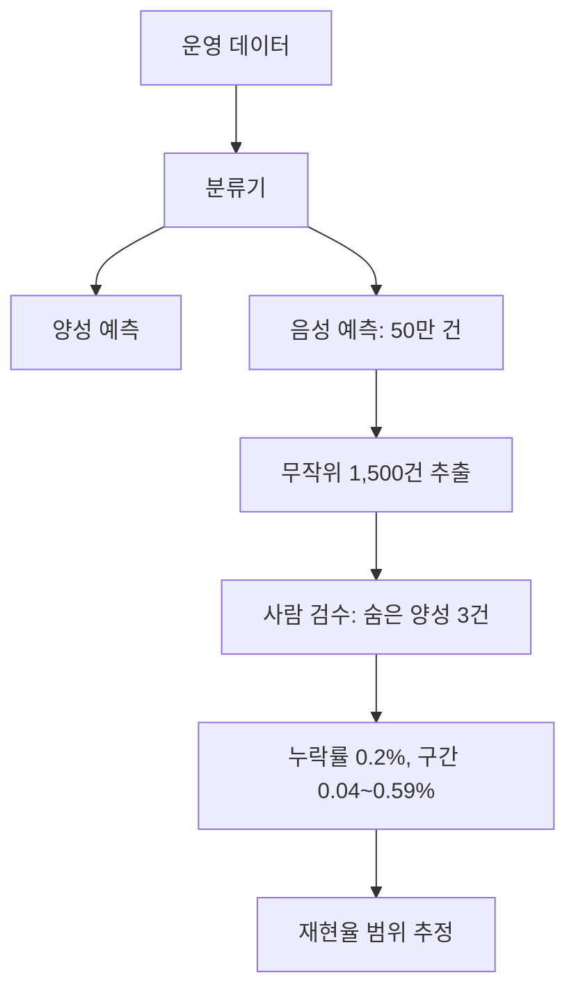
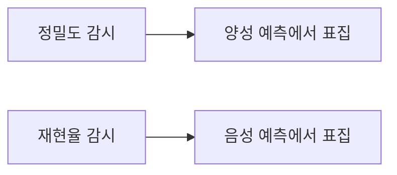

# 예측 음성 표본으로 재현율 감시

> 분류기가 "음성"이라고 한 것들 중에서 무작위로 표본을 뽑아 사람이 검수하고, **그 안에 숨은 양성(놓친 것)의 비율로 재현율을 추정**하는 방법. 정밀도 감시는 "양성 예측"을 뽑아 보지만, 재현율은 반드시 "음성 예측" 쪽을 봐야 한다.

## 쉽게 말하면
공항 보안 검색대가 통과시킨 가방 중 몇 개를 무작위로 열어 보면, 위험물이 얼마나 빠져나갔는지 알 수 있다. 걸러 낸 가방만 아무리 열어 봐도 놓친 것은 알 수 없다. 재현율 감시는 "통과시킨 쪽"을 뒤지는 일이다.

## 자세히
- **용어**: 통과(음성 예측) 집합에서 표본을 뽑아 양성 비율을 **elusion(누락률)** 이라 부른다. 법률 전자증거개시(eDiscovery)의 기술 지원 검토(TAR)에서 널리 쓰는 검증법이다.
- **재현율 계산**: TP는 양성 예측 중 검수로 확인된 진짜 양성 수. 누락된 양성 FN ≈ 누락률 × 음성 예측 총수. 재현율 = TP / (TP + FN).
- **ei-Recall(Herbert Roitblat 계열 elusion 방법을 변형한 e-discoveryteam 2015 글)**: FN을 점추정하지 않고 **정확 이항 신뢰구간**으로 FN의 하한(FNl)·상한(FNh)을 구해 재현율을 범위로 보고한다. Rl = TP/(TP+FNh), Rh = TP/(TP+FNl).
- **계산 예(글 속 가정 예시)**: TP 4,000, 음성 예측 50만 건, 표본 1,500건에서 누락 3건(0.2%). 95% 구간 약 0.04~0.59% → FN 약 206~2,923 → **재현율 약 58%~95%**. 표본이 작으면 범위가 넓어 쓸모가 줄어든다.
- **한계**
  - 양성이 드물수록(누락률이 낮을수록) 표본에서 누락을 거의 못 봐 추정이 불안정하다. 글 저자는 중요한 프로젝트에서 1,500건 미만 표본을 권하지 않는다.
  - TP 수가 정확하다는 가정이 필요하다(정밀도가 높아 검수로 확인 가능해야 함).
  - elusion만 쓰면 재현율을 과대평가할 수 있다는 비판이 있다(ACEDS 글: 최대 36%p 사례 주장) — 양성·음성 예측 양쪽을 층화 표집하는 방식이 대안.
  - 1차 라벨러가 틀릴 수 있으므로 검수 기준·수준을 고정해야 한다.
- **직접 재현율 표집과 비교**: 양성 전체에서 무작위로 뽑으려면 약 400/유병률 건을 검수해야 해 유병률이 낮으면 부담이 크다.

## 그림으로 보기

## 예시
- 스팸 필터: "정상"으로 분류된 메일 중 주 1,500건을 사람이 검수해 스팸이 몇 건 섞였는지 센다.
- 계산 코드: `fn_low, fn_high = rate_low*neg, rate_high*neg; recall_low = tp/(tp+fn_high)`

## 헷갈리는 것과 비교
| 개념 | 표집 대상 | 알 수 있는 것 |
|---|---|---|
| [운영 분류기 감시 표본 추출](#classifier-monitoring-sampling) | 양성 예측 | 정밀도 |
| 음성 예측 표본 | 음성 예측 | 누락률 → 재현율 |
| 층화 검증 표집 | 양쪽 | 재현율·정밀도, 과대평가 완화 |

## 더 읽을거리
- [Introducing ei-Recall (e-discoveryteam, 2015)](https://e-discoveryteam.com/2015/01/04/introducing-ei-recall-a-new-gold-standard-for-recall-calculations-in-legal-search-part-one/) — 공식·한계 열어 확인.
- [ACEDS: TAR 검증 표본 크기 Part II](https://aceds.org/there-is-no-one-size-fits-all-sample-size-appropriate-for-tar-validation-part-ii/) — 검색 결과로만 확인(미열람).
