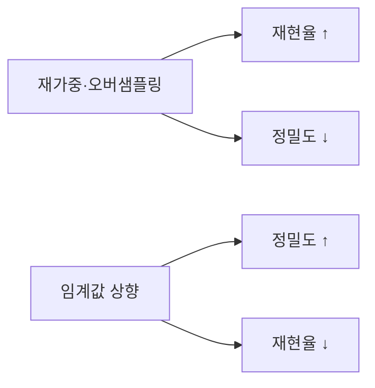
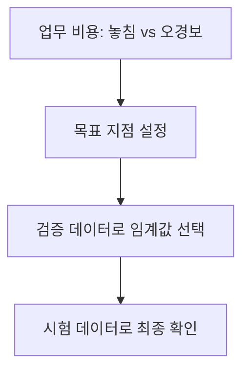

# 재현율-정밀도 거래

> 소수 클래스를 잘 잡도록 데이터를 보정(재가중·오버샘플링)하면 **재현율은 오르지만 정밀도가 떨어지는 거래**가 생긴다. 그래서 보정만 하고 끝내지 않고, 어디에서 끊을지(임계값)를 업무 비용에 맞춰 정해야 한다.

## 쉽게 말하면
화재 경보기를 아주 민감하게 하면 진짜 불은 거의 다 잡지만 토스트만 구워도 울린다. 둔감하게 하면 오작동은 줄지만 불을 놓칠 수 있다. 보정은 경보기를 민감하게 만드는 일이고, 임계값은 감도 조절 다이얼이다.

## 자세히
(scikit-learn 임계값 조정 문서(1.9 계열)를 직접 열어 확인하고, scikit-learn 1.9.1로 직접 실험. 상위 노드 [재가중·오버샘플링](#reweighting-oversampling)의 실험 설정을 이어받았다.)
- **문서 요점**: 이진 분류의 `predict`는 확률 0.5(또는 결정 함수 0)를 기준으로 삼는데, 문서는 이 고정 기준을 대부분의 용도에서 이상적이지 않다고 설명한다(종양 탐지는 놓친 암의 비용이 불필요한 추가 검사보다 크다). `TunedThresholdClassifierCV`는 학습 후 교차 검증으로 지정한 지표를 최대화하는 임계값을 찾는다(기본 지표는 균형 정확도, 5-겹 층화). `predict_proba`와 ROC·PR 곡선은 그대로고 예측 레이블만 바뀐다. 이미 학습한 모델을 학습 데이터로 튜닝(`cv="prefit"`)하면 과적합 위험이 있다고도 경고한다. 문서는 `class_weight`·리샘플링과 확률의 관계는 다루지 않는다.
- **직접 실험(합성 2만 개, 양성 약 3.9%, 시험 양성 234건, 로지스틱 회귀)**
  | 방법 | 정밀도 | 재현율 | 비고 |
  |---|---|---|---|
  | 보정 없음, 임계 0.5 | 0.0 | 0.0 | 양성 예측 1건뿐 |
  | `class_weight="balanced"`, 임계 0.5 | 0.070 | 0.615 | 양성 예측 2,069건(전체의 약 34%) |
  | balanced, 임계 0.7 | 0.308 | 0.244 | 임계를 올리면 정밀도가 오른다 |
  | 보정 없음 + 학습셋 교차검증 F1 최적 임계(0.125) | 0.406 | 0.368 | 시험 F1 **0.386** |
  | balanced + 같은 방식 최적 임계(0.663) | 0.270 | 0.415 | 시험 F1 0.327 |
  - **평균 예측 확률**: 보정 없음 0.038(실제 양성률 0.039와 일치), balanced 0.447. 즉 balanced를 쓰면 확률이 부풀려져 0.5 기준이 사실상 아무 의미가 없어진다.
  - 이 실험에서는 **보정 없이 임계값만 조정한 쪽이 F1이 높았다**(0.386 대 0.327). 한 데이터·한 모델·한 시드의 결과이므로 항상 그렇다고 일반화하지 않는다. 다만 "보정은 정확도를 재현율로 바꾸는 거래이고, 그 위치는 임계값으로도 조절할 수 있다"는 점이 보인다.
- **선택 순서(제안)**: ① 업무 비용 정리(놓침 한 건과 오경보 한 건의 비용) ② 평가 곡선(PR 곡선)을 그리고 목표 재현율·정밀도 정하기 ③ 보정 없이 확률을 잘 맞춘 뒤 임계값만 조정하는 방법과 재가중/오버샘플링 + 임계값 조정을 비교 ④ 임계값은 **학습 데이터와 분리한 검증 데이터(또는 교차 검증)**로 선택 ⑤ 최종 결정은 시험 데이터로 한 번만.
- **함정**: 시험 데이터로 임계값을 고르면 낙관적이다. 서빙에서 양성 비율이 변하면 임계값도 다시 점검해야 한다.

## 그림으로 보기

## 예시
- 사기 탐지(양성 3~4%): 놓침 비용 50배라면 임계값을 낮춰 재현율을 올리되, 검토 인력(하루 200건)에 맞춰 예측 양성 건수를 제한.
- 교육 소재: "보정하면 정확도가 떨어지는데 괜찮은가?"를 위 표로 답하기.

## 헷갈리는 것과 비교
| 개념 | 차이 |
|---|---|
| 재현율-정밀도 거래 | 보정 후 임계값으로 조절하는 균형 |
| [재가중·오버샘플링](#reweighting-oversampling) | 학습 쪽 보정 방법 |
| [확률 보정](#pred-probs-calibration) | 확률 값 자체를 실제 비율에 맞춤(balanced는 확률을 왜곡) |
| 임계값 조정 | 결정 기준만 바꿈(확률은 그대로) |

## 더 읽을거리
- [scikit-learn: Tuning the decision threshold for class prediction](https://scikit-learn.org/stable/modules/classification_threshold.html) — `TunedThresholdClassifierCV`, 고정 임계값의 한계(직접 확인).
