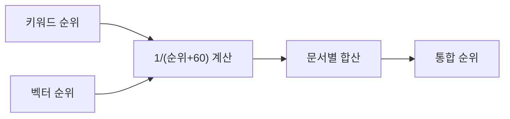
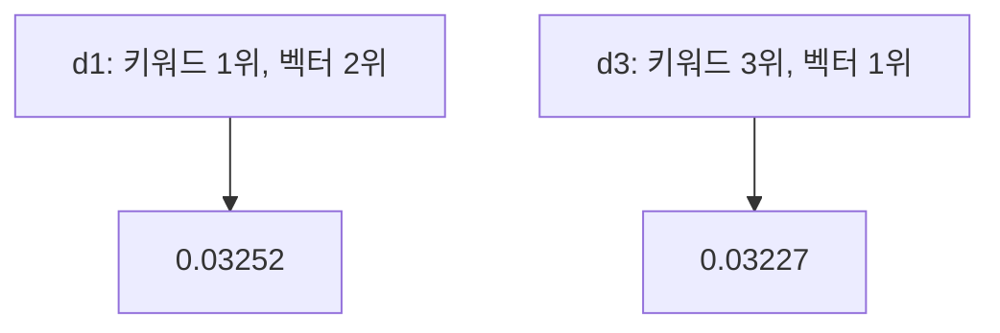

# RRF(순위 합산)

> 키워드 검색과 벡터 검색처럼 **점수 척도가 서로 다른 여러 검색 결과를 "순위"만으로 합치는** 방법. 각 목록에서 문서의 점수를 `1/(순위+k)`로 매겨 더한다.

## 쉽게 말하면
심사위원마다 점수 기준이 달라도(누구는 10점 만점, 누구는 100점 만점) "몇 등으로 뽑았나"만 모아 합치면 공정해진다. 여러 심사위원이 모두 상위로 꼽은 후보가 이긴다.

## 자세히
(Microsoft Learn의 Azure AI Search 문서 열람, 2026-11 갱신본 기준.)
- 정의: 병렬로 실행된 여러 쿼리의 순위 결과를 하나의 통합 순위로 만드는 알고리즘. 하이브리드 쿼리와 다중 벡터 쿼리에서 사용된다.
- 절차: ① 각 쿼리의 순위 목록을 얻는다 ② 목록 안의 각 문서에 **`1/(rank + k)`** 점수 부여 ③ 문서별로 목록 간 점수를 합산 ④ 합산 점수로 정렬. 문서에 따르면 **k는 60 같은 작은 값**일 때 실험적으로 잘 작동한다. 이 k는 최근접 이웃 개수 k와 무관한 별개 상수.
- 점수 척도 문제 해결: 전체 텍스트(BM25)는 상한이 없고 벡터는 코사인에서 0.333~1.00 같은 범위라 점수를 직접 더할 수 없다. 순위만 쓰면 정규화가 필요 없다.
- 상한: 쿼리당 기여가 최대 약 1/k이므로 합치는 쿼리 수가 많을수록 점수 상한이 커진다.
- 가중: 벡터 쿼리에 가중치(0.5, 2.0 등)를 곱해 중요도를 조절할 수 있다(Azure 구현).
- 순서: 의미 순위 재조정(semantic ranker)은 RRF 병합 이후에 적용되며 점수는 별도(`@search.rerankerScore`, 0~4)로 보고된다.
- 직접 계산 예(k=60): 키워드 순위 d1=1, d2=2, d3=3, 벡터 순위 d3=1, d1=2, d4=3이면 합산 점수는 d1 0.03252 > d3 0.03227 > d2 0.01613 > d4 0.01587. 두 목록 모두에 있는 d1·d3이 위로 올라온다.

## 그림으로 보기



## 예시
```python
def rrf(lists, k=60):
    s = {}
    for L in lists:
        for r, d in enumerate(L, 1): s[d] = s.get(d, 0) + 1/(r+k)
    return sorted(s, key=s.get, reverse=True)
```
- 교육: 같은 질문에 BM25와 벡터 결과를 합쳐 순위 변화를 눈으로 확인.

## 헷갈리는 것과 비교
| 개념 | 차이 |
|---|---|
| RRF | 순위로 합침, 점수 정규화 불필요 |
| 점수 가중 합 | 점수를 정규화해 가중 평균 |
| [HNSW 인덱스](#hnsw-index) | 벡터 검색 쪽의 근사 검색 구조 |

## 더 읽을거리
- [Hybrid search scoring (RRF) — Microsoft Learn](https://learn.microsoft.com/en-us/azure/search/hybrid-search-ranking) — 공식 설명(읽음).
