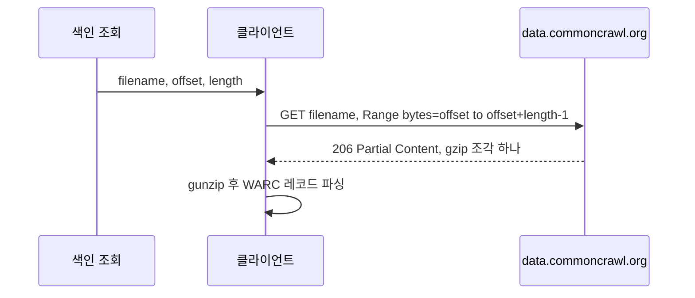
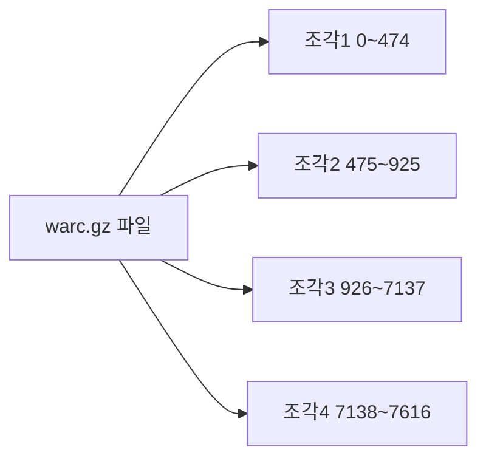

# 오프셋으로 레코드 받기

> 색인에서 얻은 **WARC 파일 이름·시작 바이트(offset)·길이(length)**로 HTTP Range 요청을 보내, 수 TB짜리 WARC 파일에서 **레코드 하나만** 내려받는 방법.

## 쉽게 말하면
수천 쪽짜리 백과사전에서 색인이 "17권 4,012쪽부터 3쪽"이라고 알려 주면, 그 부분만 펼쳐 보면 된다. 책 전체를 집으로 가져올 필요가 없다. 바이트 위치가 쪽수 역할을 한다.

## 자세히
- **색인의 세 열**: `warc_filename`, `warc_record_offset`, `warc_record_length`([Athena로 색인 조회](#athena-cc-index-query)). 경로 앞에 `https://data.commoncrawl.org/`를 붙이면 파일 주소가 된다.
- **왜 되는가**: WARC `.warc.gz`는 **레코드마다 따로 gzip 압축한 조각을 이어 붙인** 구조라서, 임의의 레코드 시작 바이트에서 잘라 읽어도 그 조각만 독립적으로 풀린다.
- **직접 실행(2026-11-28, `CC-MAIN-2024-10` 첫 WARC 파일, 표준 라이브러리만 사용)**: 
  - `Range: bytes=0-1023` 요청에 **HTTP 206**과 1,024바이트가 돌아왔다(`warc.paths.gz`로도 확인).
  - 같은 파일의 앞 20만 바이트를 받아 gzip 조각 경계를 읽으니 레코드가 `offset 0, 475바이트`(warcinfo), `475, 451`(request), `926, 6,212`(response, `Content-Length: 26414`), `7138, 479`(metadata) 순으로 이어졌다. 즉 응답 본문(response) 하나가 압축 6,212바이트다.
  - 계산한 `offset=475, length=451`로 `Range: bytes=475-925`만 다시 요청해 `zlib.decompress(raw, 31)`로 풀자 665바이트의 `WARC-Type: request` 레코드가 나왔다. **오프셋·길이만으로 정확히 그 레코드가 복원됐다.**
- **요청 형식**: `Range: bytes=<offset>-<offset+length-1>`. 끝 값이 offset+length에서 1을 뺀 값임에 주의(포함 범위).
- **레코드 종류**: warcinfo, request, response, metadata 등이 있고, 본문 텍스트가 필요하면 `response`의 HTTP 헤더 뒤 payload를 읽는다. 색인은 보통 response 레코드 위치를 가리킨다(일반 설명, 색인 쪽 세부는 미확인).
- **예의**: 한 번에 대량 요청하면 서버에 부담이다. 동시 요청 수를 제한하고 실패 시 지연을 두고 재시도한다(제안).
- 한계: 이 실습은 색인 조회 없이 파일 앞부분에서 경계를 직접 읽은 것이다. CDX 서버 호출은 이번에 시간 초과(504)로 확인하지 못했다.

## 그림으로 보기



## 예시
```python
import urllib.request, zlib
u = "https://data.commoncrawl.org/" + warc_filename
req = urllib.request.Request(u, headers={"Range": f"bytes={off}-{off+length-1}"})
rec = zlib.decompress(urllib.request.urlopen(req).read(), 31)
```
| 값 | 의미 |
|---|---|
| 206 | 부분 응답 성공 |
| 200 | 서버가 Range를 무시하고 전체를 보냄 → 중단 확인 필요 |
- 업무 장면: 색인에서 뽑은 한국어 페이지 1,000건의 위치로 본문만 받아 교육용 코퍼스를 만든다.

## 헷갈리는 것과 비교
| 개념 | 차이 |
|---|---|
| 오프셋 Range 요청 | 필요한 레코드만 받음 |
| 파일 전체 다운로드 | 수 GB. 대부분 불필요 |
| [Athena 색인 조회](#athena-cc-index-query) | 위치를 알아내는 단계 |
| [열 기반 색인](#columnar-index-parquet) | 위치가 들어 있는 표 |

## 더 읽을거리
- [Index to WARC Files and URLs in Columnar Format (Common Crawl)](https://commoncrawl.org/blog/index-to-warc-files-and-urls-in-columnar-format) — 위치 열 설명(직접 읽음).
- [Common Crawl 데이터 서버](https://data.commoncrawl.org/) — Range 요청 실습 대상(직접 요청해 확인).
