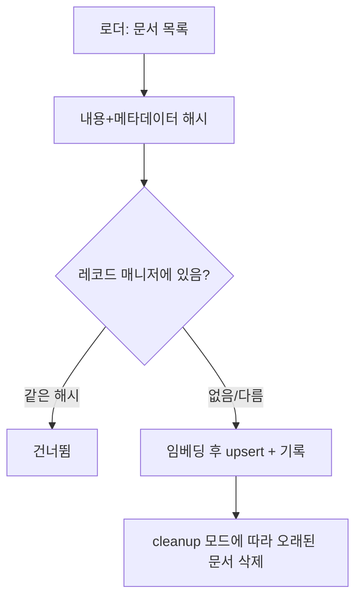
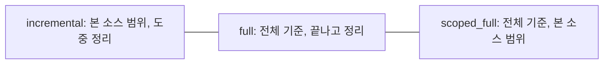

# 레코드 매니저

> **레코드 매니저(record manager)**는 벡터 색인에 어떤 문서를 언제 넣었는지 **해시·시각·소스 ID로 기록**해 두고, 다음 색인 때 **새 것만 넣고, 바뀐 것은 갱신하고, 사라진 것은 정리하게 해 주는 장부**다. LangChain의 색인 API(`index()`)가 대표 구현이다.

## 쉽게 말하면
도서관 입고 장부다. 책이 들어올 때마다 책 지문과 입고일을 적어 두면, 다음에 같은 책이 오면 "이미 있음"으로 건너뛰고, 개정판이 오면 옛 책을 치우고 새 책을 넣을 수 있다.

## 자세히
(LangChain 참조 문서 `langchain_core` `index()` 페이지(reference.langchain.com)를 WebFetch로 직접 확인. 옛 how-to 가이드 URL은 리디렉션되어 열지 못했다. 버전은 문서 기준이며 변경될 수 있다.)
- **역할(문서)**: `index()`는 문서를 벡터 저장소에 적재하고 record manager로 **추가·갱신·건너뛸 문서를 추적**한다. 문서는 **해시로 식별**되며 UID를 직접 지정할 수 없다. 레코드 매니저는 문서별 **타임스탬프가 있는 집합**이다.
- **해싱(문서)**: **문서 내용과 메타데이터를 함께** 해시한다. `key_encoder`는 `sha1`(기본), `sha256`, `sha512`, `blake2b` 또는 사용자 함수. 문서는 **SHA-1이 충돌 저항성이 없으므로 새 애플리케이션은 더 강한 인코더**를 쓰라고 경고한다. 인코더를 바꾸면 중복을 피하려면 **색인을 재구축**해야 한다.
- **정리 모드(문서)**
  | 모드 | 동작 |
  |---|---|
  | `None`(기본) | 아무것도 삭제하지 않음 |
  | `incremental` | **이번 실행에서 본 소스 ID** 중 갱신되지 않은 문서를 삭제. 색인 도중 계속 정리해 중복 노출이 줄어듦 |
  | `full` | 로더가 이번에 반환하지 않은 **모든** 문서 삭제. 색인이 끝난 뒤 정리하므로 잠시 중복이 보일 수 있음 |
  | `scoped_full` | full과 같되 이번에 본 소스 ID 범위만 삭제(`langchain-core` 0.3.25에서 추가) |
- **`source_id_key`(문서)**: 각 문서의 원본 소스를 식별. incremental·scoped_full 정리는 소스 ID에 의존한다. (생략 시 동작은 이 페이지에 명시되지 않았다. 기존 노드 [RAG 재조정 작업](#rag-reconciliation-job)은 소스 코드 docstring에서 incremental·scoped_full에 필수이며 없으면 ValueError라고 확인했다.)
- **안전장치·경고(문서)**: `full` 모드는 **로더가 전체 데이터셋을 반환해야** 한다. 아니면 지우면 안 되는 문서까지 지운다. incremental에서 한 소스 ID가 여러 배치에 걸치면 작업이 일부 반복(결과는 정확, 큰 배치가 효율적). scoped_full은 소스 ID를 메모리에 두며 약 1천만 문서 이상이면 병렬화가 필요할 수 있다. `cleanup_batch_size` 기본 1000. `force_update`는 이미 있는 문서도 다시 색인(임베딩 재생성에 유용).
- **한계(해석)**: 레코드 매니저는 **벡터 저장소 밖의 장부**라서 둘의 상태가 어긋나면(수동 삭제 등) 장부와 색인이 불일치할 수 있다.

## 그림으로 보기

## 예시
- 사내 위키를 매일 색인: `cleanup="incremental"`, `source_id_key="source"`로 바뀐 페이지만 재임베딩하고 옛 청크를 정리.
- 교육 활동: 문서 3개로 첫 색인과 수정 후 두 번째 색인에서 추가·건너뜀·삭제 건수가 어떻게 되는지 표로 예측.

## 헷갈리는 것과 비교
| 개념 | 차이 |
|---|---|
| 레코드 매니저 | 색인 이력을 기록하는 장부 |
| [사이드카 청크 매핑](#sidecar-chunk-mapping) | 문서→청크 ID 표(직접 삭제용) |
| [청크 내용 해시](#chunk-content-hash) | 해시로 변경 감지하는 기법 자체 |
| [RAG 재조정 작업](#rag-reconciliation-job) | 장부와 원본을 주기 대조하는 작업 |

## 더 읽을거리
- [langchain_core indexing `index()` 참조](https://reference.langchain.com/python/langchain_core/indexing/api/index) — cleanup 모드, source_id_key, 해싱·경고(직접 확인).
