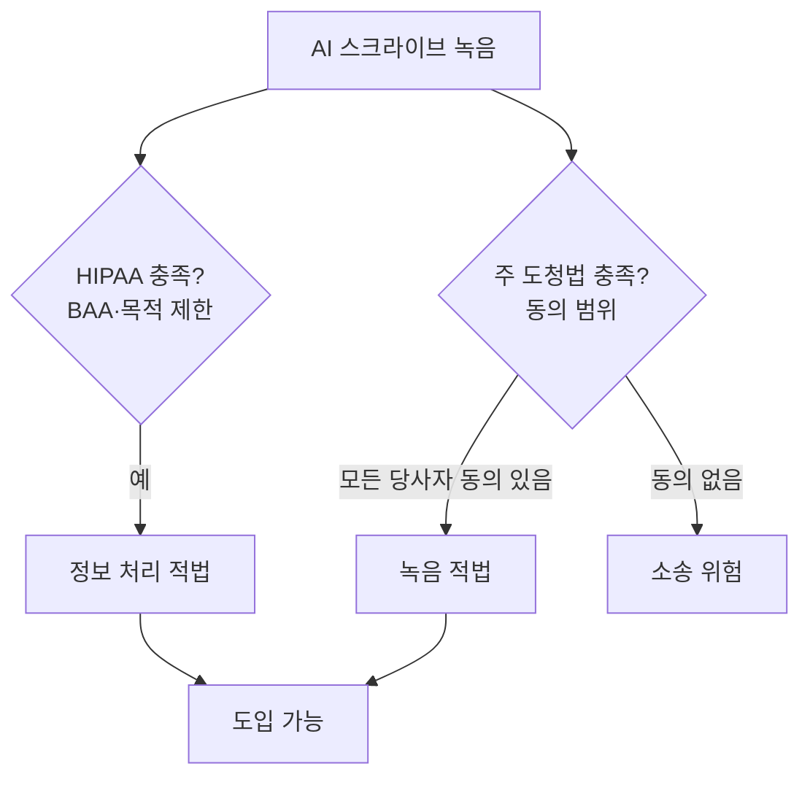

# 녹음 동의와 법

> AI 스크라이브처럼 대화를 녹음하는 서비스는 환자 개인정보법(HIPAA)과 별개로 주(州)별 녹음·도청법의 동의 규칙도 지켜야 한다.

## 쉽게 말하면
병원 문을 여는 열쇠가 두 개인 셈이다. HIPAA는 "진료 정보를 어떻게 다루나"의 열쇠, 주 도청법은 "남의 대화를 녹음해도 되나"의 열쇠다. 한쪽만 열어서는 못 들어간다.

## 자세히
- **HIPAA(미국)**: 업체가 사업 파트너 계약(BAA)을 맺고 녹음을 치료·지불·운영 목적에만 쓰면 별도 환자 승인이 보통 필요 없다는 해석이 일반적이다.
- **주 도청법**: HIPAA가 이를 대체하지 못한다. **모든 당사자 동의(all-party consent)** 주에서는 환자 동의 없는 녹음이 위법일 수 있다. 어느 주가 해당하는지는 자료마다 다르다(캘리포니아·플로리다·일리노이·펜실베이니아·워싱턴 등을 흔히 든다. 13개·16개 등 개수 주장이 엇갈림). **주 법령 원문 확인 필수**.
- **소송(주장 단계)**: Sharp HealthCare, Sutter Health, MemorialCare 등을 상대로 동의 없이 녹음했다는 집단소송이 제기됐다(2026년 기사 기준, 판결 아님). 청구 근거는 HIPAA가 아니라 주 법.
- **실무 권고(블로그 다수)**: 일방 동의 주에서도 세션마다 명시적 동의를 받고 기록한다. 형식적 체크박스만으로는 동의로 보기 어렵다는 지적도 있다.
- 한국은 통신비밀보호법·개인정보보호법의 별도 규율이 적용된다(이 글에서 다루지 않음, 확인 필요).
- 법률 자문이 아니다. 대부분 업체·블로그 출처다.

## 그림으로 보기

## 예시
- 클리닉이 두 당사자 동의 주에서 도입: 진료 시작 때 "AI가 대화를 받아 적는데 괜찮으시죠?"를 구두로 묻고 차트에 동의 여부를 남긴다. 거절하면 녹음을 끄고 직접 기록.
- 예외 규정을 검토: 응급, 미성년자, 통역사 동석 등.

## 헷갈리는 것과 비교
| 개념 | 차이 |
| --- | --- |
| HIPAA | 건강정보 보호, 녹음 동의 요건 아님 |
| 주 도청법 | 녹음 동의 규율, 주마다 다름 |
| [음성 복제 동의](#voice-cloning-consent) | 목소리 복제·사용 동의, 녹음 자체와는 다른 문제 |
| [Ambient scribe](#ambient-scribe) | 이 규칙이 적용되는 제품 |

## 더 읽을거리
- [Your ambient AI scribe consent checkbox is not consent (KevinMD, 2026-07)](https://kevinmd.com/2026/07/your-ambient-ai-scribe-consent-checkbox-is-not-consent.html) — 형식적 동의 비판(검색 결과 요약만 확인)
- [Thyra Health: AI Scribe Consent Laws by State (2026-09)](https://thyrahealth.com/blog/2026/09/ai-scribe-recording-patient-consent-guide/) — 주별 가이드(업체 블로그)
- [Telephone call recording laws (Wikipedia)](https://en.wikipedia.org/wiki/Telephone_call_recording_laws) — 일방·전원 동의 구분 개요
