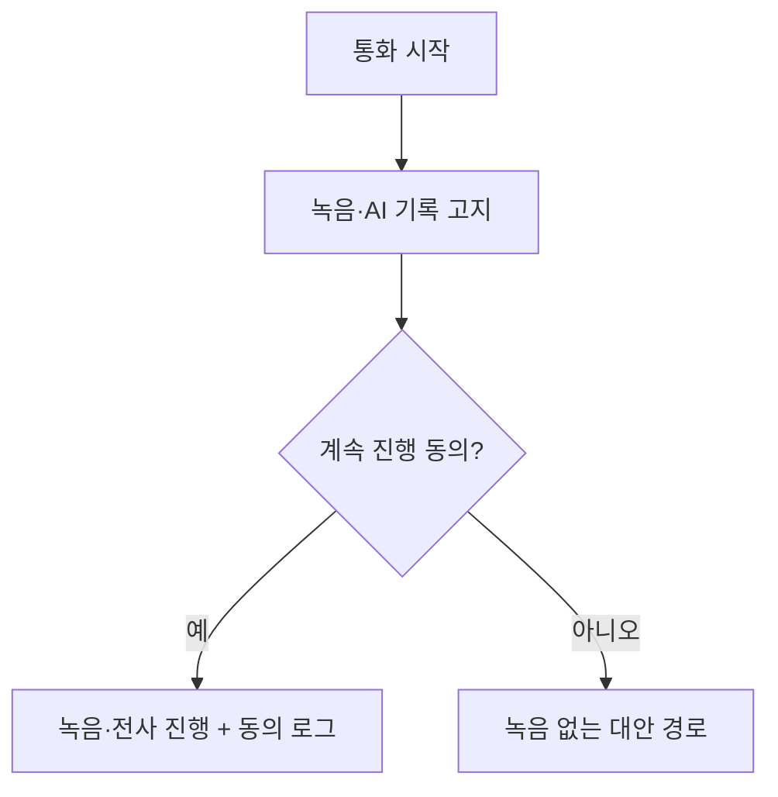
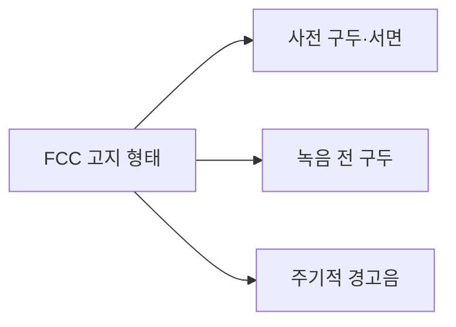

# 녹음 고지 설계

> 통화·상담을 녹음하거나 AI가 기록할 때, 통화 초반에 녹음 사실을 알리고 동의 또는 거부를 받는 흐름을 설계하는 일. 어느 주 법이 적용될지 불확실할 때 가장 엄격한 기준에 맞추는 것이 안전한 기본값이다.

## 쉽게 말하면
가게 입구의 "CCTV 촬영 중" 표지판처럼, 통화 시작에 "이 통화는 품질 향상을 위해 녹음됩니다"라고 알리는 것이다. 표지판이 없으면 몰래 찍은 것과 구분되지 않는다.

## 자세히
출처는 위키백과 "Telephone call recording laws"(열람, 2차 출처)와 18 U.S.C. § 2511(열람)이다. 미국 맥락이며 법률 자문이 아니다.
- **FCC가 인정하는 고지 세 형태(위키백과, 전화회사 녹음 대상)**: ① 모든 당사자에 대한 사전 구두·서면 고지, ② 녹음 전 구두 고지(가장 흔함), ③ 통화 중 일정 간격으로 울리는 경고음.
- **법적 배경**: 연방법은 한 당사자의 동의면 녹음을 허용하지만([일방 동의](#one-party-consent)) 전원 동의 주가 있고 주 경계 판례가 있어([주 경계 통화](#cross-state-calls)) 상대 위치를 모를 때 엄격한 기준을 기본값으로 삼는 것이 보수적이다.
- **고지 흐름 설계(해석)**: ① 통화 시작 직후 첫 문장에 녹음·AI 기록 사실과 목적 고지, ② 계속 통화하면 동의로 보는지 명시 동의를 받는지 정책 결정(주법에 따라 다름), ③ 거부 시 대안(녹음 없는 상담, 다른 채널)을 제공, ④ 동의·거부를 로그로 남김, ⑤ 이후 AI 요약·전사·훈련 사용 범위를 고지문에 맞춤.
- **AI 통화 시 추가 고려(해석)**: 상대가 AI와 대화 중임을 알리는 EU AI Act 50조 1항 같은 별도 의무가 있을 수 있다([50조 투명성 의무](#article-50-transparency)). 지역마다 요건이 다르다.
- **한계**: 위키 문서는 주별 예외와 최신 법 변화를 모두 담지 못한다. 고지 문구의 법적 충분성은 변호사와 확인한다.

## 그림으로 보기

## 예시
- 첫 멘트 예: "이 통화는 상담 품질과 기록 작성을 위해 녹음되고 AI로 정리됩니다. 계속 진행하시면 동의로 보며, 원치 않으시면 말씀해 주세요."(문구 예시, 법적 충분성은 별도 검토)
- 교육 실습: 자기 서비스의 첫 멘트를 쓰고 위 다섯 가지 설계 요소가 모두 들어 있는지 점검.

## 헷갈리는 것과 비교
| 개념 | 차이 |
|---|---|
| 녹음 고지 | 알리는 행위 |
| 동의 | 허락을 받는 행위(주법에 따라 필요) |
| [일방 동의](#one-party-consent) | 당사자 한 명 동의 규칙 |
| [주 경계 통화](#cross-state-calls) | 어느 주 법이 적용되나 |

## 더 읽을거리
- [Wikipedia: Telephone call recording laws](https://en.wikipedia.org/wiki/Telephone_call_recording_laws) — FCC 고지 형태(열람, 2차 출처)
- [18 U.S.C. § 2511 (Cornell LII)](https://www.law.cornell.edu/uscode/text/18/2511) — 연방 규칙(열람)
