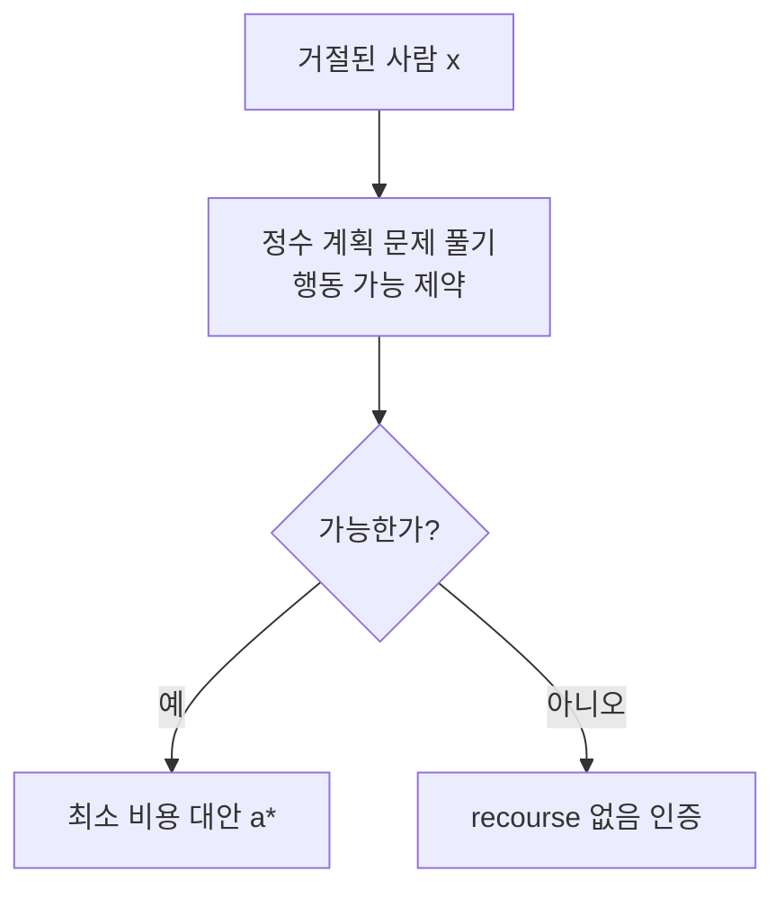

# recourse 점검(정수 계획법)

> 선형 분류기가 거절된 사람 **각각에게** 실행 가능한 대안이 존재하는지를, 정수 계획법(integer programming)으로 **증명 가능하게** 점검하는 방법이다(Ustun·Spangher·Liu). 찾지 못한 것이 아니라 "없음"까지 확인해 준다.

## 쉽게 말하면
미로 출구를 사람이 눈으로 찾다가 못 찾으면 "출구가 없다"고 단정할 수 없다. 이 방법은 가능한 모든 경로를 수학적으로 따져 "출구가 있다(가장 짧은 길은 이것)" 또는 "출구가 정말 없다"를 확정한다.

## 자세히
(arXiv 1809.06514 PDF 본문을 직접 열어 확인)
- **문제 설정**: 고정된 선형 분류기 f(x)=sign(⟨w,x⟩)와 거절된 사람 x에 대해, 행동 가능한 변화 a 중 결정을 뒤집는 최소 비용 a*를 구하는 최적화 문제(식 1·2)를 푼다. 이산 변수 제약(예: 월 수는 0~6 정수), 교육 수준은 증가만, immutable은 불변을 넣고 IP 솔버(CPLEX·CBC)에 맡긴다.
- **핵심 성질**: 문제가 **가능하면** 최적해가 최소 비용 대안, **불가능하면** 그 사람에게 actionable recourse가 없음이 **인증**된다. 논문은 이를 일반 설명기법과 구별한다. 설명기법은 못 찾았더라도 대안이 존재할 수 있어(찾지 못함 ≠ 없음) 실행 가능성을 검증하지 못한다고 한다. CPLEX 12.8로 최적해 또는 불가능 증명을 얻었다고 보고한다.
- **응용: 신용 평가 감사(논문 실험)**: 30,000명·16개 특징(소비·상환 패턴, 교육, 신용 이력, 나이, 혼인). ℓ1 벌점 {1,…,1000}의 로지스틱 회귀를 만들어 거절된 사람마다 IP를 풀었다. 결과(논문 보고): 벌점이 작은 모델은 모두에게 recourse를 줬지만, 벌점이 커져 행동 가능 특징이 줄수록 recourse를 가진 사람 수가 줄었고, **테스트 오류 변화는 작았다**. 비용(백분위 이동) 중앙값은 0.20에서 0.39로 거의 2배.
- **원인 분석**: 한 특징을 immutable로, 또는 actionable로 두는 두 감사를 돌려 비교하면 recourse가 없는 원인이 "과거 연체 여부"라는 immutable 지표임을 알 수 있다. 이를 "최근 연체 여부"로 바꾼 모델을 쓰면 recourse를 줄 수 있다고 논문은 제안한다.
- **한계**: 선형 모델 대상이며, 행동 집합과 비용 함수는 사람이 정하는 가정이다. 개인정보·정책 판단이 얽힌다.

## 그림으로 보기

## 예시
- 신용 모델 3개의 정확도가 비슷할 때, 거절된 고객 중 대안이 없는 비율을 감사해 비율이 낮은 모델을 채택.
- 교육 소재: 작은 장난감 모델로 "대안 있음/없음"을 손으로 확인해 보는 실습.

## 헷갈리는 것과 비교
| 개념 | 차이 |
|---|---|
| IP 감사 | 대안이 없다는 것까지 증명 |
| 일반 반사실 탐색 | 찾으면 제시, 못 찾아도 없다고 못함 |
| [실행 가능한 특징](#actionable-features) | 감사의 제약 입력 |
| [대안의 비용·시간](#recourse-cost-and-time) | 감사의 최적화 목표 |

## 더 읽을거리
- [Actionable Recourse in Linear Classification (arXiv 1809.06514)](https://arxiv.org/abs/1809.06514) — PDF 본문(방법·신용 평가 실험)을 직접 확인.
