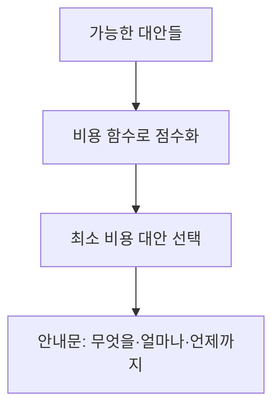
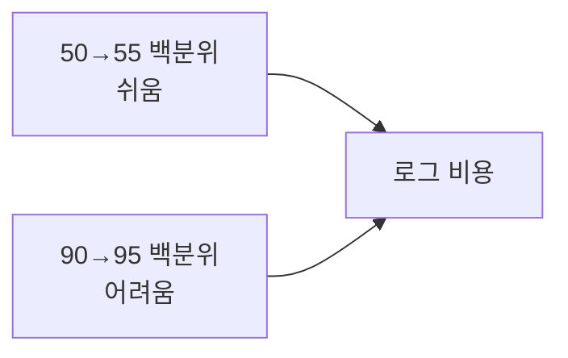

# 대안의 비용·시간

> 대안(recourse)이 "존재한다"는 것과 "현실적으로 따를 수 있다"는 다르다. 그래서 대안을 고를 때 **변경이 얼마나 어려운지(비용)**를 수치화하고, 변경에 걸리는 **기간**까지 고려해야 한다. 이 글은 비용 함수를 중심으로 설명한다.

## 쉽게 말하면
"연봉을 두 배로 올리세요"도 "카드 사용률을 5%p 낮추세요"도 둘 다 대안이다. 그러나 후자가 훨씬 쉽다. 같은 효과를 내는 여러 대안 중 **가장 쉬운 것**을 골라 보여 줘야 쓸모가 있다. 그리고 쉬운 정도는 이미 상위권인 사람과 중간인 사람에게 다르다.

## 자세히
(Ustun·Spangher·Liu, arXiv 1809.06514 PDF 본문 직접 확인. **기간(시간) 모델링은 이 논문에서 다루지 않는 것으로 보이며**, 기간은 아래 "해석" 항목의 실무 제안이다.)
- **왜 유클리드 거리가 아닌가**: 논문의 기본 비용 함수는 특징값 자체가 아니라 **목표 집단 내 백분위 이동**으로 비용을 잰다. 장점: ① 특징의 단위·스케일에 따라 변하지 않는다 ② 목표 집단의 분포를 반영한다. 기본값은 모든 특징의 같은 백분위 변화를 같은 비용으로 취급하며, 이 가정은 도메인 전문가가 상대적 난이도를 지정해 완화할 수 있다.
- **최대 백분위 이동(식 3)**: 비용 = max_j |Q_j(x_j+a_j) − Q_j(x_j)|. 감사용이다. 최적 비용이 0.25라면 결정을 뒤집으려면 **어떤 특징이든 최소 25백분위는 움직여야** 한다는 뜻이다. 논문은 이를 이용해 각 특징을 최대 50백분위 또는 90백분위까지만 바꿀 수 있게 가정한 두 시나리오에서 recourse를 가진 사람 수를 비교하는 방법도 설명한다.
- **총 로그 백분위 이동(식 4)**: 플립셋(대안 목록) 생성용. 높은 백분위에서 출발할수록 변경이 기하급수적으로 어려워진다는 개념을 담는다(예: 소득 90→95백분위는 50→55보다 어렵다).
- **실험 수치(논문 보고)**: 신용 평가 모델에서 정규화를 키우면 비용 중앙값이 0.20 → 0.39로 거의 2배. 즉 모델 개발 선택이 사람들이 감당해야 할 노력을 바꾼다.
- **해석(제안, 논문 주장 아님)**: 기간을 반영하려면 "6개월 연체 없음"처럼 시간이 지나야 바뀌는 특징은 조건부 immutable/지연 특징으로 모델링하고 안내문에 소요 기간을 명시하는 방식이 가능하다. 모델이 바뀌면 안내한 대안이 무효가 될 위험도 안내해야 한다.

## 그림으로 보기

## 예시
- 두 대안: A 카드 사용률 20%p 낮추기(15백분위 이동), B 소득 30% 올리기(40백분위 이동). 비용이 낮은 A를 먼저 제시.
- 교육 소재: 같은 거절 통지에 대해 "쉬운 대안"과 "어려운 대안"의 순서를 학생이 정하고 이유를 토론.

## 헷갈리는 것과 비교
| 개념 | 차이 |
|---|---|
| 유클리드 거리 비용 | 스케일 의존, 난이도 무시 |
| 백분위 이동 비용 | 집단 분포 반영 |
| 최대 백분위 이동 | 감사용(최소 필요 노력) |
| 총 로그 백분위 이동 | 플립셋용(쉬운 변화 우선) |
| [recourse 점검(정수 계획법)](#recourse-audit-integer-programming) | 비용을 목적함수로 쓰는 방법 |

## 더 읽을거리
- [Actionable Recourse in Linear Classification (arXiv 1809.06514)](https://arxiv.org/abs/1809.06514) — 비용 함수 식 3·4와 신용 실험(PDF 본문 직접 확인).
