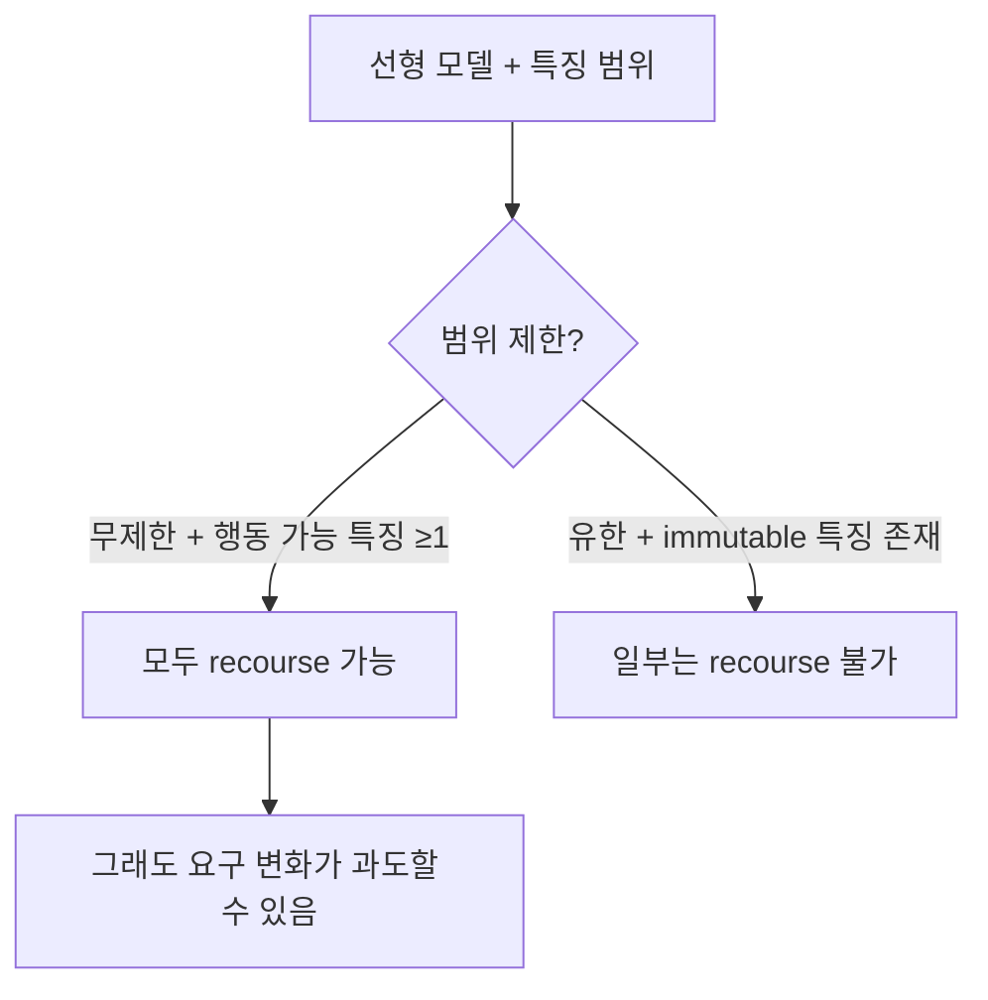
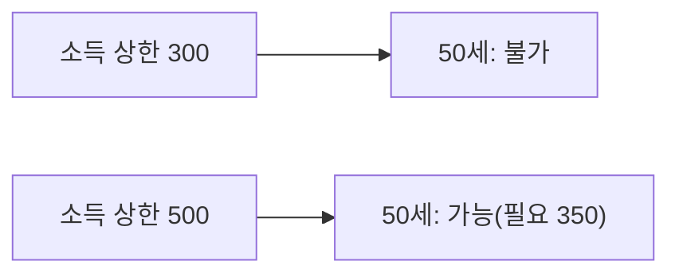

# recourse 가능성과 값의 범위

> 모델이 개인에게 결정을 바꿀 **대안(recourse)이 있는지는, 행동 가능한 특징이 실제로 얼마나 큰 값까지 움직일 수 있느냐(범위)**에 달려 있다. 특징 범위가 유한하면 바꿀 수 없는 특징(나이 등)이 불리하게 작용하는 사람은 어떤 노력으로도 승인되지 못할 수 있다.

## 쉽게 말하면
장학금 기준이 "점수 + 가산점"인데 가산점에 상한이 있고, 어떤 학생은 바꿀 수 없는 감점을 이미 받았다면, 가산점을 아무리 채워도 기준에 못 미칠 수 있다. 반대로 상한 없이 점수를 무한히 올릴 수 있다면 누구든 이론상 통과하지만, 요구 수준이 터무니없이 높을 수 있다.

## 자세히
(Ustun·Spangher·Liu의 「Actionable Recourse in Linear Classification」(arXiv 1809.06514) 서론과 "Feasibility Guarantees" 절을 PDF로 직접 읽어 확인하고, 숫자 예는 직접 계산했다.)
- **논문의 가능성 판단(선형 분류기)**
  - **Remark 1**: **행동 가능한 특징만 쓰고** 한 클래스만 예측하지 않는 선형 분류기는 대상 집단의 **모든 사람에게 recourse를 보장**한다. 반대로 immutable 특징만 쓰거나 항상 한 클래스만 예측하면 모든 사람의 recourse를 막는다.
  - **Remark 2**: 모든 특징이 **범위 제한이 없으면**, 행동 가능한 특징이 하나라도 있는 선형 분류기는 모든 사람에게 recourse를 준다.
  - **Remark 3**: 모든 특징이 **유한 범위**이면, immutable 특징이 하나라도 있는 선형 분류기는 **일부 사람에게 recourse를 주지 못할 수 있다**.
  - 논문은 그래서 recourse 가능성 주장이 **행동 가능한 특징(소득, 카드 수)의 범위 설정**에 달려 있고, 이진·순서·범주 특징은 정의상 범위가 정해져 있다고 설명한다. 실무에서는 불가능하다는 주장이 지나치게 좁은 범위 때문이 되지 않도록 **느슨한 범위**를 쓰라고 권한다. 느슨하면 분류기가 "엄청난 변화를 요구"하며 겉으로 recourse를 제공하는 것처럼 보일 수 있다.
- **recourse가 막히는 다른 경로(논문 서론)**: 특징 선택(immutable·조건부 immutable·행동 불가 특징 사용, 결측·불리한 분포), **운영 임계값**(위험 ≥50%에서는 recourse가 있어도 ≥80%에서는 없을 수 있음), **과도한 변화**(모든 사람에게 recourse를 주더라도 일부에게 소득 5만 달러→100만 달러 같은 비현실적 변화를 요구). 그래서 이상적인 점검은 대상 집단에서 recourse의 **가능성과 난이도**를 모두 평가한다.
- **직접 계산 예(선형 점수 = −1 + 0.01×소득(만원) − 0.05×나이, 점수 >0 승인, 나이는 바꿀 수 없음)**
  | 나이 | 소득 상한 300만원: 최대 점수 | 상한 500만원: 최대 점수 | 승인에 필요한 소득 |
  |---|---|---|---|
  | 30 | **+0.50 → 가능** | +2.50 | 250만원 |
  | 50 | **−0.50 → 불가** | +1.50 → 가능 | 350만원 |
  | 70 | −1.50 → 불가 | +0.50 → 가능 | 450만원 |
  소득 상한을 300에서 500으로 바꾸면 **50대와 70대의 recourse 유무가 바뀐다.** 상한을 넓히면 "가능"이라고 판정되지만 필요한 소득이 350~450만원으로 높아져 **현실적이지 않은 요구**일 수 있다. 숫자는 설명용이다.
- **설계(제안)**: ① 특징 범위를 **현실적 상한(예: 상위 99백분위)**과 **느슨한 상한** 두 가지로 가능성 점검 ② 집단별로 recourse 없는 사람의 비율과 **필요 변화량의 분포**(중앙값·상위 분위) 보고 ③ 임계값 변경 시 recourse 변화를 점검 ④ 불가능한 사람에게는 사람 심사 경로 ⑤ immutable 특징의 가중치가 큰 모델은 recourse 관점에서 재검토.
- **한계**: 위 결론은 **선형 분류기**에 대한 것이다. 비선형 모델은 별도 분석이 필요하다.

## 그림으로 보기

## 예시
- 대출 모델에서 연령 가중치가 크고 소득 상한이 낮게 잡힌 평가에서 고령 신청자의 recourse 불가 비율이 높게 나옴 → 모델의 연령 의존을 줄이거나 사람 심사 경로 추가.
- 교육 소재: "노력해도 바꿀 수 없는 거절"을 토론(AI 의사결정의 책임 교육).

## 헷갈리는 것과 비교
| 개념 | 차이 |
|---|---|
| recourse 가능성과 값의 범위 | 범위 때문에 대안이 없는 사람이 생김 |
| [조건부 immutable 특징](#conditionally-immutable-features) | 한 방향으로만 변하는 특징 |
| [행동 가능한 특징](#actionable-features) | 개인이 바꿀 수 있는 특징 |
| [배포 후 recourse 변화](#recourse-out-of-sample) | 시간이 지나 대안이 사라지는 문제 |

## 더 읽을거리
- [Actionable Recourse in Linear Classification (arXiv 1809.06514)](https://arxiv.org/abs/1809.06514) — Remark 1~3과 recourse 실패 경로(PDF 직접 확인).
