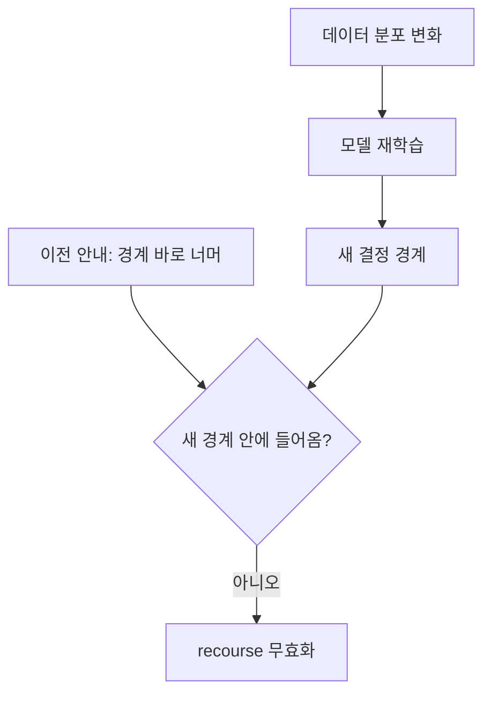
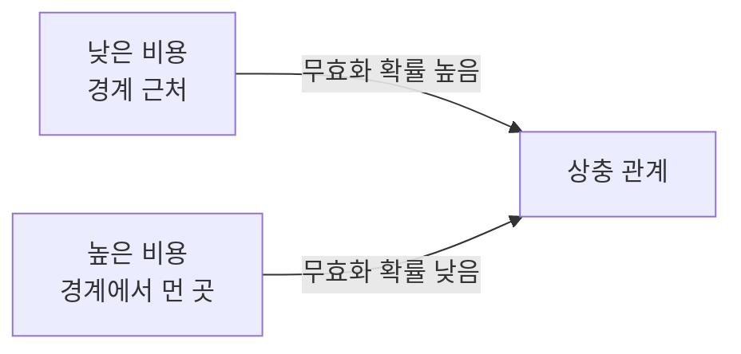

# 모델 갱신과 대안 무효화

> 모델이 **재학습·갱신**되면, 이전 모델 기준으로 "이렇게 하면 승인된다"고 안내한 recourse가 **새 모델에서는 더 이상 통하지 않을 수 있다**. 데이터 분포 변화가 모델 갱신을 부르고, 그 갱신이 recourse를 무효화한다.

## 쉽게 말하면
학교가 "토익 800점이면 합격"이라고 안내해 놓고 다음 해에 "850점"으로 올리면, 800점을 만든 학생은 불합격이다. 모델 갱신은 합격선이 조용히 움직이는 일이다.

## 자세히
(Rawal·Kamar·Lakkaraju, 「Algorithmic Recourse in the Wild: Understanding the Impact of Data and Model Shifts」(arXiv 2012.11788, 2020-12 제출, v3 2021-06) 초록을 WebFetch로 직접 확인. 본문 수치는 확인하지 못함.)
- **전제**: 기존 recourse 방법은 모델이 고정이라고 가정한다. 현실에서는 데이터 분포가 변해(시간·지역·데이터 정정) 모델이 **재학습**된다.
- **논문 주장**: 모델 갱신으로 **이전에 유효했던 recourse가 무효화**될 수 있고, 최신 recourse 알고리즘도 예외가 아니다. 합성·실제 데이터에서 **시간적·지리적 이동, 데이터 정정**으로 인한 이동 모두 같은 현상을 보였다.
- **이론(논문)**: recourse가 무효화될 확률의 **하한**을 유도했다(0이 되지 않는다). 또 **무효화 확률과 recourse 비용 사이에 상충(trade-off)**이 있다. 비용을 최소화하는 recourse는 결정 경계에 바짝 붙어 있어 갱신에 더 취약하다는 의미다(해석).
- **대응(관련 연구, 요약 수준)**: 모델 이동에 견고한 recourse를 적대적 학습으로 만드는 연구, 안전 마진을 두는 방식 등. → [recourse 안전 마진](#recourse-safety-margin)
- **운영 관점(제안)**: 모델을 갱신할 때 기존 안내를 받은 사람들의 recourse 유효 비율을 점검하고, 안내문에 "현재 모델 기준" 날짜를 적는다.

## 그림으로 보기

## 예시
- 은행이 분기마다 모델을 갱신: 1분기에 안내한 "부채 $1,000 이하"가 2분기엔 "$800 이하"로 바뀜.
- 교육 소재: 고객에게 준 조언이 모델 업데이트 후 틀리면 누구 책임인가.

## 헷갈리는 것과 비교
| 개념 | 차이 |
|---|---|
| 모델 갱신 무효화 | 모델이 바뀌어 기준이 이동 |
| [대안의 소요 기간](#recourse-time-horizon) | 실행 시간 동안 세상이 변함 |
| [recourse 안전 마진](#recourse-safety-margin) | 무효화에 대비한 여유 |
| 데이터 드리프트 | 입력 분포 변화 자체. 이것이 갱신의 원인 |

## 더 읽을거리
- [Algorithmic Recourse in the Wild (arXiv 2012.11788)](https://arxiv.org/abs/2012.11788) — 모델 갱신이 recourse를 무효화하는 하한과 비용 상충(초록 확인).
- [Time Can Invalidate Algorithmic Recourse (arXiv 2410.08007)](https://arxiv.org/abs/2410.08007) — 시간 경과 관점의 후속 논의.
