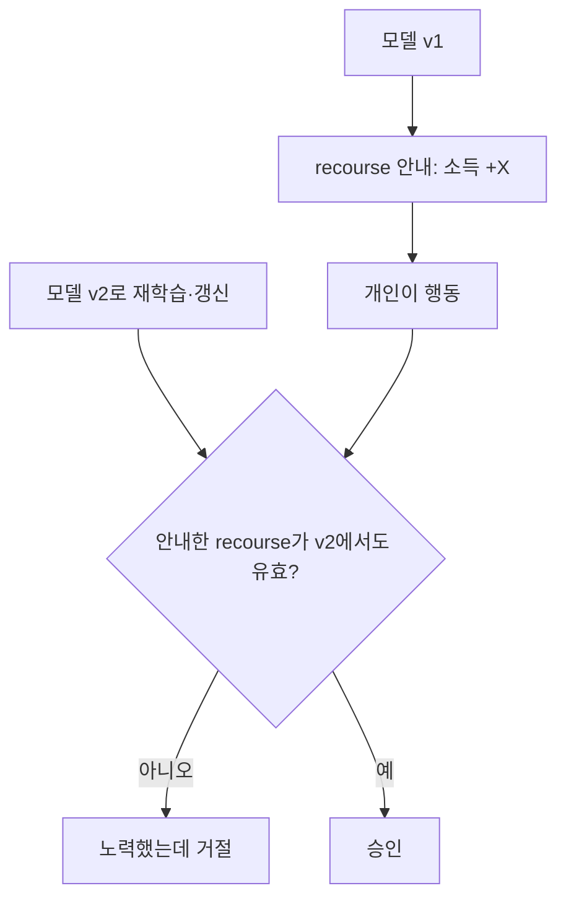
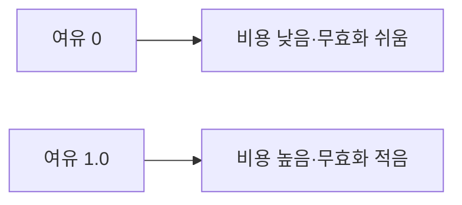

# 배포 후 recourse 변화

> 개인에게 "이렇게 바꾸면 승인된다"고 안내한 대안(recourse)이, **모델이 나중에 다시 학습·갱신되거나 입력 분포가 바뀌면 더 이상 유효하지 않게 되는** 문제다. 안내받은 사람이 노력해서 값을 바꿨는데 승인이 안 되는 일이 생긴다.

## 쉽게 말하면
"3개월 동안 월 50만 원씩 저축하면 대출 승인" 안내를 받고 그대로 했는데, 그 사이 은행이 심사 기준표를 새로 바꿔 버리면 약속은 소용없어진다. 대안은 모델의 **현재 모습**에 맞춘 것이기 때문이다.

## 자세히
(Upadhyay·Joshi·Lakkaraju의 「Towards Robust and Reliable Algorithmic Recourse」(arXiv 2102.13620, ROAR)의 초록과 서론을 PDF로 직접 확인하고, 무효화 비율은 직접 시뮬레이션했다. recourse의 배경은 [행동 가능한 특징](#actionable-features), 가능성의 한계는 [recourse 가능성과 값의 범위](#recourse-feasibility-bounds).)
- **문제(ROAR 논문)**: 기존 사후 recourse 기법은 **예측 모델이 변하지 않는다**고 가정한다. 하지만 모델은 데이터셋 이동 등으로 **주기적으로 재학습**되고, 그러면 이미 안내된 recourse가 **무효**가 될 수 있다. 서론은 Rawal 등이 최신 기법이 만든 recourse가 여러 모델 이동에서 쉽게 무효화됨을 실험으로 보였다고 인용한다. 논문은 ROAR(적대적 학습으로 모델 이동에 **강건한** recourse를 찾는 틀)를 제안하고, 기존 기법의 recourse가 **무효화될 확률의 하한**을 이론적으로 유도했으며 강건 recourse의 **추가 비용도 유한하다**고 증명했다고 밝힌다(수치는 초록에 없고 확인하지 못했다).
- **직접 시뮬레이션(로지스틱 모델, 거절된 500명, 행동 가능한 특징 2개만 최소 변경, 안내 후 모델을 **재학습**: 입력 분포·기준이 이동한 데이터 3,000건)**
  | 안내 시 여유(margin) | 원래 모델에서 유효 | 평균 변화량 | 재학습(이동 0.5)에서 유효 | 재학습(이동 1.0)에서 유효 |
  |---|---|---|---|---|
  | 0.0 (경계에 딱 맞춤) | 0.59 | 0.91 | **0.00** | **0.00** |
  | 0.5 | 1.00 | 1.06 | 0.69 | 0.00 |
  | 1.0 | 1.00 | 1.22 | 1.00 | 0.54 |
  결정 경계에 딱 맞춘 recourse는 **재학습 후 전부 무효**였다. 점수에 여유를 두면(변화량 0.91→1.22, 약 34% 증가) 이동이 작을 때는 유효성을 지켰고 이동이 크면(1.0) 여유 1.0에서도 54%만 유효했다. 이 단순 실험은 모델 이동의 방향·크기를 임의로 둔 것이라 비율 자체에 큰 의미는 없고, **여유를 두면 유효성은 오르고 비용도 오른다**는 trade-off를 보여 준다(ROAR가 이를 원리적으로 다루려는 방법이지만 이 실험은 ROAR를 구현한 것이 아니라 여유만 둔 간단한 대용이다).
- **또 하나의 경로(Ustun 논문 서론)**: 특징 누락, 불리한 분포 등으로 **배포 집단에서** recourse가 달라질 수 있고, 운영 임계값을 엄격하게 하면 recourse가 사라질 수도 있다.
- **운영(제안)**: ① recourse에 **유효 기한**과 "모델 갱신 시 변경될 수 있음" 고지 ② 갱신 전후로 이미 안내한 recourse의 **유효 비율**을 계산·보고 ③ 점수에 여유(안전 마진) 또는 강건 recourse 방법(ROAR 같은) 사용, 비용 증가와 균형 ④ 안내를 받고 행동한 사람에 대한 예외·재심사 경로 ⑤ 모델 갱신 정책(주기, 변경 폭)을 recourse 관점에서 검토.
- **한계**: 법적·윤리적 책임(안내한 대안과 실제 결정의 불일치)은 이 글에서 다루지 않았다.

## 그림으로 보기

## 예시
- 신용 모델이 분기마다 재학습되는데 3개월 전 안내한 recourse의 유효율을 갱신 때마다 측정해 70% 미만이면 안내문에 여유 폭을 늘림(설정 예).
- 교육 소재: "AI가 알려준 거절 대처법이 유효한지" — 모델 업데이트 시나리오 토론.

## 헷갈리는 것과 비교
| 개념 | 차이 |
|---|---|
| 배포 후 recourse 변화 | 모델·분포가 바뀌어 안내한 대안이 무효화 |
| [recourse 가능성과 값의 범위](#recourse-feasibility-bounds) | 특징 범위 때문에 대안이 없음 |
| [조건부 immutable 특징](#conditionally-immutable-features) | 방향 제약 |
| 강건 recourse(ROAR) | 모델 이동에 견디는 대안을 만드는 방법 |

## 더 읽을거리
- [Towards Robust and Reliable Algorithmic Recourse (arXiv 2102.13620)](https://arxiv.org/abs/2102.13620) — 모델 이동에 의한 recourse 무효화와 ROAR(PDF 앞부분 직접 확인).
- [Actionable Recourse in Linear Classification (arXiv 1809.06514)](https://arxiv.org/abs/1809.06514) — recourse 실패 경로(PDF 직접 확인).
