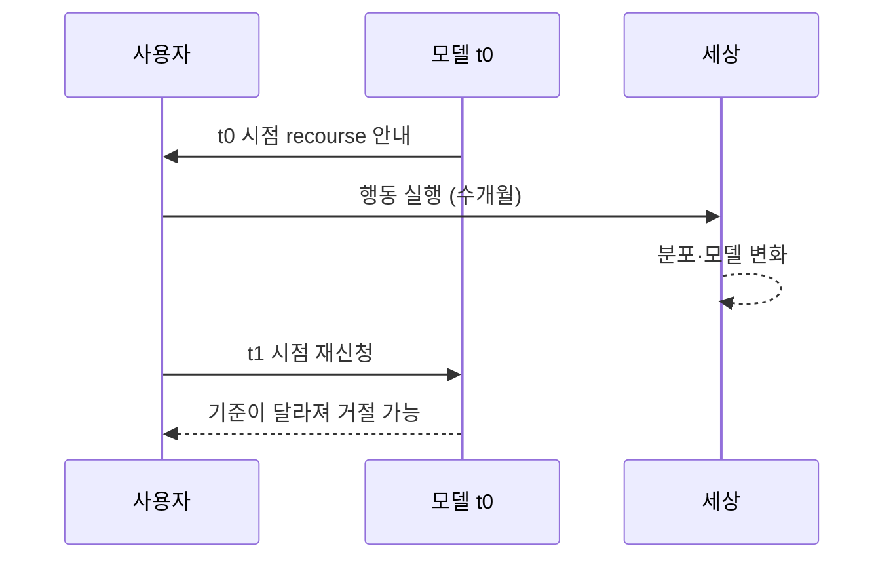
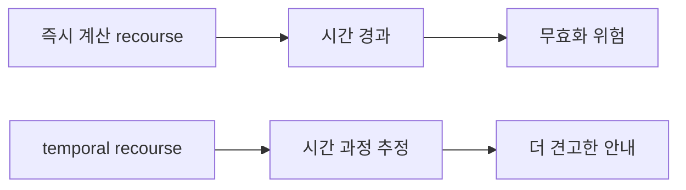

# 대안의 소요 기간

> **대안의 소요 기간(recourse time horizon)**은 "이렇게 바꾸면 승인된다"는 안내가 실제로 실행되는 데 걸리는 **시간**과, 그 시간 동안 세상(분포·모델)이 바뀌어 **안내가 틀어질 수 있다**는 문제를 가리킨다.

## 쉽게 말하면
내비게이션이 "30분 뒤 도착"이라 했는데 가는 도중 교통 상황이 바뀌어 길이 막히면, 안내한 경로는 이미 낡은 정보다. recourse도 마찬가지다. 신용 점수를 올리는 데 1년이 걸린다면, 1년 뒤의 심사 기준은 지금과 다를 수 있다.

## 자세히
(De Toni·Teso·Lepri·Passerini, 「Time Can Invalidate Algorithmic Recourse」(arXiv 2410.08007, FAccT 2025 채택으로 저자가 표기) 초록과 요약을 WebFetch로 직접 확인. 세부 수식은 확인하지 못함.)
- **핵심 주장(논문)**: recourse의 행동은 **실행에 시간이 걸리고**, 그동안 세상이 변해 효과가 달라질 수 있다. 인과 모델을 쓰는 견고한 recourse 방법도 **세상이 정지(stationary)해 있지 않으면 시간이 지나며 실패**할 수 있다. 저자들은 세상이 완전히 결정적이지 않다면 반사실적(counterfactual) recourse를 최적으로 풀 수 없다고도 주장한다.
- **제안(논문)**: 시간을 명시적으로 모델링하는 **temporal recourse 알고리즘**. 데이터를 만드는 확률 과정의 추정기가 있다고 가정한다. 합성·현실적 데이터 시뮬레이션에서 추세가 있는 분포에서 더 견고한 해를 보였다고 보고한다.
- **단순한 해결이 안 되는 이유**: 행동을 마친 뒤 다시 계산하면 되지 않느냐고 생각하기 쉽지만, 그 사이 상태가 변해 갱신된 요구 조건을 못 맞출 수 있다.
- **설계 관점(제안)**: 특징별로 변하는 데 걸리는 시간(대출 상환 수개월, 학력 수년)을 비용과 함께 표시하고, 안내문에 **유효 기간**을 명시한다. → [행동 집합 정의](#action-set-definition)

## 그림으로 보기

## 예시
- 대출: 연체 이력을 "최근 24개월"로 지우려면 2년이 걸린다. 안내문에 "예상 소요 24개월, 그 시점 기준은 달라질 수 있음"을 적는다.
- 교육 소재: 같은 조언이 6개월 뒤에도 맞을지 토론.

## 헷갈리는 것과 비교
| 개념 | 차이 |
|---|---|
| 소요 기간 | 실행 시간 동안 세상이 변하는 문제 |
| [모델 갱신과 대안 무효화](#recourse-model-update-invalidation) | 모델 재학습으로 기준이 바뀌는 경우 |
| [recourse 안전 마진](#recourse-safety-margin) | 여유를 두어 변화에 대비 |
| [백분위 이동 비용](#percentile-shift-cost) | 변경의 난이도(시간과 별개) |

## 더 읽을거리
- [Time Can Invalidate Algorithmic Recourse (arXiv 2410.08007)](https://arxiv.org/abs/2410.08007) — 시간이 recourse를 무효화하는 이유와 temporal 알고리즘(초록 확인).
