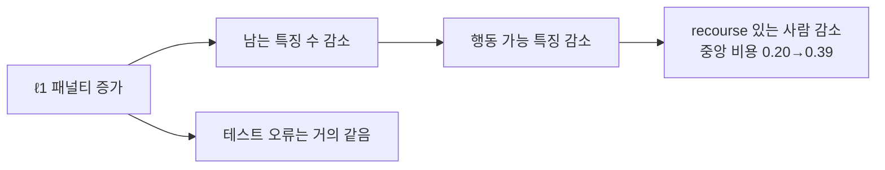
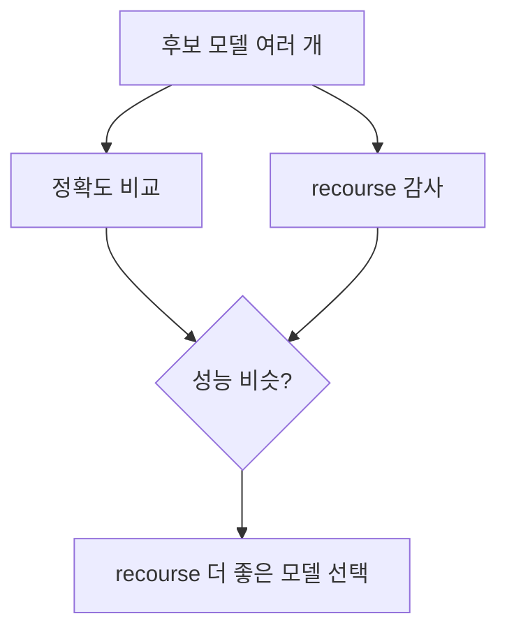

# recourse와 정규화

> 모델을 만들 때 흔히 하는 **정규화 강도 조절·특징 선택**이 성능은 거의 그대로 두면서도 **"결정을 뒤집을 수 있는 사람의 수"와 "뒤집는 데 드는 비용"을 크게 바꿀 수 있다**는 관찰이다. 정확도만 보고 모델을 고르면 일부 사람의 대안이 사라질 수 있다.

## 쉽게 말하면
회사 승진 심사표에서 평가 항목을 20개에서 3개로 줄였다고 하자. 심사 정확도는 비슷해도, 남은 3개가 "바꿀 수 없는 항목"(입사 연도 등)이면 아무리 노력해도 승진할 길이 없어진다. 정규화는 항목을 줄이는 도구이고, 어떤 항목이 살아남느냐가 사람들의 선택지를 정한다.

## 자세히
(Ustun·Spangher·Liu, 「Actionable Recourse in Linear Classification」(arXiv 1809.06514) 4.1절 Model Selection 실험을 PDF로 직접 읽어 확인.)
- **실험 설정**: 신용 데이터(n=30,000명, 특징 d=16개: 소비·상환 패턴, 학력, 신용 이력, 나이, 결혼 여부). 연체 예측 모델로 **ℓ1 정규화 로지스틱 회귀**를 ℓ1 패널티 {1, 2, 5, 10, 20, 50, 100, 500, 1000}로 학습했다. 사람이 바꿀 수 있는 것은 소비·상환 패턴과 학력(증가만)이고, 나이 등은 불변으로 두었다. 불리한 예측을 받은 사람마다 정수 계획법(IP)으로 recourse를 구했다.
- **결과(논문)**
  - 패널티를 키워도 **테스트 오류는 거의 안 변했지만**, recourse의 **가능 비율과 비용은 크게 변했다**.
  - 패널티가 작을 땐 모든 사람이 recourse가 있었다. 패널티가 커지면 recourse가 있는 사람 수가 줄었다. 정규화가 **행동 가능한 특징의 수를 줄이기** 때문이다.
  - recourse 비용의 중앙값이 약 **0.20에서 0.39로 거의 두 배**가 됐다. 비용 q는 "최소한 q 백분위만큼 어떤 특징을 바꿔야 한다"는 뜻이므로, 중앙값 사람이 20백분위 → 39백분위를 움직여야 한다는 의미다. → [백분위 이동 비용](#percentile-shift-cost)
- **논문의 요지**: ℓ1 정규화와 recourse 사이에 일반 법칙이 있다는 주장이 아니라, **특징 선택·파라미터 튜닝 같은 표준 개발 작업이 recourse에 영향을 줄 수 있다**는 예시다. 정확도 최대 모델이 일부 사람의 recourse를 없애는데, 성능이 거의 같으면서 모든 사람에게 recourse를 주는 모델이 존재할 수 있다.
- **실무 적용(제안)**: 모델 선택 표에 "정확도·공정성 지표"와 함께 **recourse 가능 비율·중앙 비용**을 열로 추가하고, 성능이 비슷한 후보 중에서 고른다. → [recourse 점검(정수 계획법)](#recourse-audit-integer-programming)

## 그림으로 보기

## 예시
- 대출 모델 후보 9개를 패널티별로 학습한 뒤, 표에 오류율과 "recourse 없는 사람 비율"을 나란히 두고 고른다.
- 교육 활동: "정확도 1% 차이 vs 대안 없는 고객 수천 명" 중 무엇을 택할지 토론한다.

## 헷갈리는 것과 비교
| 개념 | 차이 |
|---|---|
| recourse와 정규화 | 개발 선택이 사람의 대안에 미치는 영향 |
| 과적합 방지용 정규화 | 일반화 성능이 목적. recourse는 고려 안 함 |
| [가변 변형 특징](#mutable-variant-feature) | 특징 설계가 recourse를 바꾸는 다른 경로 |
| [recourse 가능성과 값의 범위](#recourse-feasibility-bounds) | 행동 범위 설정이 가능성에 미치는 영향 |

## 더 읽을거리
- [Actionable Recourse in Linear Classification (arXiv 1809.06514)](https://arxiv.org/abs/1809.06514) — 4.1절 모델 선택 실험, ℓ1 패널티별 recourse 결과(PDF 직접 확인).
- [ustunb/actionable-recourse (GitHub)](https://github.com/ustunb/actionable-recourse) — 논문 저자가 제공하는 재현 스크립트(논문 본문에서 링크 확인).
