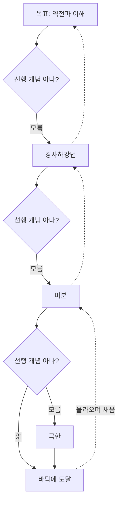
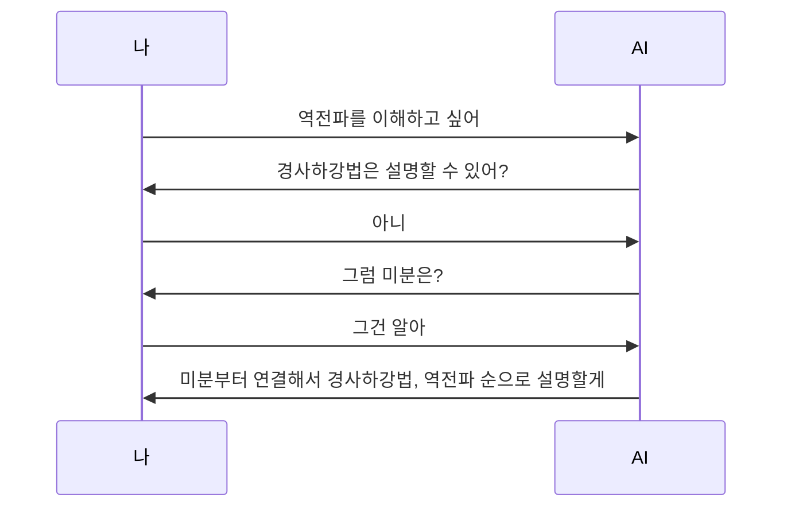

# 재귀적 공백 채우기

> 모르는 개념을 만나면 그것을 이해하는 데 필요한 선행 개념을 찾고, 그 안에서 또 모르는 것이 나오면 같은 일을 반복해 "아는 곳"에 닿을 때까지 내려갔다가 다시 올라오는 학습법.

## 쉽게 말하면
계단을 오르다 한 칸이 빠져 있으면 그 위로 못 간다. 그 칸을 메우러 내려가 보니 아래에도 빈 칸이 있다. 계속 내려가 단단한 바닥(내가 확실히 아는 것)을 찾고, 바닥부터 한 칸씩 메우며 올라온다. 이것이 "재귀"다. 같은 질문("이걸 알려면 뭘 알아야 하지?")을 계속 되묻는다.

## 자세히
- **용어에 대해**: "재귀적 공백 채우기"는 이 지도에서 쓰는 이름이다. 같은 이름의 정립된 학술 용어는 찾지 못했다. 가장 가까운 연구는 2025년 arXiv 논문 **RPKT(Recursive Prerequisite Knowledge Tracing)**로, LLM이 선행 개념을 그때그때 찾아 학습자의 지식 경계까지 재귀적으로 추적한다.
- **RPKT 방식**: 학습자가 개념마다 "안다/모른다"만 표시하면 시스템이 "모른다"의 선행 개념을 펼친다. 예: 역전파 → 경사하강법을 모름 → 미분 → 극한. 모르는 선행 개념부터 가르치고 목표로 돌아온다. 학습자가 스스로 이름 붙이지 못하는 "모르는 줄 모르는 것(unknown unknowns)"을 드러내는 것이 목적이다.
- **관련 연구**: 교육용 LLM 논문 SHAPE는 "한 번에 개념 하나, 모르는 개념부터"라는 Guided Gap Filling 단계를 둔다.
- **직접 하는 절차**: ① 목표 개념 정하기 ② 설명해 보기([파인만 기법](#feynman-technique)) ③ 막힌 곳 = 공백 목록 ④ 공백마다 선행 개념 묻기(필요하면 [소크라테스식 질문](#socratic-method)) ⑤ 아는 개념에 닿으면 멈추고 위로 올라오며 채우기.
- **조심할 점**: 끝없이 내려갈 수 있다. 깊이 한도(예: 3단계)를 정하고, 지금 목표에 꼭 필요한 선행만 판다. 이 지도의 "새 가지 뻗기"도 같은 구조다.

## 그림으로 보기

## 예시
- 프롬프트: "[LangGraph]를 이해하고 싶어. 내가 모르는 선행 개념을 하나씩 물어보고, 모른다고 하면 그것의 선행 개념으로 내려가. 최대 3단계까지만. 바닥에 닿으면 아래에서부터 설명해 줘."
- 교육 설계: 수강생의 "모르는 용어" 목록을 받아 선행 관계 지도로 그리고, 가장 아래 칸부터 수업한다.

## 헷갈리는 것과 비교
| 개념 | 차이 |
| --- | --- |
| 재귀적 공백 채우기 | 모르는 것의 선행 개념으로 내려갔다 올라옴(깊이 방향) |
| [파인만 기법](#feynman-technique) | 설명으로 공백을 "찾는" 단계. 이 학습법의 탐지 도구 |
| [소크라테스 논증법](#socratic-method) | 질문으로 공백을 "드러내는" 대화 방식 |
| 선수 과목 이수 | 미리 정한 순서. 재귀적 채우기는 내 지식에 맞춰 즉석에서 결정 |

## 더 읽을거리
- [RPKT: Learning What You Don't Know (arXiv 2508.11892)](https://arxiv.org/abs/2508.11892v2) — 선행 개념을 재귀로 추적하는 대화형 AI 튜터 연구
- [SHAPE (arXiv 2604.22134)](https://arxiv.org/pdf/2604.22134) — Guided Gap Filling 단계를 가진 교육용 LLM
