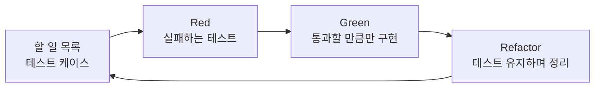
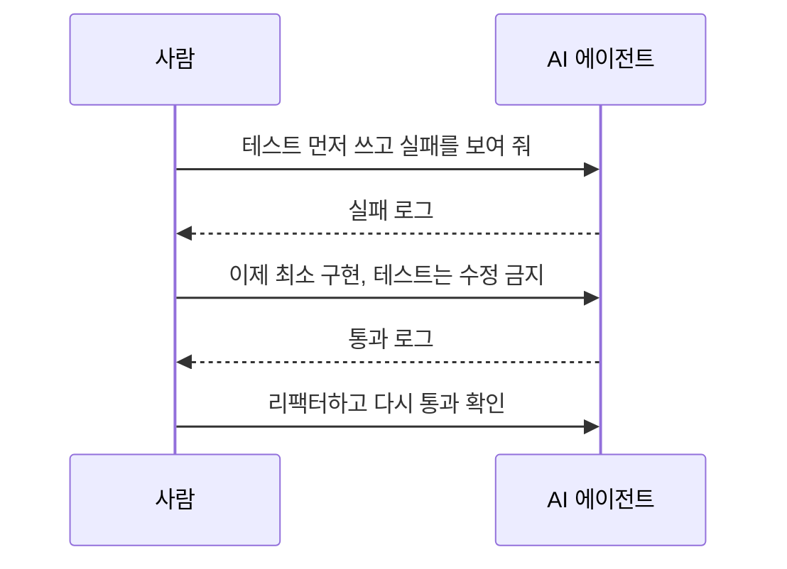

# 레드-그린-리팩터

> TDD의 3박자 반복 사이클. 실패하는 테스트를 쓰고(Red), 통과할 만큼만 구현하고(Green), 테스트를 유지한 채 코드를 정리한다(Refactor).

## 쉽게 말하면
요리 시식과 같다. ①먼저 "이 맛이어야 한다"는 기준(테스트)을 적고 아직 맛이 안 나는 걸 확인한다 ②기준을 겨우 맞출 만큼만 요리한다 ③맛은 유지한 채 주방을 정리하고 레시피를 다듬는다. 마지막 정리를 건너뛰면 기준은 통과해도 주방이 엉망이 된다.

## 자세히
**Martin Fowler의 TDD 설명**: ①할 일 목록으로 테스트 케이스를 먼저 적고 하나를 고른다 ②**Red**: 다음 기능의 테스트를 쓴다 ③**Green**: 테스트가 통과할 때까지 기능 코드를 쓴다 ④**Refactor**: 새 코드와 기존 코드를 깨끗하게 재구성한다. 그다음 목록의 다음 테스트로 반복하며 떠오르는 테스트는 목록에 추가한다. 가장 흔한 실패는 **리팩터 단계를 건너뛰는 것**이다 — 테스트는 있지만 지저분한 코드 조각 모음이 남는다. 테스트를 쓰는 순서를 고르는 것도 기술이며, 좋은 테스트는 설계의 핵심으로 빨리 이끈다. 구현보다 인터페이스를 먼저 생각하게 되고 스스로 검사하는 코드가 생긴다.

**직접 돌려 본 한 사이클(pytest)**
1. Red — `test_discount.py`에 테스트 3개(10% 할인, 0% 할인, 음수 거부)를 쓰고 `discount.py`가 없는 상태로 실행 → `ERROR ... 1 error`(실패 확인).
2. Green(최소 구현) — `return price * (100 - percent) / 100` → `1 failed, 2 passed`. 음수 거부 테스트가 `DID NOT RAISE ValueError`로 실패. 쓴 테스트가 누락된 요구를 잡아냈다.
3. Green(보완) — `if percent < 0: raise ValueError(...)` 추가 → `3 passed`.
4. Refactor — 중복·이름·구조를 정리하고 테스트를 다시 돌려 여전히 통과하는지 확인한다.

**AI 코딩 에이전트와 쓸 때**
- 에이전트에게 "먼저 실패하는 테스트를 쓰고 **실패를 보여 줘**, 그 뒤 구현해"라고 단계를 못 박는다. 실패를 눈으로 봐야 테스트가 헛돌지 않는다는 보증이 된다.
- 구현 단계에서 **테스트를 고치지 못하게** 한다(통과시키려고 테스트를 완화하는 편법 방지). 테스트와 구현을 분리된 서브에이전트에 맡기는 방식도 쓴다(자세한 문제는 [TDD](#tdd)의 컨텍스트 오염 참고).
- 리팩터 단계를 명시적으로 요청한다. AI는 통과하면 멈추기 쉽다.

## 그림으로 보기




## 예시
```python
# Red: test_discount.py
def test_negative_rejected():
    with pytest.raises(ValueError):
        discount(100, -5)

# Green: discount.py
def discount(price, percent):
    if percent < 0:
        raise ValueError("percent must be >= 0")
    return price * (100 - percent) / 100
```
업무 예: 엑셀 수식 대신 파이썬으로 수수료 계산기를 만들 때, 수강생이 정상·경계·오류 입력 테스트를 먼저 쓰고 AI에게 구현을 맡긴다.

## 헷갈리는 것과 비교
| 개념 | 차이 |
|---|---|
| Red | 실패하는 테스트(요구의 코드화) |
| Green | 통과할 최소 구현(예쁘지 않아도 됨) |
| Refactor | 동작 유지, 구조 개선 |
| [TDD](#tdd) | 이 사이클을 쓰는 방법론 전체 |
| [SDD](#sdd) | 문서 명세가 먼저. 두 방식을 함께 쓰기도 함 |

## 더 읽을거리
- [Test Driven Development (Martin Fowler)](https://martinfowler.com/bliki/TestDrivenDevelopment.html) — 단계와 흔한 함정
