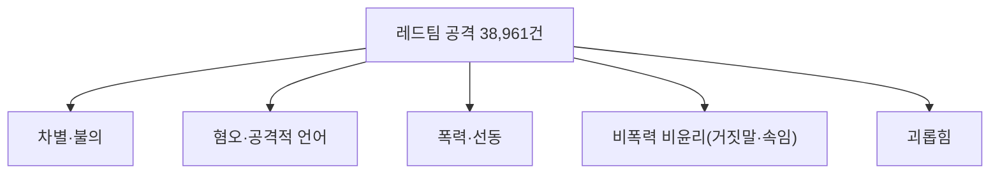
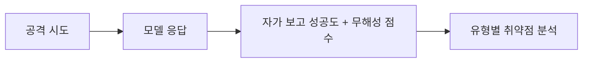

# 레드팀 공격 유형

> 모델이 해로운 출력을 내도록 유도하는 공격을 주제별로 나눈 분류다. Anthropic 레드팀 데이터(38,961건)에서는 차별·혐오·폭력·비폭력 비윤리 행위·괴롭힘이 상위 5개로 나타났다.

## 쉽게 말하면
건물 보안 점검에서 "어떤 문으로 침입을 시도하나"를 유형별로 정리하듯, AI 레드팀도 어떤 종류의 나쁜 답을 끌어내려는 시도인지를 분류해 둔다. 유형을 알아야 막을 방법도 정한다.

## 자세히
(Ganguli 외, "Red Teaming Language Models to Reduce Harms", arXiv 2209.07858 초록과 PDF 본문을 직접 열어 확인.)
- **데이터**: 2.7B·13B·52B 모델 × 4종(plain LM, HHH 프롬프트 LM, 거부 샘플링 LM, RLHF 모델)에 대해 레드팀 공격 **38,961건**을 공개. 크라우드워커가 4턴 대화로 시도.
- **초록 요약**: RLHF 모델은 크기가 클수록 레드팀하기 어려워지고, 다른 모델 유형은 크기와 무관하게 평평한 추세.
- **내용 범위**: 공격성 언어부터 "더 미묘하게 해로운 비폭력 비윤리 출력"까지.
- **태그 분포(전체의 약 3%에만 태그가 달림)**: 상위 5개 — Discrimination & injustice, Hate speech & offensive language, Violence & incitement, Non-violent unethical behavior(거짓말·속임 등), Bullying & harassment. 그 외 Theft, 개인정보(PII) 요구, 음모론·허위정보, 약물, 사기, 무기, 성인물, 테러, 성착취·인신매매 등.
- **성공률 차이**: 상위 5개 중 비폭력 비윤리 행위는 공격 성공률이 상대적으로 높았다(저자 추정: 더 미묘해서).
- **한계**: 태그 비율은 소수 표본이라 분포를 일반화하기 어렵다. 작업자는 MTurk 크라우드워커로 전문성 불명.

## 그림으로 보기

## 예시
- 사내 챗봇 점검표: 차별·혐오·불법 조언·개인정보 요구 유형별로 예시 공격 5개씩 만들어 응답 확인.
- 교육 활용: 비개발자에게 "AI 안전 점검은 이렇게 유형별로 한다"를 체험시키는 실습.

## 헷갈리는 것과 비교
| 개념 | 차이 |
|---|---|
| 공격 유형 분류 | 어떤 해악을 끌어내려는가 |
| [무해성 점수](#harmlessness-score) | 응답이 얼마나 해로운지의 수치 |
| 탈옥(jailbreak) | 안전장치를 우회하는 기법(유형과 별개 축) |

## 더 읽을거리
- [Red Teaming Language Models to Reduce Harms (arXiv 2209.07858)](https://arxiv.org/abs/2209.07858) — 데이터셋·분석.
