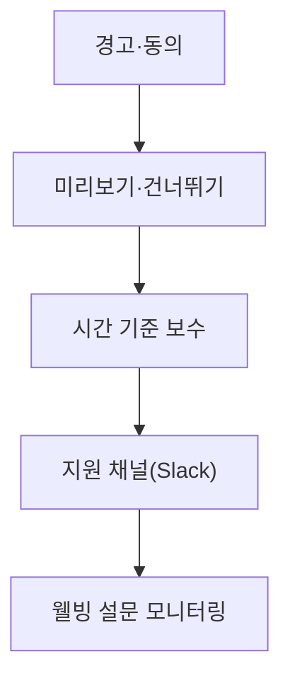
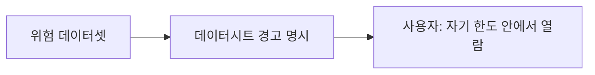

# 위험 데이터 취급

> 레드팀·안전 데이터는 불쾌하거나 해로운 내용을 담고 있어, 작업자와 데이터 사용자 모두의 정신적 안전을 지키는 절차(경고·건너뛰기·시간 기준 보수·지원 채널)가 필요하다.

## 쉽게 말하면
응급실 의료진이 힘든 장면을 자주 보듯, 해로운 글을 읽고 평가하는 사람도 마음의 피로가 쌓인다. 그래서 미리 경고하고, 싫으면 건너뛸 수 있게 하고, 서로 기댈 수 있는 팀을 만든다.

## 자세히
(Ganguli 외 arXiv 2209.07858 본문 3.5절과 부록 A.2, 데이터시트를 직접 읽고 확인.)
- **사전 조사**: 트러스트&세이프티 분야 문헌과 현업 전문가 인터뷰를 거쳐 모범 사례를 작업 설계에 반영.
- **안내와 선택권**: 작업 지침에서 민감한 내용에 노출될 수 있다고 명확히 경고. 특정 민감 주제를 시키지 않고 참가자가 **자신의 위험 감수 범위 안에서 주제를 고르게** 함.
- **검토 작업의 안전장치(부록)**: ① 할당량이 아니라 **시간 기준 보수**(최소 시간당 20달러 — 스트레스를 키우는 할당량 압박을 피함) ② 더 위험한 검토 작업은 가까이 소통하는 **Upwork 집단에만** 배정, 공유 Slack 채널로 연구진이 지원·소통 ③ **미리보기로 건너뛰기(opt out)** 기능 ④ 10개 작업 뒤 **웰빙 설문**(콘텐츠 모더레이션 연구의 설문을 참고).
- **크라우드 작업 보수**: MTurk 작업자는 5개 대화 세트당 7.50~9.50달러. (논문은 캘리포니아 최저임금 시간당 15달러와 비교 언급.)
- **공개 데이터의 경고(데이터시트)**: "이 데이터는 불쾌·위협적일 수 있다"고 명시하고, 차별 발언·학대·폭력·자해·착취 등을 포함한다고 안내. 사용자는 **개인 위험 감수 범위 안에서만** 열람하고 마음 챙김·휴식·시간 제한 같은 회복 습관을 익힐 것을 권장.
- 이 노드의 비용 수치·기준은 2022년 한 연구의 사례이며 현재 업계 기준과 다를 수 있다.

## 그림으로 보기

## 예시
- 사내 안전 평가 팀: 샘플 평가 전 경고, 건너뛰기 버튼, 일정 시간마다 휴식과 설문.
- 교육 활용: 데이터 라벨러·모더레이터의 정신적 부담을 AI 윤리 수업의 한 주제로.

## 헷갈리는 것과 비교
| 개념 | 차이 |
|---|---|
| 위험 데이터 취급 | 작업자·사용자 보호 절차 |
| [레드팀 공격 유형](#red-team-attack-types) | 데이터의 내용 분류 |
| 개인정보 보호 | 데이터 속 개인정보 문제(별개 축) |

## 더 읽을거리
- [Red Teaming Language Models to Reduce Harms (arXiv 2209.07858)](https://arxiv.org/abs/2209.07858) — 3.5절·A.2·데이터시트.
