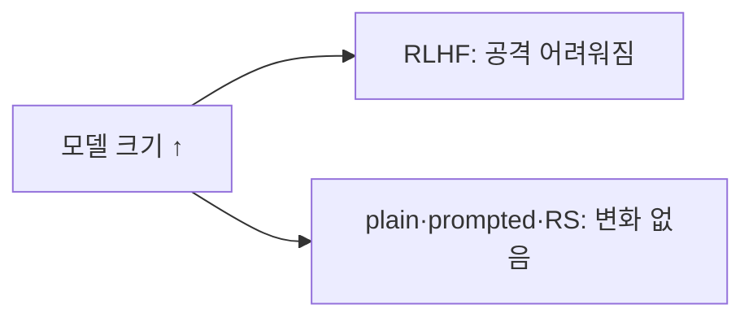
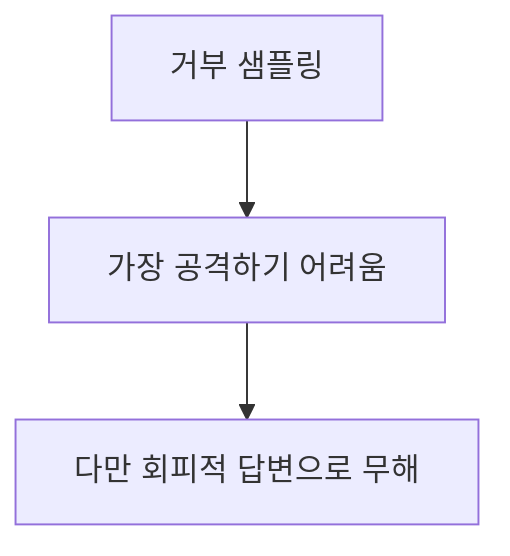

# RLHF와 레드팀 난이도

> Anthropic 실험에서 RLHF로 안전하게 학습한 모델은 클수록 레드팀하기 어려웠지만, 일반·프롬프트·거부 샘플링 모델은 크기와 무관하게 난이도가 거의 변하지 않았다.

## 쉽게 말하면
방어 훈련을 받은 경비원은 체력이 커질수록 뚫기 어려워지는데, 경고문만 붙인 경비원은 덩치가 커져도 비슷하게 뚫린다는 결과다. 안전은 크기가 아니라 훈련 방식의 영향이 크다.

## 자세히
(Ganguli 외 arXiv 2209.07858 초록과 서론을 직접 읽고 확인.)
- **설계**: 모델 크기 3가지(2.7B·13B·52B) × 유형 4가지 — plain LM / HHH 프롬프트 LM / **거부 샘플링(RS)**(16개 중 선호 모델 기준 최선 선택) / **RLHF**(같은 선호 모델로 학습).
- **결과 4가지(서론)**: ① RLHF 모델은 크기가 커질수록 레드팀하기 훨씬 어렵다. ② plain·prompted·RS는 크기에 대해 평평한 추세. ③ HHH 프롬프트는 plain LM보다 유의하게 어렵지 않았다 — 정적 평가에서는 프롬프트가 효과적이라고 본 이전 결과와 어긋남. ④ RS 모델은 모든 크기에서 가장 레드팀하기 어렵지만, 정성적으로는 **회피적인 답변**으로 무해해진다.
- **지표**: 참가자 자가 보고 성공도와 최소 무해성 점수(두 지표 모두 그림 1).
- **해석 주의(제안)**: 레드팀 난이도는 작업자·공격 방식에 의존한다. RS가 어려운 것은 안전해서라기보다 거절·회피 때문일 수 있어 도움됨과 함께 봐야 한다([무해성 점수](#harmlessness-score)).

## 그림으로 보기

## 예시
- 사내 모델 평가: 크기만 키운 모델과 안전 학습을 한 모델의 레드팀 성공률을 같은 공격 세트로 비교.
- 교육 활용: "큰 모델이 더 안전하다"는 통념을 데이터로 점검.

## 헷갈리는 것과 비교
| 개념 | 차이 |
|---|---|
| RLHF 모델 | 선호 모델 보상으로 학습, 규모에 따라 개선 |
| 거부 샘플링 | 추론 때 여러 개 중 선택(비용은 추론에) |
| [레드팀 공격 유형](#red-team-attack-types) | 공격의 종류(난이도와 별개) |

## 더 읽을거리
- [Red Teaming Language Models to Reduce Harms (arXiv 2209.07858)](https://arxiv.org/abs/2209.07858) — 초록·1장 결과.
