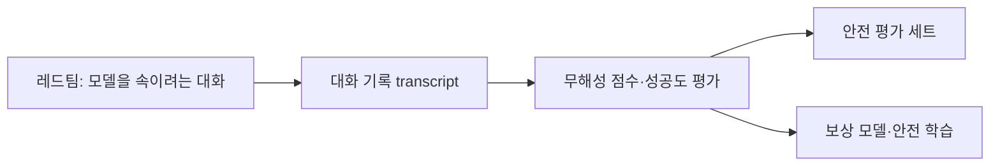
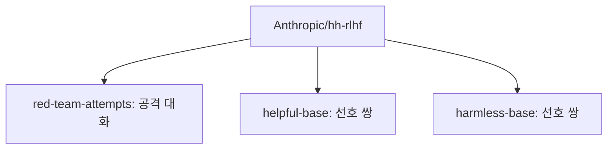

# 레드팀 데이터

> 레드팀(red team)이 일부러 모델을 속이거나 해로운 답을 끌어내려는 공격 대화를 기록한 데이터다. 모델이 어디서 어떻게 무너지는지 보여 주고, 안전 평가와 보상 모델·안전 학습의 재료가 된다.

## 쉽게 말하면
은행이 보안업체에 "금고를 털어 보라"고 맡긴 뒤 침투 기록을 받아 보안 규칙을 고치는 것과 같다. 공격 기록이 쌓일수록 어디가 뚫리는지 알 수 있다. 다만 이 기록 자체에 위험한 내용이 들어 있어 취급에 주의가 필요하다.

## 자세히
(Anthropic의 논문 arXiv 2209.07858 초록과 Anthropic/hh-rlhf 데이터셋 카드를 직접 열어 확인.)
- **논문(Ganguli 등, Anthropic)**: 모델의 해로운 출력을 찾고 측정하려고 레드팀을 했다. **레드팀 공격 38,961건**을 공개했다. 모델은 **2.7B·13B·52B 세 규모**, 네 유형(일반 언어 모델, 도움·정직·무해 프롬프트를 준 모델, 거부 표집 모델, **RLHF 모델**). 결과: RLHF 모델은 규모가 커질수록 "레드팀하기 점점 어려워지고", 나머지 유형은 규모에 따라 평평한 추세. 공격은 모욕적 언어부터 폭력적이진 않지만 비윤리적인 내용까지 다양한 해악을 드러냈다.
- **데이터셋 카드(Anthropic/hh-rlhf)**: red-team-attempts 하위 집합은 레드팀 구성원과 AI 비서의 **사람이 만든 대화 기록**. 필드: `transcript`, `min_harmlessness_score_transcript`(선호 모델의 무해성 점수, **낮을수록 해로움**), `num_params`·`model_type`, `rating`(레드팀 구성원이 평가한 성공도), `task_description`과 그 점수, `red_team_member_id`·`is_upworker`, `tags`(최대 6개, 4개 모델 유형 중 2개에서 무작위 1,000건에만). 저장소 전체 행 수는 약 169,352(기본 train 161k·test 8.55k)이며 이 하위 집합의 기록 수는 카드에 없다.
- **주의(카드)**: 차별적 언어, 학대·폭력·자해 논의 등 **불쾌하거나 충격적인 내용**을 포함할 수 있다. 목적은 모델을 덜 해롭게 만드는 연구이며 **대화 에이전트 학습용이 아니라**고 명시한다.
- **선호 데이터와 다르다(카드)**: helpful-base·harmless-base는 레드팀 기록이 아니라 chosen·rejected 응답 쌍으로 된 **선호 데이터**다. harmless 데이터는 기본 모델에서만 수집됐고 `data_dir="harmless-base"`로 불러온다.
- **데이터로서의 용도(제안)**: ① 안전 평가 세트(분포 밖 공격 포함) ② 거부 응답 SFT·보상 모델 학습 ③ 위험 유형 분류. 분할 시 같은 공격자·같은 기법이 학습과 평가에 갈리지 않게([그룹 정의하기](#group-definition)).
- **한계(제안)**: 레드팀 구성원의 창의성·언어·문화에 의존해 전수 조사가 아니다. 시간이 지나면 새 공격이 나오므로 데이터가 낡는다.

## 그림으로 보기



## 예시
```python
from datasets import load_dataset
rt = load_dataset("Anthropic/hh-rlhf", data_dir="red-team-attempts")  # 위험 콘텐츠 주의
hb = load_dataset("Anthropic/hh-rlhf", data_dir="harmless-base")      # 선호 쌍(chosen/rejected)
```
(데이터셋 카드가 알려 준 `data_dir` 사용법. 직접 내려받아 실행하진 않았다.)
- 사내 챗봇 출시 전: 직원이 "정책 우회·개인정보 빼내기"를 시도한 대화를 모아 거부 응답이 제대로 나오는지 평가(제안). 교육 활용: AI 안전 수업에서 "공격 기록이 어떻게 평가 데이터가 되는가" 설명.

## 헷갈리는 것과 비교
| 개념 | 차이 |
|---|---|
| 레드팀 데이터 | 공격 대화 기록(해로움 점수 포함) |
| 선호 데이터 | 같은 질문의 응답 쌍에서 더 나은 것 표시 |
| [SFT 데이터](#sft-supervised-finetuning) | 모범 답안 쌍 |
| 안전 벤치마크 | 고정 문항 평가 세트 |

## 더 읽을거리
- [Red Teaming Language Models to Reduce Harms (arXiv 2209.07858)](https://arxiv.org/abs/2209.07858) — 38,961건·규모별 결과(초록 확인).
- [Anthropic/hh-rlhf 데이터셋 카드](https://huggingface.co/datasets/Anthropic/hh-rlhf) — 필드·경고·사용법(열어 확인).
