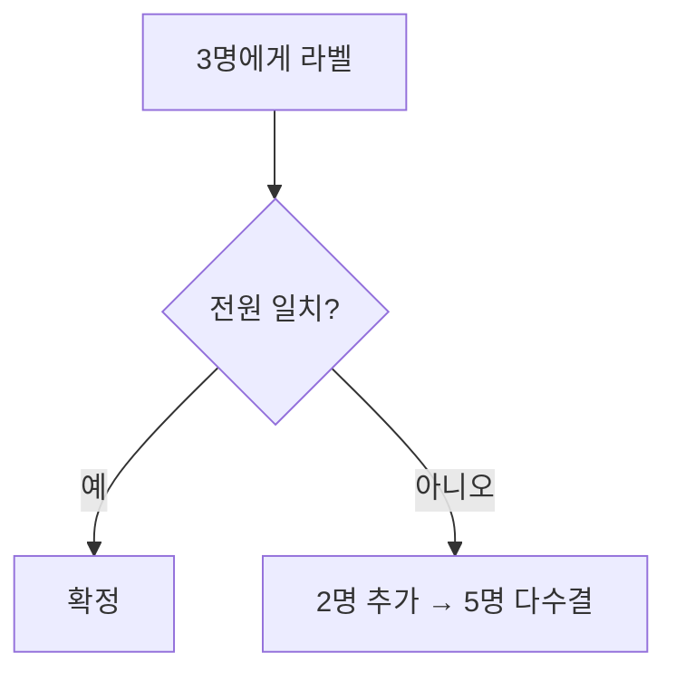
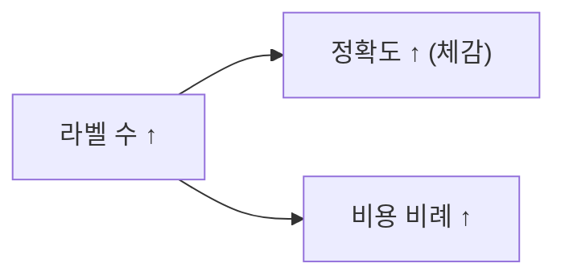

# 샘플당 라벨 중복 수

> 샘플당 라벨 중복 수(redundancy)는 같은 샘플에 몇 명에게 라벨을 받을지 정하는 값이다. 많을수록 합의가 정확해지지만 비용이 비례해 늘고, 추가 이득은 점점 줄어든다.

## 쉽게 말하면
요리 맛을 보는 사람을 1명에서 3명으로 늘리면 판단이 크게 좋아지지만, 9명에서 11명으로 늘려도 큰 차이가 없다. 처음 몇 명이 가장 값어치 있다.

## 자세히
- **직접 계산(이항분포, 독립 가정, 작업자 정확도 p, 다수결 정확도와 추가 2명의 이득)**:

| 라벨 수 | p=0.7 정확도 | 이득 | p=0.8 정확도 | 이득 |
| --- | --- | --- | --- | --- |
| 1 | 0.700 | - | 0.800 | - |
| 3 | 0.784 | +0.084 | 0.896 | +0.096 |
| 5 | 0.837 | +0.053 | 0.942 | +0.046 |
| 7 | 0.874 | +0.037 | 0.967 | +0.025 |
| 9 | 0.901 | +0.027 | 0.980 | +0.014 |
| 11 | 0.922 | +0.021 | 0.988 | +0.008 |

  p=0.8이면 3명→5명의 이득 4.6%p, 9명→11명은 0.8%p다. 샘플 하나당 비용은 라벨 수에 비례하므로 한계 효용이 비용 증가를 못 따라가는 지점에서 멈춘다.
- **논문 사례(Snow 외, EMNLP 2008)**: 7개 작업 평균으로 전문가 한 명과 같은 수준의 평가자 간 일치도를 내는 데 비전문가 라벨이 샘플당 약 4개 필요했다고 보고한다([과반 판정 임계값](#majority-vote-threshold)). 작업 설정에 한정된 수치다.
- **적응형 설계(직접 계산, p=0.8)**: 먼저 3명에게 받고 전원 일치하면 확정, 갈리면 2명을 더 받아 5명 다수결로 정하는 방식. 평균 라벨 수 3.96개로 정확도 0.942를 얻어 고정 5명(0.942)과 같은 정확도를 약 21% 적은 라벨로 얻는다. p=0.7이면 평균 4.26개로 정확도 0.837(5명 고정과 같음)이다. 이 이득은 독립 가정에서의 계산이며, 어려운 샘플에서 일치가 몰리면 달라질 수 있다.
- **쉬운 샘플과 어려운 샘플(해석)**: 어려운 샘플은 불일치가 많아 추가 라벨이 필요하고, 쉬운 샘플은 2~3명이면 충분하다. 그래서 일괄 고정보다 적응형이 효율적이다. 독립이 깨지면([주석자 공통 편향](#shared-annotator-bias)) 라벨을 늘려도 이득이 제한된다([Condorcet 배심 정리](#condorcet-jury-theorem)).

## 그림으로 보기

## 예시
- p=0.8일 때 고정 5명 대신 적응형(3+2)을 쓰면 평균 약 3.96개로 같은 정확도(위 계산).
- 교육 활용: 비용 곡선과 정확도 곡선을 함께 그려 "몇 명이 가장 효율적인가"를 정한다.

## 헷갈리는 것과 비교
| 개념 | 차이 |
| --- | --- |
| 라벨 중복 수 | 샘플당 라벨 개수 |
| [과반 판정 임계값](#majority-vote-threshold) | 몇 명 일치해야 확정 |
| [Condorcet 배심 정리](#condorcet-jury-theorem) | 인원 증가의 이론 |
| [표본 이중 라벨](#sampled-double-annotation) | 일부 샘플에만 중복 적용 |

## 더 읽을거리
- [Cheap and Fast — But is it Good? (Snow 외, 2008)](https://aclanthology.org/D08-1027/) — 샘플당 비전문가 라벨 약 4개 ≈ 전문가 1명
