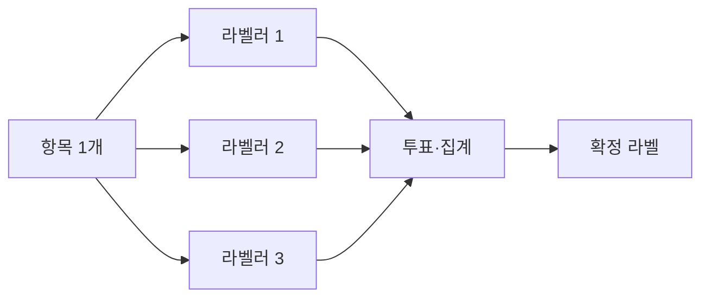
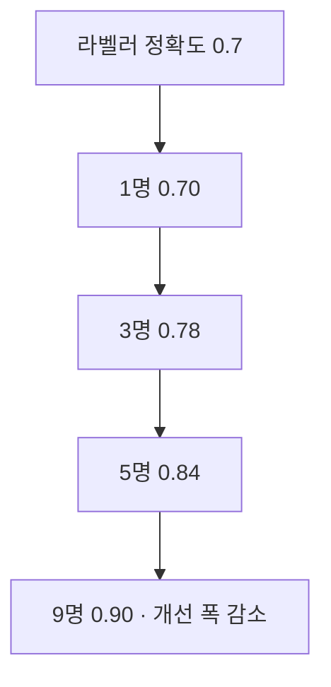

# 항목당 라벨 수 정하기

> 크라우드소싱에서는 한 항목에 여러 명이 라벨을 달아 합쳐 쓰는데, 몇 명이면 충분한가를 정하는 문제다. 2008년 연구는 감정 인식 과제에서 비전문가 평균 4명의 라벨을 합치면 전문가 1명 수준의 일치도에 이른다고 보고했다.

## 쉽게 말하면
길 안내를 물을 때 한 사람 말만 믿기보다 네 사람에게 물어 다수와 같은 답을 따르면 전문가 안내만큼 믿을 만해지는 것과 같다. 다만 사람이 늘수록 비용이 늘고, 모든 사람이 같은 방식으로 틀리면 숫자를 늘려도 소용이 없다.

## 자세히
(Snow 등 「Cheap and Fast — But is it Good?」(EMNLP 2008) PDF 본문을 직접 내려받아 확인하고, 투표 정확도는 직접 계산.)
- **연구 개요(초록)**: Amazon Mechanical Turk의 비전문가 라벨을 5개 과제 — 감정 인식, 단어 유사도, 텍스트 함의 인식, 사건 시간 순서, 단어 의미 중의성 해소 — 에서 기존 전문가 정답과 비교. 모두에서 비전문가 라벨이 전문가 정답과 **높은 일치**를 보였고, 감정 인식에서는 비전문가 라벨로 학습한 모델이 전문가 라벨로 학습한 것만큼 효과적이었다. **편향 보정 기법**으로 두 과제의 품질이 크게 향상.
- **"4명" 결과(본문)**: 7개 감정 과제를 합쳐 보니 **평균적으로 예제당 비전문가 4명의 라벨**로 전문가 1명과 같은 평가자 간 일치도(ITA)에 도달. "Fear"를 제외한 모든 과제에서 **최대 9명 이내**, 자주는 **2명**만으로 전문가 수준. 이때 비전문가 라벨 7,000개를 모으는 데 **2달러**를 지불했다고 보고한다(본문 직접 확인). 결론 절에서도 같은 4개를 되풀이한다.
- **주의**: 이 숫자는 2008년 MTurk, 특정 NLP 과제의 결과다. 과제 난이도·라벨러 풀·보상이 다르면 달라지며 오늘 LLM 시대의 라벨링에 그대로 적용하면 안 된다.
- **직접 계산(독립 이진 라벨러, 다수결, 동률은 무작위)**
  | 개인 정확도 | 1명 | 3명 | 5명 | 7명 | 9명 |
  |---|---|---|---|---|---|
  | 0.6 | 0.600 | 0.648 | 0.683 | 0.710 | 0.733 |
  | 0.7 | 0.700 | 0.784 | 0.837 | 0.874 | 0.901 |
  | 0.8 | 0.800 | 0.896 | 0.942 | 0.967 | 0.980 |
  정확도가 높을수록 적은 인원으로 충분하고, 0.6에서는 9명으로도 0.73에 그친다. **개선 폭은 점점 줄어든다(수확 체감)**. 독립 가정이 핵심이며 실제로는 라벨러 간 상관이 있어 이득이 더 작다(제안).
- **정하는 법(제안)**: ① 소규모 시범으로 라벨러 정확도·일치도 측정 ② 목표 라벨 품질 정하기 ③ 쉬운 항목은 1~2명, 불일치 항목에만 추가 라벨러를 배정하는 **적응형 중복**으로 비용 절감 ④ 라벨러 편향·품질은 별도 모델로 보정([Dawid-Skene 집계](#dawid-skene-aggregation), [작업자 품질 골드 문항](#worker-quality-gold-questions)).

## 그림으로 보기

## 예시
- 사내 감정 라벨링: 2명이 라벨링 → 일치하면 확정, 불일치 시에만 3번째 라벨러 투입(적응형 중복).
- 위험 라벨(의료·법률)은 전문가 2명+판정(adjudication)([이중 라벨링과 판정](#double-annotation-adjudication)).

## 헷갈리는 것과 비교
| 개념 | 차이 |
|---|---|
| 중복 라벨링 수 | 한 항목에 몇 명이 라벨을 다는가 |
| [이중 라벨링과 판정](#double-annotation-adjudication) | 전문가 2명+판정 구조 |
| [Dawid-Skene 집계](#dawid-skene-aggregation) | 라벨러별 신뢰도를 반영해 합치는 방법 |
| 다수결 | 가장 단순한 집계 |

## 더 읽을거리
- [Cheap and Fast — But is it Good? (EMNLP 2008)](https://aclanthology.org/D08-1027/) — 비전문가 라벨 4명=전문가 1명(PDF 본문 확인).
