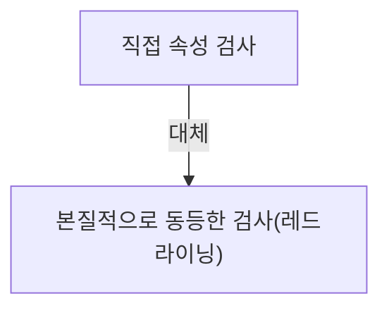

# 중복 부호화(redundant encoding)

> 민감 속성의 정보가 다른 특징들에 거의 그대로 담겨 있어, 속성을 지워도 같은 정보를 복원할 수 있는 상태다. 대리 변수(proxy)와 같은 계열의 개념이다.

## 쉽게 말하면
주민등록번호를 지워도 생년월일·성별·지역이 남아 있으면 같은 사람을 알아낼 수 있다. 같은 정보가 여러 곳에 겹쳐 적혀 있는 것이다.

## 자세히
(Dwork 외 arXiv 1104.3913과 fairmlbook을 하위 에이전트가 읽은 노트 기준. Hardt 2016은 열지 못해 **미확인**.)
- **정의(Dwork 외)**: 속성 소속을 직접 묻는 검사를 "본질적으로 동등한" 다른 검사로 바꿔 쓰는 것. 대표 사례로 **레드라이닝**(Hunt 2005 인용)을 든다.
- **우편번호 언급**: Dwork 외에서 우편번호는 광고 타기팅 예시로만 나오며 명시적 대리 변수 주장은 아니다(에이전트 확인).
- **fairmlbook**: 해당 페이지의 예는 유전체·브라우징 기록·망막 사진 등이며 "proxy"나 "우편번호"라는 표현을 쓰지 않는다.
- **점검(제안)**: 다른 특징만으로 민감 속성을 예측하는 모델을 만들어 정확도가 높으면 중복 부호화가 있다([대리 변수 점검 테스트](#proxy-detection-test)).
- **대응(제안)**: 변수 제거만으로는 부족하므로 속성별 성능 평가, 제약 조건·재가중, 영향 큰 특징 점검.

## 그림으로 보기

## 예시
- 대출 모델에서 인종을 제거했지만 거주 지역·학교가 인종을 높은 정확도로 예측.
- 교육 활용: 몇 개의 특징만 남기고 숨은 속성을 맞히는 게임.

## 헷갈리는 것과 비교
| 개념 | 차이 |
|---|---|
| 중복 부호화 | 정보가 여러 특징에 겹쳐 있음 |
| 대리 변수 | 속성의 대용으로 쓰이는 특징 |
| [Fairness through unawareness](#fairness-through-unawareness) | 이 문제로 실패하는 접근 |

## 더 읽을거리
- [Fairness Through Awareness (arXiv 1104.3913)](https://arxiv.org/abs/1104.3913) — 부록 A.
