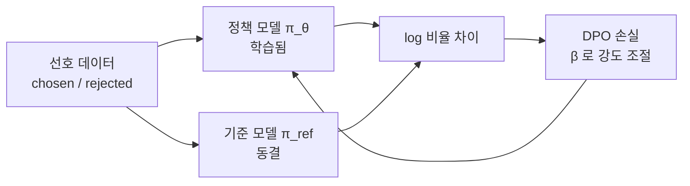

# 기준 모델(reference model)

> 기준 모델은 파인튜닝(DPO·RLHF 등) 동안 가중치를 얼리고 "원래 모습" 척도로만 쓰는 모델이다. 학습 중인 모델(policy)이 여기서 얼마나 멀어졌는지를 [KL](#kl-penalty-finetuning)이나 로그 확률 비율로 재서 과하게 달라지지 않게 붙잡는다.

## 쉽게 말하면
이사 간 뒤에도 "원래 살던 집 사진"을 벽에 걸어 두고 가끔 비교하는 것과 같다. 새 집(학습 중 모델)을 마음대로 꾸미되, 원래 집과 너무 달라지면(말투가 무너지거나 기존 능력을 잃으면) 감점한다. 사진은 절대 고치지 않는다.

## 자세히
- DPO 손실은 `log(π_θ(y|x) / π_ref(y|x))` 형태로, 선택된 답과 거절된 답 각각을 **기준 모델 대비 로그 확률 비율**로 비교한다. 그 차이를 sigmoid에 넣는다. 기준 모델이 없으면 비율을 못 만든다.
- `β`(TRL 기본 0.1)는 기준 모델에서 벗어나는 정도를 조절한다. 클수록 기준에 더 붙어 있는다.
- TRL `DPOTrainer`: `ref_model=None`이면 **학습 시작 시점의 정책 모델**을 기준으로 자동 사용한다. 직접 넘기는 기준 모델은 PeftModel일 수 없다.
- 메모리 절감: `precompute_ref_log_probs=True`면 학습 전에 데이터 전체에 대한 기준 로그 확률을 미리 계산해 기준 모델을 메모리에 둘 필요가 없다. LoRA를 쓰면 어댑터를 끈 상태가 곧 기준 모델이라 사본이 필요 없다(일반적인 구현 방식).
- 움직이는 기준: TR-DPO는 `sync_ref_model=True`로 일정 스텝(기본 512)마다 `π_ref = α·π_θ + (1−α)·π_ref_prev`(α 기본 0.6)로 기준을 갱신한다. 단 PEFT·`precompute_ref_log_probs`와는 함께 못 쓴다.
- 보통 기준은 SFT를 마친 모델이다. 학습 안 된 베이스를 기준으로 하면 비율이 의미 있는 앵커가 못 된다(주장: 실무 관행).

## 그림으로 보기


## 예시
```python
from trl import DPOTrainer, DPOConfig
args = DPOConfig(beta=0.1, precompute_ref_log_probs=True)
trainer = DPOTrainer(model="Qwen/Qwen3-0.6B", args=args, train_dataset=ds)  # ref_model=None → 시작 시점 사본
```
기준 모델 메모리가 부담이면 위 옵션이나 LoRA를 쓴다.

## 헷갈리는 것과 비교
| 개념 | 차이 |
| --- | --- |
| 기준 모델 | 동결, 비교용 |
| 정책 모델 | 학습 대상 |
| [보상 모델](#reward-model) | 답의 점수를 매김 — 기준 모델과 다름 |
| [DPO](#dpo) | 기준 모델 대비 비율로 선호를 학습 |

## 더 읽을거리
- [TRL DPO Trainer 문서](https://huggingface.co/docs/trl/dpo_trainer) — ref_model·beta·sync_ref_model 설명
