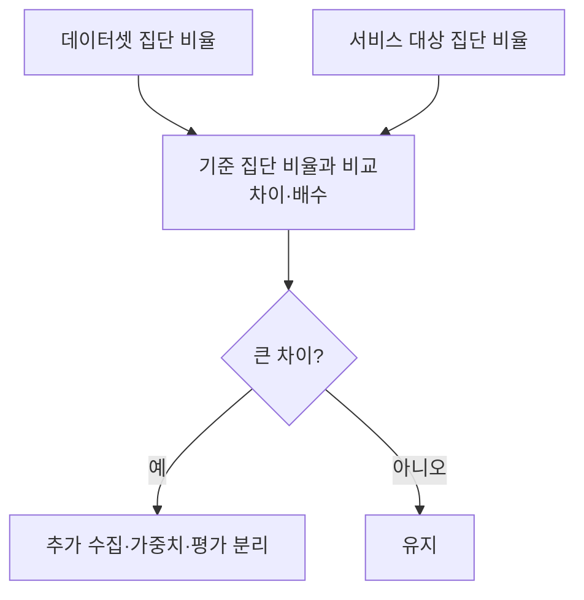
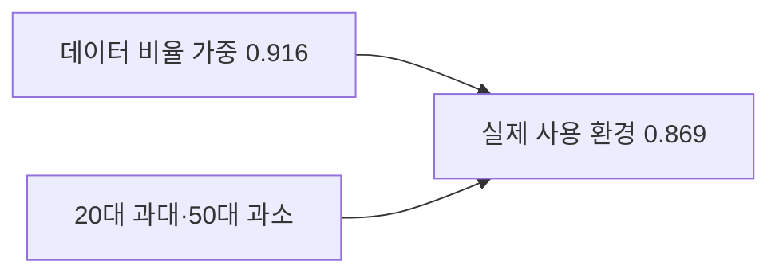

# 기준 집단 비율과 비교

> 데이터셋의 집단별 비율을 **실제로 서비스를 쓰게 될 사람들(기준 집단)의 비율**과 나란히 놓고 차이를 확인하는 점검이다. 데이터에 많이 들어 있는 집단과 실제로 쓰는 집단이 다르면, 평균 성능이 실제 사용 성능을 대표하지 못한다.

## 쉽게 말하면
신제품 설문을 20대 위주로 모았는데 실제 구매자가 50대 이상이 많다면, 설문의 "만족도 90%"는 구매자의 만족도가 아니다. 설문 응답자의 구성과 실제 구매자의 구성을 비교해 어긋남을 먼저 확인해야 한다.

## 자세히
(Kish 유효 표본 크기 공식은 위키백과 문서를 직접 열어 확인했고, 나머지는 가상 수치로 직접 계산. 사후층화(poststratification) 설명은 이번에 문서를 열지 못해 일반 통계 관행으로 서술한다.)
- **비교 방법(제안)**: ① 서비스 대상 집단의 비율을 공식 통계·고객 데이터에서 정한다 ② 데이터셋 비율과 차이(%p)·배수(데이터 비율 ÷ 기준 비율)를 표로 낸다 ③ 큰 차이가 있는 집단을 표시한다([작은 칸 표시](#crosstab-small-cell-flag)와 함께).
- **직접 계산(가상 예: 1,000건, 4개 연령대, 기준 집단은 가정)**
  | 연령대 | 데이터 | 기준 | 차이(%p) | 배수 |
  |---|---|---|---|---|
  | 20대 | 42% | 18% | +24 | 2.33 |
  | 30대 | 31% | 22% | +9 | 1.41 |
  | 40대 | 18% | 25% | −7 | 0.72 |
  | 50대 이상 | 9% | 35% | −26 | 0.26 |
  카이제곱 적합도 검정은 통계량 569.6, p≈4×10⁻¹²³으로 두 분포가 다르다고 나온다. 단, 큰 데이터에서는 작은 차이도 유의하게 나오므로 **p값보다 차이의 크기와 방향**을 본다.
- **성능에 미치는 영향(가정)**: 집단별 정확도를 0.95, 0.93, 0.88, 0.78이라고 하면 **데이터 비율 가중 정확도는 0.916**이지만 **기준 집단 비율로 가중하면 0.869**다. 평균 정확도 보고가 실제 사용 환경을 과대평가한다.
- **보정 방법(제안)**: ① 추가 수집으로 부족한 집단 보강 ② **사후층화 가중치**(기준 비율 ÷ 데이터 비율, 위 표에서 0.43, 0.71, 1.39, 3.89)로 평가·학습에 가중 ③ 가중치가 극단이면(최대/최소 9.1배) 소수 표본에 크게 의존하므로 불안정. Kish 유효 표본 크기 n_eff = (Σw)²/Σw²로 보면 가중 후 1,000건이 약 515건 값어치(위키백과: Deff=n/n_eff, 가중치가 불균등하면 유효 표본이 줄어든다).
- **한계**: 기준 집단 자체가 불확실하거나 바뀔 수 있다. 연령 같은 한두 속성만 맞춘다고 대표성이 보장되지는 않으며, 공식 인구 통계와 실제 서비스 이용자는 다를 수 있다.

## 그림으로 보기

## 예시
- 사내 상담 챗봇 평가 데이터가 신입 사원 질문 중심인데 실제 이용자는 경력직이 많음: 직급 비율을 비교하고 경력직 질문을 추가 수집, 평가 점수는 실제 비율로 가중.
- 교육 소재: "평균 정확도 92%의 함정"을 위 표로 보여 주기(AI 활용 평가 교육).

## 헷갈리는 것과 비교
| 개념 | 차이 |
|---|---|
| 기준 집단 비율과 비교 | 데이터 구성을 실제 사용 집단과 비교 |
| [데이터 구성 표](#dataset-composition-table) | 데이터 안의 구성만 정리 |
| [작은 칸 표시](#crosstab-small-cell-flag) | 건수 적은 칸의 신뢰도 경고 |
| 표본 편향 | 표본이 모집단과 다른 일반 문제(이 점검이 이를 확인하는 도구) |

## 더 읽을거리
- [Effective sample size — 위키백과](https://en.wikipedia.org/wiki/Effective_sample_size) — Kish의 유효 표본 크기 공식(직접 확인).
