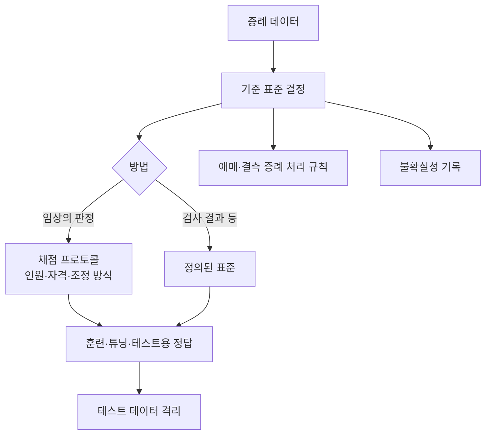

# 기준 표준 설정

> 의료 AI의 PCCP에서, 각 환자·증례의 "실제 상태(정답, ground truth)"를 어떤 방법으로 정할지 정하고 그 근거를 적는 일. FDA 지침은 이를 "가장 적합한 표준(most suitable standard)"이라 부른다.

## 쉽게 말하면
AI 시험지를 채점하려면 정답지가 필요하다. 정답지를 누가 어떻게 만들었는지가 불분명하면 점수도 믿을 수 없다. 의사 3명의 합의로 만들었는지, 조직검사 결과를 썼는지, 정답이 애매한 증례는 어떻게 했는지를 미리 정해 둔다.

## 자세히
출처: FDA 지침 "PCCP for AI-Enabled Device Software Functions"(2024-12-04 최초, 2025-08-18 재발행) PDF, Modification Protocol 데이터 관리 절과 Appendix A(내려받아 읽음).
- **정의(지침)**: 기준 표준은 각 환자·증례·기록의 **진짜 상태를 정의하는 가장 적합한 표준**이다. PCCP에는 "가장 적합하다"고 판단한 **근거**를 넣어야 하고, 기기 위험을 고려할 수 있다. 훈련·튜닝·테스트 중 한 곳 또는 모두에 쓰일 수 있다.
- **Appendix A의 점검 질문(요지)**:
  - 기준 표준 결정 방법의 정당화는?
  - 임상의 평가에 기반한다면 채점 프로토콜은? (참여 임상의 총수와 자격, 제공 데이터, 평가를 수집·판정(adjudication)하는 방식)
  - 기준 표준 결과가 **애매하거나 없는** 증례는 어떻게 다루나?
  - 기준 표준에 내재한 **불확실성**은?
  - 결정 방법 중 자동화된 것이 있나? 훈련·튜닝·테스트용 표준이 서로 다른가?
  - 최초 허가를 뒷받침한 기준 표준과, AI 모델 업데이트에 적용할 기준 표준이 다른가?
- **왜 필요한가(지침)**: 기준 표준이 최선의 정답 결정 과정인지 FDA가 평가하게 하고, 시간에 따라 환자 집단·진료 표준이 변한 뒤에도 성능이 현재를 대표하는지 보기 위함이다.
- **테스트 데이터 격리와 짝**: 테스트 데이터는 개발에 접근할 수 없게 격리(sequestration)하고, 훈련·튜닝·테스트를 분리해 과적합과 성능 오기재를 막는다.
- **임상의가 정답을 정할 때**: 기준 표준을 어떻게 정하는지에 대한 프로토콜을 제출하라고 한다.
- **주의**: 이 글은 지침의 권고 요지이며, 어떤 기준 표준이 "충분한지"에 대한 단일 기준은 없다.

## 그림으로 보기

## 예시
- 폐결절 AI: 영상의학 전문의 3명이 독립 판독 후 불일치는 4번째 전문의가 판정, 조직검사 결과가 있으면 그것을 우선. 애매한 증례는 별도 표시.
- 업데이트 시: 새 병원 데이터의 정답 결정 방법이 최초 허가 때와 다르면 그 차이와 영향을 문서화.

## 헷갈리는 것과 비교
| 개념 | 차이 |
|---|---|
| 기준 표준(reference standard) | 증례의 실제 상태를 정하는 방법 |
| 정답 라벨 | 기준 표준의 결과물 |
| [변경 프로토콜](#modification-protocol) | 상위 요소, 기준 표준은 데이터 관리 안에 있음 |
| [MRMC 독자 연구](#mrmc-study) | 판독자 성능 비교, 정답 결정 방식과 별개이나 정답이 필요 |

## 더 읽을거리
- [PCCP for AI-Enabled Device Software Functions (FDA 지침 PDF)](https://www.fda.gov/media/166704/download) — Appendix A 기준 표준 결정 질문(내려받아 확인)
