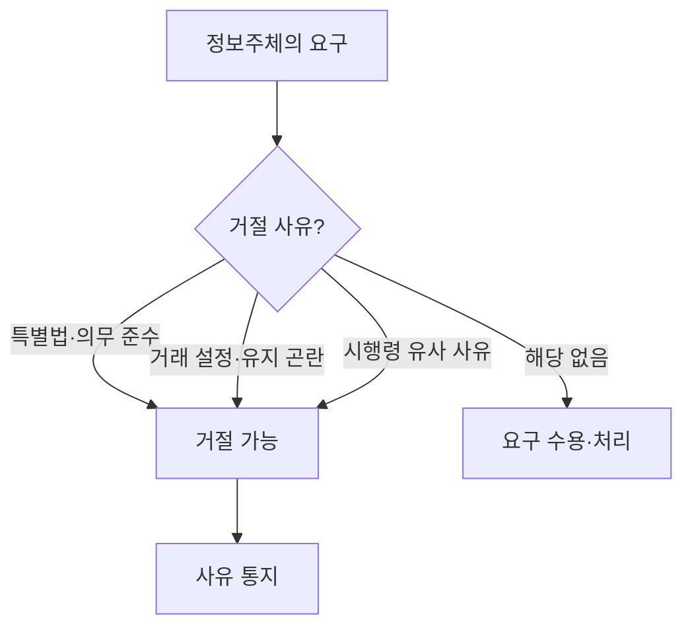

# 요구 거부 사유

> 신용정보법 제36조의2 제3항이 정한, 금융회사 등이 자동화평가 설명·정정·재산출 요구를 **거절할 수 있는 경우**. (법률 자문 아님)

## 쉽게 말하면
권리가 있다고 해서 무조건 들어주는 건 아니다. 다른 법이 막거나 거래 자체가 불가능해지는 경우처럼 정해진 예외 안에서만 회사가 "안 됩니다"라고 할 수 있다.

## 자세히
출처: itwiki 제36조의2 정리(본문 확인), BC카드 설명요구서(검색 요약). 시행령 본문은 확인하지 못했다.
- **법률 사유 세 가지(제3항)**: ①법 또는 다른 법률에 특별 규정이 있거나 법령상 의무 준수를 위해 불가피한 경우 ②요구에 따르면 금융거래 등 상거래관계의 설정·유지가 곤란한 경우 ③①②와 유사하며 대통령령이 정하는 경우.
- **금융사 양식 예(하위 자료)**: 정정 요청 내용이 사실과 다른 경우, 같은 거래에 3회 이상 반복 행사하는 경우가 안내된다. 시행령 근거 조문 번호는 자료마다 달라 확인하지 못했다.
- **통지**: 거절 통지의 방식은 대통령령에 위임되어 있다.
- **비교**: 개인정보 보호법은 다른 사람의 생명·신체·재산을 부당하게 침해할 우려 같은 사유로 거절할 수 있다고 해설된다([인적 개입 재처리](#human-reprocessing)).
- **실무 시사점**: 거절이 가능하더라도 근거와 사유를 문서로 남겨야 분쟁에서 방어된다(해석).

## 그림으로 보기

## 예시
- 금융사가 법령상 보관 의무가 있는 기록의 삭제 요청을 거절 → 첫 번째 사유.
- 같은 대출 건에 정정 요구가 반복되어 양식 기준으로 거절 → 시행령·내부 기준 대조 필요.

## 헷갈리는 것과 비교
| 개념 | 차이 |
|---|---|
| 요구 거부 사유 | 회사가 거절할 수 있는 예외 |
| [결과 재산출 요구](#recalculation-request) | 거절 대상이 되는 정보주체의 요구 |
| [신용정보법 제36조의2](#credit-info-act-36-2) | 두 가지를 모두 담은 조문 |
| [인적 개입 재처리](#human-reprocessing) | 개인정보 보호법 쪽 구제 조치 |

## 더 읽을거리
- [itwiki: 신용정보법 제36조의2](https://www.itwiki.kr/w/%EC%8B%A0%EC%9A%A9%EC%A0%95%EB%B3%B4%EC%9D%98_%EC%9D%B4%EC%9A%A9_%EB%B0%8F_%EB%B3%B4%ED%98%B8%EC%97%90_%EA%B4%80%ED%95%9C_%EB%B2%95%EB%A5%A0_%EC%A0%9C36%EC%A1%B0%EC%9D%982) — 제3항 거절 사유 정리
- [BC카드 설명요구서](https://www.bccard.com/down/individual/membership/request_explanation.pdf) — 금융사 양식의 거절 사유(검색 요약만 확인)
