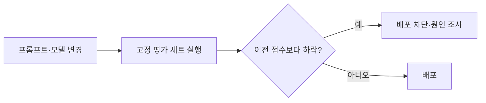
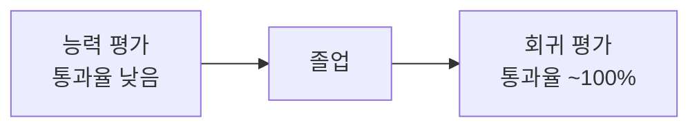

# 회귀 평가

> 프롬프트·모델·코드를 바꾼 뒤 예전에 되던 기능이 망가지지 않았는지 확인하는 평가.

## 쉽게 말하면
집 수리 후 "전에 켜지던 전등이 아직 켜지나?"를 하나씩 눌러 보는 일이다. 새 기능이 잘 되는지(능력 평가)와는 다른 질문이다.

## 자세히
Anthropic 글의 구분:
- **능력 평가**: 에이전트가 무엇을 잘하나. 처음엔 통과율이 낮아야 오를 '언덕'이 된다.
- **회귀 평가**: 예전에 하던 걸 아직 하나. 통과율이 100%에 가까워야 한다.
- 능력 평가가 출시 후 높은 통과율에 이르면 회귀 평가로 '졸업'시켜 계속 돌린다.
- 100%에 포화된 평가는 퇴행은 잡지만 개선 신호는 주지 못한다.
- 채점기 버그로 정답이 오답 처리되면 회귀로 오인한다. 실패 기록을 읽어 확인한다.
- 실무: 평가 세트를 고정하고 변경마다 CI에서 자동 실행, 이전 점수와 비교.

## 그림으로 보기

## 예시
고객 문의 분류 프롬프트를 고친 뒤, 과거 200건 정답 세트로 정확도가 94%에서 91%로 떨어졌는지 비교하고, 떨어졌으면 배포하지 않는다.

## 헷갈리는 것과 비교
| 개념 | 차이 |
| --- | --- |
| 회귀 평가 | 기존 기능 유지 확인 |
| 능력 평가 | 새로 얼마나 잘하나 |
| 단위 테스트 | 코드 함수 검증. 회귀 평가는 모델 출력 품질까지 포함 |

## 더 읽을거리
- [Demystifying evals for AI agents](https://www.anthropic.com/engineering/demystifying-evals-for-ai-agents) — 능력·회귀 평가 구분과 졸업 개념
