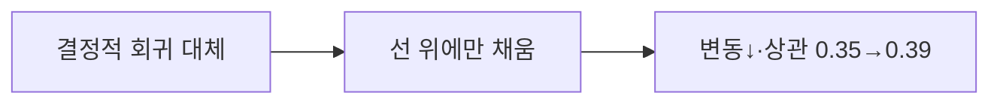
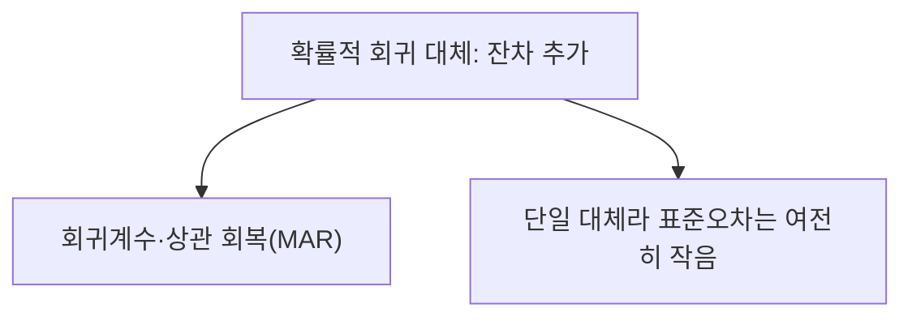

# 회귀 대체의 한계

> 결측값을 회귀식 예측값으로 채우면 점들이 회귀선 위에 놓여 변동이 사라지고 상관이 부풀려진다. 잔차를 더하는 확률적 회귀 대체로 일부 개선되지만 단일 대체의 한계는 남는다.

## 쉽게 말하면
빈칸을 "이 정도일 것"이라는 직선 위의 값으로만 채우면 모든 빈칸이 지나치게 깔끔하게 직선 위에 모여 변수 사이의 관계가 실제보다 강해 보인다.

## 자세히
(FIMD 1.3.4–1.3.5절을 하위 에이전트가 원문으로 읽은 노트 기준. 3.1절은 읽지 않았다.)
- **결정적 회귀 대체**: 대체값이 회귀선 위에 놓여 **변동 과소추정**, 허위 관계 생성(FIMD 표현: "가장 위험한(most dangerous)" 방법). Ozone–Solar.R 상관이 0.35 → **0.39**로 과대.
- **확률적 회귀 대체(mice `norm.nob`)**: 잔차에서 무작위 값을 뽑아 더한다. 결측이 MAR일 때 **회귀계수와 상관을 회복**한다.
- **남는 문제**: 단일 대체 후 표준오차가 여전히 너무 작다. 음수 값이 대체되는 등 비현실적 값도 나올 수 있다.
- **해결(제안)**: 다중 대체([Rubin 규칙](#rubin-rules))로 대체 간 변동을 반영.

## 그림으로 보기

## 예시
- 소득을 나이로 회귀해 채우면 소득-나이 상관이 실제보다 높게 나옴.
- 교육 활용: 직선 위 점과 잔차 추가 점을 그림으로 비교.

## 헷갈리는 것과 비교
| 방법 | 특징 |
|---|---|
| 평균 대체 | 분산 축소, 관계 약화 |
| 결정적 회귀 대체 | 관계 과대 |
| 확률적 회귀 대체 | 잔차 추가, 단일 대체 한계 |

## 더 읽을거리
- [FIMD 1.3절](https://stefvanbuuren.name/fimd/sec-simplesolutions.html) — 평균·회귀·확률적 회귀 대체.
