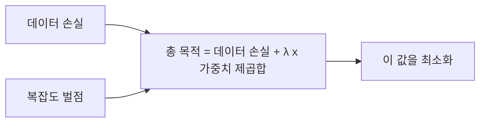
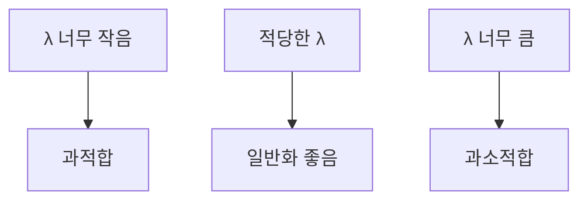

# 정규화 항

> 정규화(regularization)는 손실에 "모델 복잡도 벌점"을 더해 가중치가 너무 커지지 않게 하고 과적합을 줄이는 방법이다.

## 쉽게 말하면
시험공부에서 족보 한 장에만 매달리면 그 시험은 잘 보지만 다른 시험은 망친다. "한 가지 요령에 너무 의존하지 마"라는 벌점을 점수에 붙이면 폭넓게 공부하게 된다. 그 벌점이 정규화 항이다.

## 자세히
Google ML Crash Course 기준:
- **L2 정규화**: 복잡도 = 가중치 제곱합 w₁²+…+wₙ². 학습은 `손실 + λ × 복잡도`를 최소화한다.
- **λ(정규화율)**: 클수록 규제가 강해 과적합은 줄지만 너무 크면 가중치가 약해져 예측이 나빠진다(과소적합). λ=0이면 규제 없음.
- L2는 가중치를 0쪽으로 끌지만 정확히 0으로 만들지는 않는다. 제곱이라 큰 가중치 하나가 복잡도의 대부분(예시에선 약 93%)을 차지한다.
- 학습률과 λ는 반대로 당긴다. 학습률이 너무 크면 가중치가 커져 과적합, λ가 너무 크면 가중치가 약해진다. 학습률을 바꾸면 λ도 다시 조정해야 한다.
- 로지스틱 회귀처럼 손실이 계속 0쪽으로 끌리는 모델에선 규제나 조기 종료가 특히 중요하다. 다른 방법: L1(일부 가중치를 0으로), 드롭아웃, 조기 종료. 개념은 [과적합](#overfitting) 참고.

## 그림으로 보기

## 예시
- 특성이 100개인데 데이터가 200건이면 가중치가 제멋대로 커진다. λ를 0.01, 0.1, 1로 바꿔 검증 손실이 최저인 값을 고른다.
- 딥러닝 프레임워크의 `weight_decay` 옵션이 L2 규제와 같은 역할을 한다(대부분의 옵티마이저에 있음).

## 헷갈리는 것과 비교
| 개념 | 차이 |
|---|---|
| L2 | 큰 가중치를 강하게 줄임, 0은 거의 안 됨 |
| L1 | 일부 가중치를 정확히 0으로 만들어 특성 선택 효과 |
| 드롭아웃 | 학습 중 일부 뉴런을 꺼서 의존 분산 |
| 조기 종료 | 검증 성능이 나빠지기 전 학습 중단 |

## 더 읽을거리
- [Google ML Crash Course: Overfitting · Regularization](https://developers.google.com/machine-learning/crash-course/overfitting/regularization) — L2 공식과 λ 영향.
