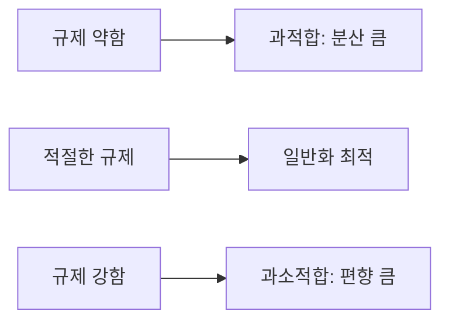
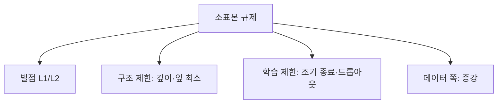

# 소표본 규제

> 데이터가 적을 때 모델이 노이즈까지 외우지 않도록 **용량(자유도)을 일부러 제한**하는 기법의 묶음. L2·L1 벌점, 트리 깊이 제한, 조기 종료, 드롭아웃 등이 대표적이다.

## 쉽게 말하면
학생이 기출 20문제만 갖고 공부할 때, 문제마다 자기만의 암기 요령을 만들게 두면 20문제는 만점이지만 새 문제에는 무력하다. "요령은 단순하게, 외울 분량은 제한"하라는 규칙이 규제다.

## 자세히
- **L2(Ridge)**: 목적 함수 ‖Xw−y‖² + α‖w‖². scikit-learn 문서: α가 클수록 수축이 커지고 계수가 공선성에 더 **견고**해진다. 특징들이 서로 비슷하면 최소제곱 해가 타깃의 작은 노이즈에 크게 흔들리는데(분산이 큼), 벌점이 이를 억제한다.
- **L1(Lasso)**: (1/2n)‖Xw−y‖² + α‖w‖₁. 문서: **계수를 정확히 0으로 만들 수 있어** 특징 선택 효과가 있다. 특징이 많고 표본이 적을 때 쓴다.
- **α 고르기**: `RidgeCV`는 알파를 내장 교차 검증으로 고른다. 기본은 효율적인 **LOO**(알파 0 불가)이며 `cv=10`으로 k겹 전환. 알파 후보는 로그 간격(`np.logspace(-6, 6, 13)`)으로 둔다.
- **그 밖의 용량 제한**
  - 트리 모델: `max_depth`, `min_samples_leaf`, 부스팅의 `learning_rate`·`n_estimators`.
  - 신경망: 조기 종료(검증 손실이 오르면 중단), 드롭아웃, 가중치 감쇠, 데이터 증강.
  - 모델 크기 자체를 줄이기: [단순 모델](#simple-model-small-data) 우선.
- **규제의 대가**: 과하면 과소적합(편향↑). 소표본에서는 분산 감소 이득이 보통 더 크다(편향-분산 상충). 규제 강도 선택이 또 하나의 자유도이므로 **중첩 교차 검증**으로 평가해야 낙관적이지 않다.
- **연결**: 소표본일수록 폴드 점수가 흔들리므로 [독립적 불확실성 추정](#independent-uncertainty-estimate)과 함께 쓴다.

## 그림으로 보기



## 예시
```python
import numpy as np
from sklearn.linear_model import RidgeCV
reg = RidgeCV(alphas=np.logspace(-3, 3, 13), cv=5).fit(X_train, y_train)
print(reg.alpha_)        # 교차 검증으로 고른 규제 강도
```
- 고객 이탈 예측(고객 300명, 특징 80개): 로지스틱 회귀에 L2/L1을 걸고 선택된 소수 변수만 설명 자료로 쓴다.

## 헷갈리는 것과 비교
| 기법 | 효과 | 특징 |
|---|---|---|
| L2 Ridge | 계수 수축 | 공선성에 강함, 0이 되지 않음 |
| L1 Lasso | 계수를 0으로 | 특징 선택 |
| 조기 종료 | 학습 횟수 제한 | 검증 세트 필요 |
| 데이터 증강 | 유효 데이터 늘림 | [전이학습](#transfer-learning-small-data)과 병용 |

## 더 읽을거리
- [scikit-learn: Linear Models (Ridge·Lasso)](https://scikit-learn.org/stable/modules/linear_model.html) — 목적 함수·RidgeCV·Lasso(앞부분 열어 확인).
