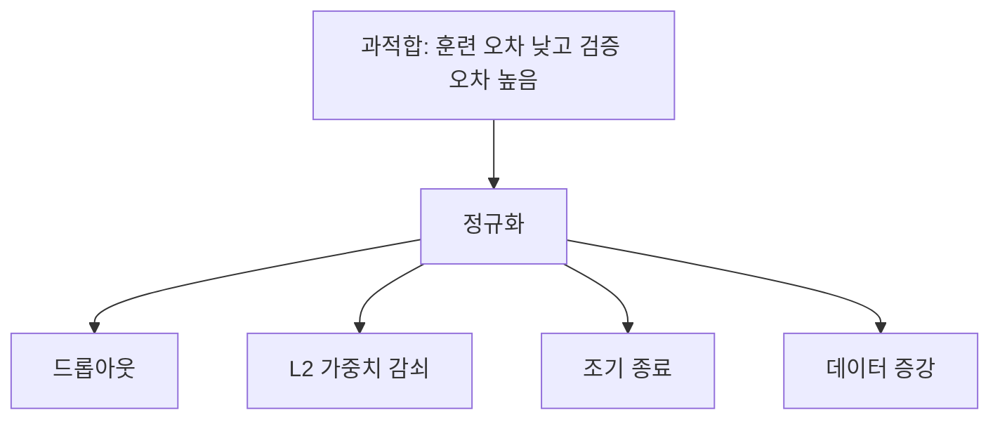

# 정규화·드롭아웃

> **정규화(regularization)** 는 모델이 학습 데이터를 외워 버리는 **과적합**을 줄이려고 모델을 일부러 단순·둔감하게 만드는 기법들이다. **드롭아웃**이 대표적이다.

## 쉽게 말하면
시험 공부 때 문제집 답만 외우면 새 문제에 약하다. 그래서 가끔 책 일부를 가리고 공부시켜, 한두 가지 단서에 기대지 않고 여러 근거로 풀게 만든다.

## 자세히
- **드롭아웃**(Hinton 외, arXiv 1207.0580 초록 확인): 작은 데이터로 큰 신경망을 학습하면 과적합이 생긴다. 학습 때마다 특징 검출기 **약 절반을 무작위로 끈다.** 뉴런이 특정 다른 뉴런의 존재에 기대는 **복잡한 공동 적응(co-adaptation)** 을 막고, 다양한 내부 맥락에서 쓸모 있는 특징을 배우게 한다. 음성·물체 인식에서 기록을 갱신했다고 보고한다.
- 그 밖의 정규화(일반 지식): 가중치 감쇠(L2), 조기 종료(early stopping), 데이터 증강, 더 많은 데이터. 최근 LLM은 드롭아웃을 약하게 쓰거나 쓰지 않는 경우가 많다(모델마다 다름).
- 추론 때는 드롭아웃을 끄고 전체 뉴런을 쓴다(일반 지식).
- 과적합 진단은 [훈련·검증·테스트 분할](#train-val-test)로 한다.

## 그림으로 보기



## 예시
```python
import torch.nn as nn
net = nn.Sequential(nn.Linear(100,64), nn.ReLU(), nn.Dropout(0.5), nn.Linear(64,10))
net.train()   # 학습: 드롭아웃 켬
net.eval()    # 추론: 끔
```

## 헷갈리는 것과 비교
| 개념 | 차이 |
|---|---|
| 드롭아웃 | 학습 중 뉴런을 무작위로 끔 |
| L2 감쇠 | 가중치 크기에 벌점 |
| 조기 종료 | 검증 성능이 나빠지면 중단 |
| 배치 정규화 | 활성값 분포 정돈(이름만 비슷, 목적 다름) |

## 더 읽을거리
- [Improving neural networks by preventing co-adaptation of feature detectors](https://arxiv.org/abs/1207.0580) — 드롭아웃 원 논문 초록.
