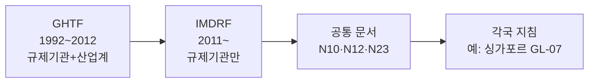
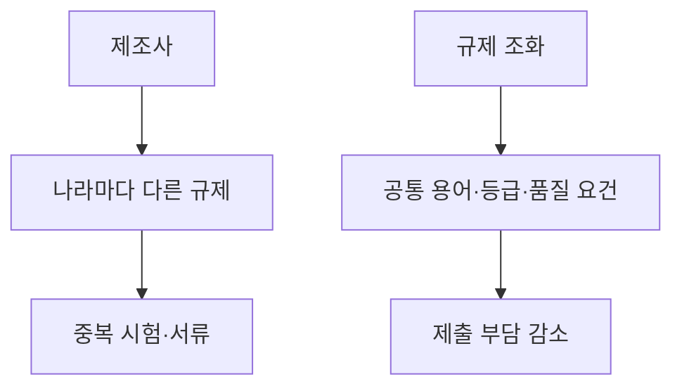

# 규제 조화

> 나라마다 다른 의료기기 규제(등급, 시험, 심사 서류, 사후 감시)를 서로 비슷하게 맞춰 같은 제품을 여러 나라에 내기 쉽게 만드는 일. IMDRF의 존재 이유이고, 그 전신인 GHTF(1992~2012)가 먼저 시작했다.

## 쉽게 말하면
충전기 규격이 나라마다 다르면 여행자는 어댑터를 사야 한다. 의료기기 규제가 나라마다 다르면 제조사는 나라마다 서류와 시험을 다시 해야 한다. 규제 조화는 "대부분 같은 설계도로 만들되 마지막 몇 가지만 다르게" 하자는 시도다. 환자는 새 기술을 더 빨리 쓰고, 규제기관은 같은 심사를 중복하지 않는다.

## 자세히
출처: 위키백과 GHTF 항목(직접 열어 읽음), IMDRF 설립 시기와 회원은 웹 검색 결과의 2차 요약(IMDRF·TGA 공식 페이지는 503으로 열지 못함).
- **GHTF(Global Harmonization Task Force)**: 1992년 EU·미국·캐나다·일본·호주가 만들었다. 유럽·아시아태평양·북미 3개 지역 체제. 5개 연구 그룹: ① 규제 체계·시판 전 제출·표시 ② 경계·시판 후 감시 ③ 품질 시스템 ④ 품질 시스템 심사 ⑤ 임상 실무(최종 문서가 없었다고 위키백과가 적는다). **산업계 대표도 참여**했다.
- GHTF는 2012년 말 해산했다(위키백과는 이유를 적지 않는다). 남긴 문서: 분류 원칙, 표시, 현장 안전 공지, 품질 시스템 내 위험 관리, 공정 검증, 심사원 교육 등. 이후 IMDRF 문서들이 GHTF 정의를 이어 쓴다(예: [N10](#n10-samd-definition)이 GHTF 의료 목적 정의를 인용).
- **IMDRF**: GHTF 후속 포럼. 2011년 구상·창립(2월에 구상, 10월 오타와 첫 회의로 보도됨 — 검색 요약, 미검증). **규제기관 공무원만** 참여하는 것이 GHTF와의 차이다. 운영위원회(Management Committee) 회원으로 호주·브라질·캐나다·중국·EU·일본·러시아·싱가포르·한국·미국이 보도된다(회원은 달라질 수 있음).
- 조화 vs 상호인정: 조화는 규칙을 비슷하게 만드는 것이고, 한 나라 승인을 다른 나라가 인정하는 상호인정과 다르다. IMDRF 문서는 권고이며 각국 법이 되려면 자체 도입이 필요하다.
- **한계**: 나라마다 법 체계·위험 감수 수준·산업 구조가 달라 완전한 일치는 어렵다. 예컨대 같은 SaMD라도 [HSA GL-07](#singapore-hsa-samd)은 IMDRF 표를 쓰되 자국 A~C 등급으로 환산한다.

## 그림으로 보기

## 예시
- 한국 의료 AI 회사가 미국·EU·싱가포르에 모두 내려 할 때, 모두 IMDRF식 "상황 × 정보 중요도" 논리로 제품을 설명하면 서류를 크게 재활용할 수 있다. 다만 등급 이름과 심사 경로는 나라별로 확인해야 한다.

## 헷갈리는 것과 비교
| 개념 | 차이 |
|---|---|
| 규제 조화 | 규칙·용어를 비슷하게 맞춤 |
| 상호인정 | 한 나라 승인을 다른 나라가 인정 |
| GHTF | 1992~2012, 산업계 포함. IMDRF의 전신 |
| [IMDRF](#imdrf) | 규제기관만의 후속 포럼 |

## 더 읽을거리
- [Global Harmonization Task Force (Wikipedia)](https://en.wikipedia.org/wiki/Global_Harmonization_Task_Force) — GHTF 연혁·연구 그룹·해산(직접 열어 읽음)
- [GHTF successor IMDRF makes presence officially known (Citeline)](https://insights.citeline.com/MT098224/GHTF-successor-IMDRF-makes-presence-officially-known/) — 후속 포럼 출범 보도(검색 결과로만 확인)
