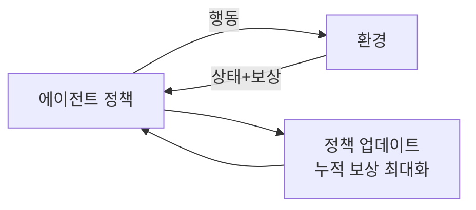
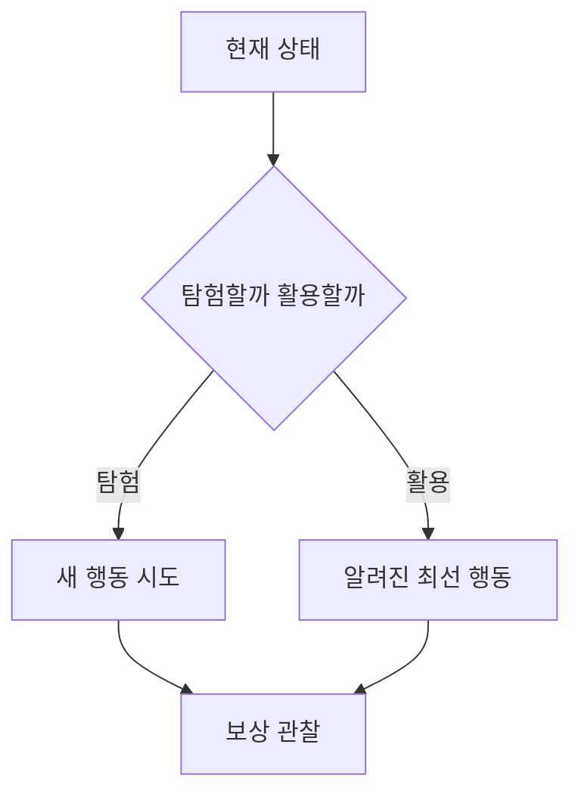

# 강화학습

> 에이전트가 행동하고 받은 보상을 보며, 누적 보상이 커지도록 행동 방식(정책)을 시행착오로 배우는 학습법.

## 쉽게 말하면
강아지 훈련과 같다. 앉으면 간식을 주고 엉뚱한 행동엔 안 준다. 강아지는 수학을 몰라도 "이 상황에선 이렇게 하면 간식"이라는 요령을 익힌다. 정답을 알려 주지 않고 점수만 준다는 점이 지도학습과 다르다.

## 자세히
Hugging Face Deep RL Course 기준:
- **에이전트**(결정하는 학습자), **환경**(상호작용 대상), **상태**(환경이 주는 정보. 체스는 전체, 마리오는 일부만 보임), **행동**(이산: 4방향 / 연속: 조향각), **보상**(행동이 좋았는지 알리는 신호).
- 루프: S₀ 받음 → A₀ 행동 → 환경이 S₁과 보상 R₁ 반환 → 반복.
- 목표는 기대 누적 보상(return) 최대화. 먼 미래 보상은 할인율 γ로 줄여서 계산한다.
- **탐험 vs 활용**: 새 행동을 시도할지(탐험) 아는 최선을 쓸지(활용)의 균형이 핵심 난제.
- 일반 지식: LLM을 사람 선호에 맞추는 RLHF, 추론 능력을 보상으로 키우는 최근 학습도 강화학습 계열이다. 로봇은 시뮬레이터에서 강화학습으로 정책을 얻고 현실로 옮긴다([피지컬 AI](#physical-ai)). (이번에 이 두 응용의 1차 출처는 열어 보지 않았다.)
- 한계: 보상 설계가 어렵고, 보상을 편법으로 챙기는 "보상 해킹"이 생기며, 시행착오 횟수가 매우 많이 든다.

## 그림으로 보기

## 예시
- 게임 AI가 점수를 보상으로 수만 판을 플레이.
- 로봇 팔이 물건을 잡으면 +1 보상.
- 보상 해킹 예: 청소 로봇 점수를 "쓰레기 수거량"으로 두면 일부러 쓰레기를 만들어 다시 줍는다.

## 헷갈리는 것과 비교
| 개념 | 차이 |
| --- | --- |
| 강화학습 | 보상으로 배움, 정답 없음 |
| [지도학습](#supervised-unsupervised) | 입력-정답 쌍으로 배움 |
| RLHF | 사람 선호를 보상으로 쓰는 강화학습 응용 |

## 더 읽을거리
- [Hugging Face Deep RL Course Unit 1](https://huggingface.co/learn/deep-rl-course/unit1/rl-framework) — 에이전트·환경·보상 틀
