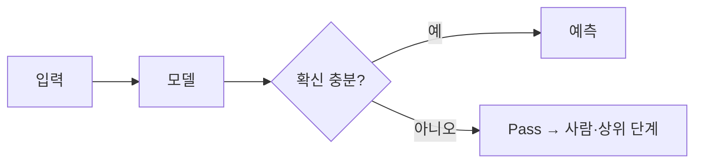

# reject option(판단 거부 옵션)

> 분류기가 확신이 낮을 때 **예측하지 않고 판단을 거부(pass)해 다음 단계로 넘기는** 선택지다. learning to defer의 출발점이다.

## 쉽게 말하면
시험에서 모르는 문제를 찍지 않고 "패스"하고 다음 사람에게 넘기는 것이다. 틀리느니 모른다고 말하는 편이 나은 상황에서 쓴다.

## 자세히
(Madras 외 "Predict Responsibly"(NeurIPS 2018, arXiv 1711.06664)와 Mozannar·Sontag(ICML 2020, arXiv 2006.01862)의 초록 페이지를 읽었다. **두 페이지 모두 reject option의 형식 정의는 주지 않는다.**)
- **구조(Madras 외 초록)**: 자동 모델과 외부 의사결정자로 이뤄진 2단계 시스템. 모델이 "Pass"를 말하고 결정을 하류로 넘길 수 있고 이것이 **rejection learning**의 기초다. 저자들은 이를 다른 에이전트가 최종 결정에 미치는 영향을 고려하는 **learning to defer**로 확장했다.
- **효과(Madras 외 초록)**: 위임 학습이 시스템을 더 정확하고 편향이 적게 만들 수 있고, 사람 결정자가 비일관적이거나 편향되어도 정확도·공정성 중 하나 이상을 개선한다고 보고.
- **임계값 방식과의 관계(해석)**: 가장 단순한 거부는 확신도가 임계값 아래이면 넘기는 것이며, 상한·하한 두 임계값으로 나누는 설계는 [이중 임계값 정책](#double-threshold-policy)이다.
- **한계**: 초록만 읽었다. 구체 수치는 확인하지 못했다.

## 그림으로 보기

## 예시
- 서류 분류 AI가 확신 0.6 미만이면 "검토 필요"로 사람에게 보낸다(제안).

## 헷갈리는 것과 비교
| 개념 | 차이 |
|---|---|
| reject option | 모델이 거부 |
| [learning to defer](#learning-to-defer) | 사람의 성능까지 고려해 위임 |
| [위임기](#rejector-model) | 넘길지 판단하는 모델 |
| [거부 vs 이관](#abstain-vs-escalate) | 답을 안 함 vs 사람에게 |

## 더 읽을거리
- [Madras et al. — Predict Responsibly](https://arxiv.org/abs/1711.06664) — 초록 읽음.
- [Mozannar & Sontag — Consistent Estimators for Learning to Defer](https://arxiv.org/abs/2006.01862) — 초록 읽음.
