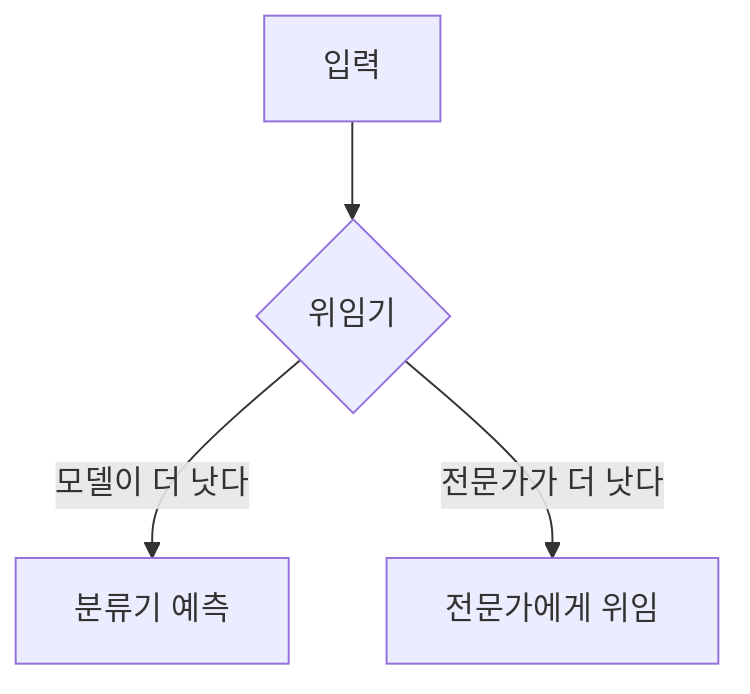

# 위임기(rejector)

> **예측할지 전문가에게 넘길지를 결정하는 모델**이다. 분류기와 함께 학습되며, 사람 전문가의 과거 판단 표본을 이용한다.

## 쉽게 말하면
신입 의사의 판단력과 별개로 "이 환자는 내가 봐도 되나, 선배에게 넘겨야 하나"를 판단하는 감각이다. 그 감각 자체를 학습시키는 모델이 위임기다.

## 자세히
(Mozannar·Sontag, "Consistent Estimators for Learning to Defer to an Expert"(ICML 2020, arXiv 2006.01862)의 초록 페이지만 읽었다. 본문 수치는 읽지 못했다.)
- **설정(초록)**: 예측을 하거나 하류의 전문가에게 **결정을 넘길 수 있는** 예측기를 연구한다. 전문가의 결정 표본으로부터 **분류기와 위임기(rejector)를 함께** 학습한다.
- **방법(초록)**: 문제를 **비용 민감 학습**으로 환원하고, 교차 엔트로피를 일반화한 **일관성 있는(consistent) 대리 손실**을 제안한다. "일관성"은 대리 손실을 최소화하면 원하는 위험을 최소화한다는 이론적 보장이다(일반 설명).
- **결과(초록)**: 다양한 실험 과제에서 효과적이었다고만 서술한다.
- **필요한 것(해석)**: 사람 전문가의 과거 판단 기록(정답과 전문가 판단 쌍). 전문가가 약한 유형은 모델이 처리하고 강한 유형은 넘기는 식이 된다.

## 그림으로 보기

## 예시
- 영수증 분류에서 상담원이 잘하는 유형은 넘기고 AI가 잘하는 유형은 자동 처리하도록 위임기를 학습(제안).

## 헷갈리는 것과 비교
| 개념 | 차이 |
|---|---|
| 위임기 | 넘길지 말지를 정하는 모델 |
| [reject option](#reject-option) | 거부 선택지 자체 |
| 분류기 | 실제 예측을 내는 모델 |

## 더 읽을거리
- [Mozannar & Sontag (2020)](https://arxiv.org/abs/2006.01862) — 초록 읽음.
