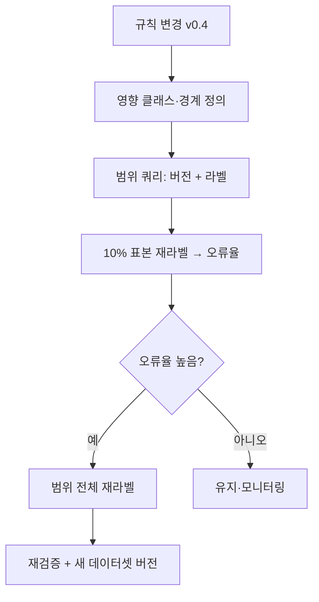
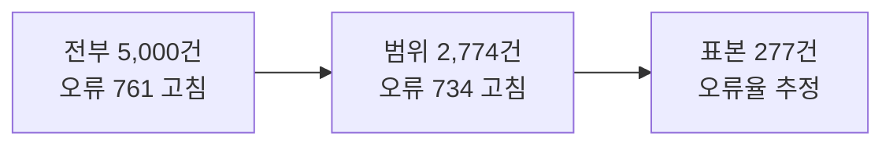

# 규칙 변경 후 재라벨링

> 라벨 규칙서가 바뀐 뒤 **어디까지 다시 라벨할지 범위를 정하고 비용 대비 효과가 큰 순서로 재라벨링**하는 절차다. 전부 다시 하는 것은 비싸고, 아무것도 안 하면 옛 규칙과 새 규칙의 라벨이 섞인다.

## 쉽게 말하면
법이 바뀌면 모든 과거 사건을 다시 심리하지 않고 새 법이 영향을 주는 유형의 사건만 다시 본다. 어떤 사건이 어떤 법으로 처리됐는지 서류에 적혀 있으면 범위가 빨리 좁혀진다.

## 자세히
- **전제**: 라벨 레코드마다 사용한 규칙서 버전을 저장해 둔다([규칙서 버전 관리](#guideline-versioning)). 변경이 어떤 클래스·경계에 영향을 주는지 [경계 사례 로그](#edge-case-log-template)에 적어 둔다.
- **직접 시뮬레이션(5,000건, 4클래스: 환불·배송·결제·기타. 옛 규칙에서 환불↔결제 경계 항목이 25%씩 잘못 라벨되고 다른 클래스는 3%. 전체 오류 761건, 15.2%)**
  | 전략 | 재라벨 건수 | 고친 오류 | 비고 |
  |---|---|---|---|
  | S1 전부 다시 | 5,000 | 761 (100%) | 가장 확실, 가장 비쌈 |
  | S2 영향 범위만(현재 라벨이 환불·결제) | 2,774 | 734 (**96%**) | 비용 약 45% 절감 |
  | S3 영향 범위의 10% 표본으로 오류율 추정 | 277 | — | 추정 오류율 0.231(실제 0.265)로 재라벨 여부 판단 |
  영향 범위만 다시 라벨해도 오류의 96%를 고치고 비용을 45% 아꼈다. 남은 4%는 영향권 밖 클래스의 일반 오류였다. 이 시뮬레이션에서 모델 확신도로 우선순위를 매긴 방식(S4)도 같은 예산에서 오류를 대부분 잡았지만, 장난감 데이터의 특성이 클래스를 너무 잘 구분해 일반화하면 안 된다.
- **절차(제안)**
  1. **영향 클래스·경계 정의**: 규칙 변경 요약에서 영향받는 라벨 쌍을 뽑는다.
  2. **범위 쿼리**: 버전·라벨·키워드로 대상 레코드 추출([재검토 검색식](#relabel-query)).
  3. **표본 점검**: 범위에서 10% 표본을 새 규칙으로 다시 라벨해 오류율 추정 → 낮으면 재라벨 생략, 높으면 진행.
  4. **우선순위**: [라벨 품질 점수](#cleanlab-label-quality-score)나 경계 키워드로 오류 가능성이 큰 순서.
  5. **재라벨 후 검증**: [표본 이중 라벨링](#sampled-double-annotation)으로 일치도를 확인하고 레코드의 버전을 갱신.
  6. **데이터셋 버전**: 재라벨 후 새 데이터셋 버전으로 저장하고 이전 모델 평가 결과와 비교할 때 라벨 변경 영향을 표시한다.
- **비용 의사결정**: (영향 범위 건수 × 건당 비용) 대비 예상 개선(오류 감소 × 모델 성능 민감도). 모델 성능에 영향이 작은 클래스는 재라벨을 미루기도 한다.
- 위 수치는 합성 데이터의 한 설정이다.

## 그림으로 보기

## 예시
- 환불/결제 경계 규칙이 바뀌면 현재 라벨이 두 클래스인 기존 레코드만 추출해 표본 점검 후 재라벨.
- 교육: 변경 관리(영향 분석 → 표본 시험 → 확대 적용)의 일반 원칙을 데이터 라벨링에 적용한 사례.

## 헷갈리는 것과 비교
| 개념 | 차이 |
|---|---|
| 재라벨링 | 규칙 변경에 따라 기존 라벨을 다시 달기 |
| [규칙서 버전 관리](#guideline-versioning) | 범위를 정하는 기반 정보 |
| [자동 삭제](#auto-delete-risk) | 삭제가 아니라 수정이 목적 |
| 데이터 버전 | 재라벨 결과물의 스냅샷 |

## 더 읽을거리
- [Overview of Annotation Creation (arXiv 1602.05753)](https://arxiv.org/abs/1602.05753) — 옛 규격 코퍼스를 새 버전으로 갱신하는 과제와 버전 공존.
